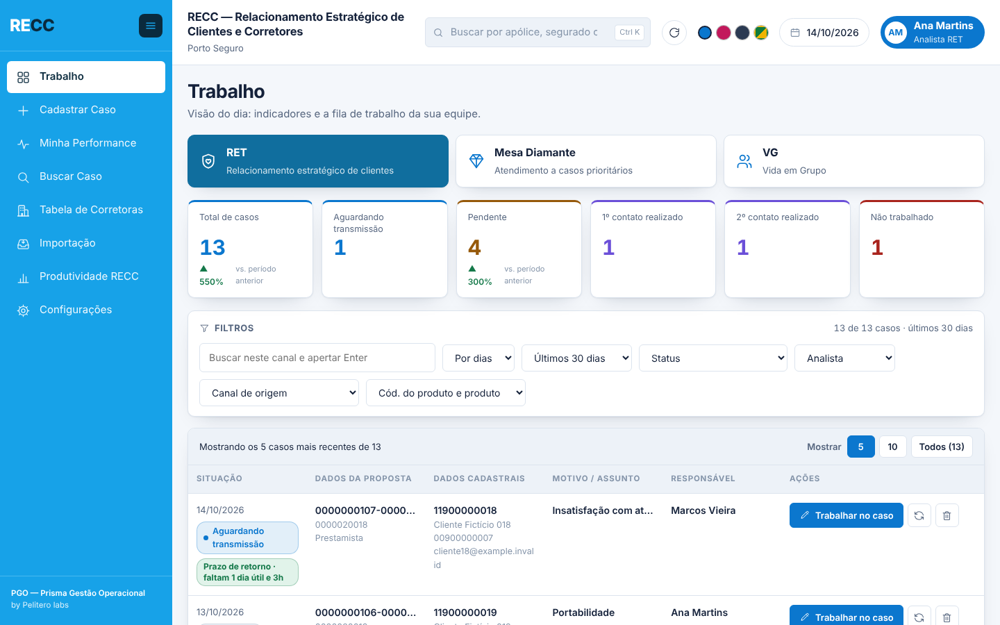
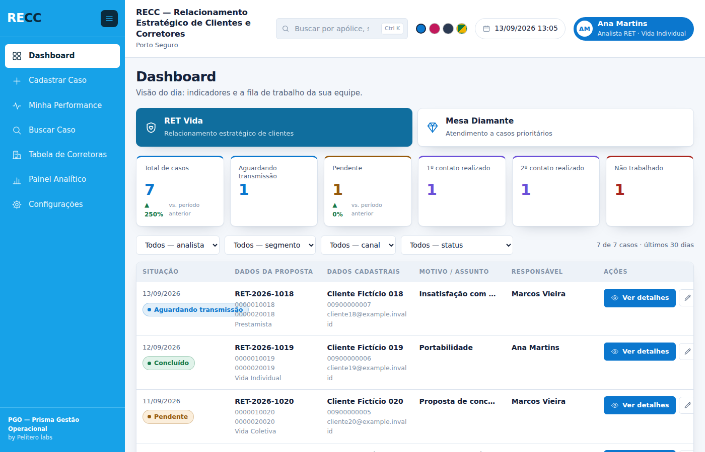

# Progresso

O estado de cada etapa, o que ela entregou e o que falta. Atualizado a cada
entrega.

**Estado geral:** 10 de 12 etapas construídas · 269 testes passando.

---

## Como as etapas foram organizadas

A ordem não é arbitrária: **cada etapa depende da anterior**, e cada uma
entrega algo que funciona sozinho e pode ser conferido na planilha. Nada de
"faz metade de tudo" — é uma camada de cada vez, testada antes da seguinte.

| # | Etapa | Estado | Testes |
|---|---|---|---|
| 1 | Fundação | ✅ pronta | 32 |
| 2 | Acesso | ✅ pronta | 32 |
| 3 | Casca | ✅ pronta | 28 |
| 4 | Cadastrar Caso | ✅ pronta | 28 |
| 5 | Trabalho | ✅ pronta · reformado | 28 |
| 6 | Configurações | ✅ pronta | 35 |
| 7 | Buscar Caso | ✅ pronta | 17 |
| 8 | Produtividade RECC | ✅ pronta | 24 |
| 9 | Minha Performance | ✅ pronta | 19 |
| 10 | Tabela de Corretoras | ✅ pronta | 22 |
| 11 | Abas de análise | ⏳ | — |
| 12 | Diagnóstico | ⏳ | — |

---

## Etapa 1 — Fundação ✅

**O alicerce: como o dado entra e sai da planilha sem se corromper.**

| Arquivo | Entrega |
|---|---|
| `Back-End/Base.gs` | O contrato das 13 abas: cabeçalhos exatos e tipo de cada coluna |
| `Back-End/Base.gs` | A porta única para o Planilhas — nenhum outro arquivo chama `SpreadsheetApp` |
| `Back-End/Base.gs` | Id decimal de 10 casas, que nunca anda para trás |
| `Back-End/Instalacao.gs` | Cria as abas numa planilha vazia e cadastra o primeiro administrador |

As duas regras que nasceram aqui e valem para sempre: a coluna é encontrada
pelo **nome do cabeçalho**, nunca pela posição; e a faixa é **formatada antes**
de receber o valor.

**Bugs pegos:** 3 (ver [`04-bugs-capturados.md`](04-bugs-capturados.md) 1 a 3).

## Etapa 2 — Acesso ✅

**Quem entra, e o que cada um pode.**

| Arquivo | Entrega |
|---|---|
| `Back-End/Entrada.gs` | Níveis, escopo, senha de administrador, auditoria |
| `Back-End/Entrada.gs` | Cadastro de quem pode entrar |
| `Back-End/Entrada.gs` | `doGet`, pacote de partida, identidade visual |
| `Front-End/SemAcesso.html` | A tela de quem não está cadastrado |

Cargo e nível de acesso ficaram separados de verdade: o cargo é rótulo
organizacional e não decide nada. E toda recusa **diz o motivo** — quatro
motivos distintos, cada um levando a um lugar diferente.

**Bugs pegos:** 3 (itens 4 a 6).

## Etapa 3 — Casca ✅

**O que aparece em toda tela.**

| Arquivo | Entrega |
|---|---|
| `Front-End/Index.html` | O esqueleto, que cola os outros dentro de si |
| `Front-End/Estilos.html` | Toda a aparência e os quatro temas |
| `Front-End/Comuns.html` | Menu lateral e barra superior |
| `Front-End/Aplicacao.html` | Ponte com o servidor, roteador e telas |

Menu lateral azul da marca com pastilha branca no item atual. Barra superior na
ordem: identidade → busca → bolinhas de cor → data do último registro →
pessoa. Quatro temas trocáveis (padrão, rosa, escuro, Brasil), guardados por
usuário.

Nasceu aqui o `Evolucao/Testes/gerar-previa.js`, que monta as telas com o mesmo
código do servidor e abre em qualquer navegador — sem publicar no Apps Script.

**Bugs pegos:** 4 (itens 7 a 10), sendo **dois encontrados olhando a tela**,
que teste nenhum pegaria.



---

## Etapa 4 — Cadastrar Caso ✅

**A primeira tela que grava dado de verdade.**

| Arquivo | Entrega |
|---|---|
| `Back-End/Casos.gs` | O motor: monta o formulário a partir de `CAMPOS` e valida o que volta |
| `Back-End/Casos.gs` | Registrar, editar, ocultar e o selo da SUSEP |
| `Front-End/CadastrarCaso.html` | A tela, com máscara, seleção de canal e o selo |

O formulário **não está escrito em lugar nenhum do código**: é montado a
partir da aba `CAMPOS` toda vez que a tela abre. Campo criado em Configurações
aparece sozinho; campo oculto para o nível **nem chega ao navegador**.

E porque o formulário é dado, o que volta da tela também é — então o servidor
revalida tudo:

- todos os problemas de uma vez, e não um por vez
- valor de campo oculto mandado pela tela é **ignorado**, não gravado
- data no futuro é recusada: o caso descreve algo que já aconteceu
- seletor só aceita valor que está na lista
- o escopo do nível vale para **escrever**, não só para ler

A máscara vive só na tela. `000.123.456-78` chega à célula como
`00012345678`, em texto.

O selo da SUSEP tem três respostas, e as três são informação: **liberada**
(com o segmento), **bloqueada** (com o motivo) e **não encontrada** — que não
é erro, é uma corretora que o cadastro não conhece.

**Bugs pegos:** 4 (itens 11 a 14), sendo um encontrado numa foto de página
inteira e um que era defeito da própria ferramenta de prévia.

---

## Etapa 5 — Trabalho ✅

**A visão do dia: quanto tem, e o que fazer agora.**

| Arquivo | Entrega |
|---|---|
| `Back-End/Indicadores.gs` | Cartões, fila, filtros e o detalhe de um caso |
| `Front-End/Trabalho.html` | A tela |
| `Front-End/Comuns.html` | A escolha do canal, usada aqui e no cadastro |

**Cartão e fila saem da mesma lista.** Contar de um lado e listar de outro
deixaria o cartão dizendo 12 e a fila mostrando 7, sem ninguém saber qual está
certo.

- Um cartão por situação, e **situação sem caso aparece zerada** — sumir do
  painel esconderia justamente a informação de que ela zerou
- **"Finalizados na célula"**: finalização preenchida e área responsável
  vazia. É conta, não coluna, então não mente quando alguém edita a área
  direto na planilha. O canal que não declara essas colunas não ganha o cartão
- Os filtros **são os campos que já são lista**: nada escrito em código. Campo
  que virar seletor vira filtro sozinho
- O alcance do nível vale no painel: quem enxerga só os próprios casos tem
  cartões contando só os dele
- A fila abre o caso inteiro sem recarregar a tela, e o detalhe respeita a
  mesma regra de visibilidade do formulário

O canal passou a declarar, na aba `CANAIS`, onde guarda cada coisa:
`ColunaDoStatus`, `ColunasDaFila`, `ColunaDaFinalizacao` e
`ColunaDaAreaResponsavel`. Declarado, e não adivinhado pelo nome — adivinhar
acerta hoje e erra no canal que vier depois.



---

## Etapa 6 — Configurações ✅

**A tela mais importante do produto: tudo o que as outras fazem sai daqui.**

`Back-End/Config.gs` e `Front-End/Configuracoes.html`, 35 testes.

> **Por que o servidor se chama `Config.gs` e não `Configuracoes.gs`.** No Apps
> Script os arquivos moram todos num projeto só, sem pasta, e o nome é único
> **independente da extensão**: com um `Configuracoes.html` já lá, o
> `Configuracoes.gs` não pode ser criado. No repositório eles ficam em pastas
> diferentes e a colisão não aparece — ela só aparece na hora de colar. Hoje um
> teste da suíte confere que nenhum `.gs` tenha o mesmo nome de um `.html`.

### Três colunas

| Coluna | O que é |
|---|---|
| **Seções** | os sete assuntos, cada um com o seu tamanho ao lado |
| **Lista** | os itens da seção; clicar escolhe |
| **Propriedades** | o item escolhido, aberto para edição. Nada grava sem Salvar |

As sete seções: campos do formulário, usuários, níveis de acesso, listas,
canais de trabalho, identidade e segurança, estrutura e auditoria.

### Três níveis de risco, três guardas

| O que se mexe | Guarda | Exemplo |
|---|---|---|
| **Conteúdo** | permissão `configurar` | renomear uma situação, cadastrar usuário |
| **Regra** | permissão `configurar` | o que um nível pode, quem vê qual campo |
| **Estrutura** | **+ senha de administrador** | criar coluna, apagar canal |

A senha não é burocracia: criar coluna escreve na planilha de produção, e ali
não existe desfazer.

### As travas que o servidor já impõe

- **Trocar o cabeçalho de um campo é recusado** — cabeçalho é o nome da coluna
  na planilha. Rótulo, seção, máscara e obrigatoriedade são livres: isso é
  aparência, não endereço
- **Reordenar muda a tela, nunca a planilha.** Foi reordenando coluna que o
  sistema anterior corrompeu dado
- **Renomear um item de lista em uso é recusado**, dizendo em quantos casos ele
  está gravado — e oferecendo a saída certa, que é trocar o rótulo
- **Ninguém se tranca do lado de fora**: tirar Configurações do único nível que
  a tem, ou a estrutura do único que pode mexer nela, é recusado
- **Coluna apagada na planilha aparece marcada** na lista de campos, em vez de
  o campo parar de funcionar sem explicação

### E as travas que a tela acrescentou

- **A aba de um canal não muda por aqui** — os casos já gravados moram nela
- **Nome de coluna é escolhido numa lista**, nunca digitado: o nome que não
  existe é recusado dizendo quais existem, em vez de deixar o painel em branco
  dias depois
- **Desligar o último canal ativo é recusado** — o Trabalho e o cadastro
  ficariam sem base nenhuma
- **A lista de telas é uma só.** `RECC_TELAS_DO_SISTEMA` alimenta o menu e a
  tela de níveis ao mesmo tempo; duas listas divergiriam, e a tela nova
  nasceria inacessível

### O diálogo da senha guarda a ação

Criar coluna pede a senha e, quando ela vem, **executa o que estava
pendente** — sem pedir o formulário de novo. Refazer tudo depois de digitar a
senha é o tipo de detalhe que faz alguém desistir no meio.

### A seção Painéis

Os cards do Trabalho deixaram de ser um texto separado por vírgula dentro da
canal e viraram **linhas da aba `PAINEIS`**: cada um com nome, o que conta,
cor, ordem e o interruptor de mostrar. Até 12 por operação. Remover um card
não toca em caso nenhum — o card é uma forma de contar, e apagar a conta não
apaga o que foi contado.

### E o que ainda não é configurável

A lista completa, sem maquiagem, está em
[`06-o-que-e-configuravel.md`](06-o-que-e-configuravel.md): o que já se ajusta
pela tela, o que ainda exige abrir a planilha, e o que não se ajusta em lugar
nenhum — com o motivo de cada um.

---

## Trabalho, segunda passada 🔧

**A fila deixou de ser uma tabela e virou uma tela de trabalho.**

### A fila em grupos

Um caso da RET tem trinta e cinco colunas. Seis lado a lado perdem o resto;
trinta e cinco não cabem. A fila passou a aceitar **grupos**: várias colunas
debaixo de um título só, com a primeira em destaque e as outras de apoio.

```
Situação: data de recepção do protocolo, status
Dados da proposta: protocolo, número da proposta, Num_apolice, produto
Dados cadastrais: nome do cliente, CPF, e-mail
Motivo / assunto: motivo do cancelamento
Responsável: analista
```

A escrita antiga, sem dois-pontos, continua valendo: cada coluna vira um grupo
com o próprio nome. Nenhum canal precisou ser reescrita.

### O caso num modal

Clicar em **Ver detalhes** abre o caso por cima, e fechar devolve a fila
exatamente como estava — mesma rolagem, mesmo filtro, mesma linha. Sair e
voltar faria perder o lugar dezenas de vezes por dia.

Dentro do modal: o caso inteiro em duas colunas, **campo em branco com um
travessão** (sumir faria a pessoa achar que o campo não existe neste canal), o
**histórico do caso** tirado da trilha de auditoria, e o botão de editar.

A edição é o **mesmo formulário** de Cadastrar Caso — o `Formulario`, que
agora mora num arquivo só e é usado pelas duas telas. Dentro do modal ele
recebe um prefixo, porque a tela de cadastro pode estar atrás e os dois não
podem disputar os mesmos identificadores.

### As quatro ações da linha

| Ação | O que faz |
|---|---|
| **Ver detalhes** | abre o modal em leitura |
| **Editar** | abre o modal já em edição |
| **Alterar situação** | um diálogo pequeno, só com a situação — é o gesto mais frequente da operação, e abrir 35 campos para mexer num só é atrito que se paga dezenas de vezes por dia |
| **Excluir** | some do sistema para todo mundo; **a linha permanece na planilha** e pode voltar |

Concluir um caso preenche a data de finalização sozinho, quando o canal tem
essa coluna e ela está vazia — é o que a operação faria à mão em seguida.

---

## Etapa 7 — Buscar Caso ✅

**O Trabalho mostra 30 dias. Aqui se acha o resto.**

`Back-End/Casos.gs` e `Front-End/BuscarCaso.html`, 17 testes.

### A regra que sustenta a tela

**Ler a coluna antes de ler as linhas.** Uma base da RET com 200 mil linhas
por 39 colunas são 7,8 milhões de células: ler tudo para procurar um
protocolo estoura o tempo do Apps Script e a cota da conta.

| Passo | Custo |
|---|---|
| 1. Ler só as **colunas de busca** e anotar em quais linhas o termo aparece | 5 colunas × 200 mil = 1 milhão de células |
| 2. Ler **inteiras** só as linhas que casaram | quase sempre uma ou duas |

Quais colunas cada canal lê está em `CANAIS.ColunasDaBusca`, e se ajusta em
Configurações. Canal que não declara nenhuma **avisa** em vez de ler a base
toda.

### A comparação ignora máscara

`123.456.789-01` acha `12345678901`, e o contrário também. Nos dois sentidos,
porque a máscara pode estar de qualquer lado — no que a pessoa digitou ou no
que está gravado. Exigir o formato exato transformaria a busca em adivinhação.

Texto compara sem acento e sem caixa, procurando o termo **dentro** do valor:
`otavio` acha `Otávio Bandeira`.

### A planilha legada

O histórico que ficou no sistema anterior. Ela é lida **como está** — a
primeira linha é cabeçalho, e nada mais é assumido: nem tipo de coluna, nem
nome, nem ordem. Por isso procura em todas as colunas dela.

- O **Id é conferido na hora de apontar**. Guardar um Id que não abre deixaria
  a busca com um recado de erro para sempre, sem ninguém saber se era o Id ou
  a planilha que tinha sumido
- Uma linha do legado **não abre no modal**: ela não é um caso do sistema, é
  histórico. Prometer edição ali seria mentira
- A planilha fora do ar **não derruba** a busca na base própria: vira um
  recado ao lado dos resultados de verdade

### E o que a busca não faz

Não fura o alcance do nível. Quem só enxerga os próprios casos na fila também
só os acha na busca — esconder na fila e mostrar aqui seria uma porta dos
fundos. Caso ocultado também não volta.

---

## Etapa 8 — Produtividade RECC ✅

**O Trabalho responde "o que eu tenho que trabalhar hoje". Aqui a pergunta é
outra: "o que está acontecendo na operação".**

`Back-End/Indicadores.gs` e `Front-End/Produtividade.html`, 24 testes.

Cada gráfico é uma linha da aba `PAINEIS` — tipo, campo que vira eixo, o que
se mede, o TOP N e a ordem. Acrescentar um gráfico é acrescentar uma linha,
em Configurações → Painéis → Gráficos.

### Cinco formas, cada uma para um trabalho

| Forma | Para quê |
|---|---|
| **Pizza** (rosca) | "de que tipo são", de relance. No máximo 6 fatias; o total no meio |
| **Barras em pé** | comparar "quanto de cada", com nomes curtos |
| **Barras deitadas** | o mesmo, com nomes compridos — em pé, "Aumento do prêmio na renovação" vira escadinha |
| **Linha** | como variou no tempo |
| **Barras com linha** | o dia a dia, com a tendência por cima |

### Três regras de leitura, e o motivo de cada uma

**Um eixo só.** "Barras com linha" não são duas escalas: a linha é a **média
móvel de 7 dias da própria barra**, na mesma altura. Dois eixos fazem a mesma
altura significar duas coisas — é o erro de gráfico mais comum que existe, e
um teste confere que a linha nunca ultrapassa a maior barra.

**Cor para identidade, tom único para magnitude.** A pizza responde "de que
tipo" e usa cores; as barras respondem "quanto" e usam um tom só. Seis cores
para dizer *quanto* fazem o olho comparar cores em vez de alturas.

**Cor segue a entidade, nunca a posição.** "Concluído" é verde porque o
catálogo diz que é, e continua verde quando um filtro o joga do primeiro para
o quarto lugar. Cor por posição repintaria o gráfico a cada filtro, e ninguém
compararia duas telas.

### A paleta

Seis tons em ordem fixa, **conferidos por régua e não por gosto**: separação
mínima entre vizinhos de ΔE 9,1 para quem não distingue vermelho e verde, e
19,6 para visão normal. Um sétimo valor vira **"Demais valores"** — nunca uma
cor nova, porque cor gerada na hora fica indistinguível das outras sob
daltonismo.

Três dos seis ficam abaixo de 3:1 de contraste com o fundo claro. A regra que
compensa isso está em todo gráfico: **o número sempre visível** (rótulo
direto), uma **tabela de números** a um clique e a **dica** no passar do
mouse. Cor é a segunda leitura, nunca a única.

O tema escuro tem os seus próprios passos, conferidos contra o fundo escuro —
não é a paleta clara reaproveitada.

### Clicar leva ao caso

Clicar numa fatia ou numa barra abre a lista dos casos que a formam, e dali o
mesmo modal do Trabalho. Sem isso o painel só informa, e informar não resolve
caso nenhum.

### Exportar

Ponto e vírgula e vírgula decimal — que é como o Excel em português abre sem
perguntar nada. Segue a permissão de `exportar`.

---

## Etapa 9 — Minha Performance ✅

**As outras telas mostram a operação. Esta mostra uma pessoa — e o cuidado
aqui é de outra natureza.**

`Back-End/Indicadores.gs` e `Front-End/MinhaPerformance.html`, 19 testes.

Um número mal escolhido no Trabalho atrapalha uma decisão. Um número mal
escolhido aqui atrapalha alguém. Quatro decisões saíram disso:

### 1. O ranking segue o alcance do nível

Quem só enxerga os próprios casos **não vê nome de colega nenhum** — vê a
própria posição contra a média da equipe. Mostrar a lista a quem não pode ver
os casos dos outros seria uma porta dos fundos, e ainda por cima a mais
constrangedora que existe num sistema de trabalho.

Quem pode ver recebe a lista — mas dos **vizinhos**, não o pódio. Um pódio
completo diz muito pouco a quem está no meio e diz demais sobre quem está
embaixo.

### 2. Todo número vem com a sua base

"8 casos" sozinho não diz nada; "8 contra 6 no período anterior" diz. E a
média da equipe aparece **sempre**: "abaixo da média" sem saber qual é a média
não é informação, é só desconforto.

Sem base de comparação a variação fica **em branco** — inventar "+100%" porque
saiu de zero é ruído que a operação aprende a ignorar, junto com a variação
que importa.

### 3. Menos é melhor, às vezes

No **tempo médio até concluir**, cair 20% é boa notícia — e a tela pinta de
verde. A mesma seta para baixo em "concluídos" é o contrário. Pintar as duas
da mesma cor faria a tela dar a notícia errada.

### 4. O que não dá para calcular não aparece

Tempo médio exige que o canal declare a coluna de finalização. Sem ela, o
indicador **some** — não aparece zerado, que pareceria desempenho ruim. Canal
sem coluna de responsável não mostra zero: mostra o que falta configurar.

### A meta é declarada, nunca inventada

`CANAIS.MetaMensalPorPessoa`, e zero desliga. Alvo tirado do nada é pior que
alvo nenhum: ele parece oficial, e ninguém sabe de onde saiu. A barra é
proporcional ao período escolhido, e passar da meta **enche a barra** — o
número diz o resto. Barra estourando a caixa é defeito, não conquista.

### "O que você fez"

A trilha da própria pessoa, e **só o que é trabalho**: cadastrou, alterou,
mudou situação, procurou. Mexer numa configuração é ação de quem administra, e
essa trilha completa vive em Configurações — aqui é a memória de quem atende,
e ela não pode virar log de sistema.

### E o desenho dos gráficos virou um módulo

`Front-End/Comuns.html`. Duas telas desenham gráficos e agora não têm duas
cópias — pela razão que já custou caro aqui: regra copiada em dois lugares é
regra que um dia diverge, e num gráfico a divergência não dá erro. Vira uma
barra um pouco mais alta do que devia.

---

## Etapa 10 — Tabela de Corretoras ✅

**Três cadastros que sustentam o resto do sistema e que, até aqui, só se
ajustavam abrindo a planilha.**

`Back-End/Cadastros.gs` e `Front-End/TabelaCorretoras.html`, 22 testes.

| Aba | O que é |
|---|---|
| **Corretoras e canais** | `CORRETORAS` — quem traz o caso, com o segmento |
| **Produtos** | `PRODUTOS` — o código é único, porque é ele que liga ao caso |
| **SUSEPs bloqueadas** | `SUSEP_BLOQUEADAS` — com o motivo, obrigatório |

### O que faz a tela valer mais que uma lista

**O volume ao lado de cada corretora.** Uma tabela de corretoras sem volume é
uma agenda telefônica; com ele, responde "quem me dá trabalho" — e a lista vem
ordenada por isso, não por ordem alfabética.

**E o aviso das SUSEPs fora do cadastro.** Esse é o achado. Enquanto uma SUSEP
não está em `CORRETORAS`, o selo do formulário diz "não encontrada" toda vez que
alguém a digita — e o sintoma aparece *na outra tela*, uma pessoa de cada vez,
sem ninguém ligar à causa. Aqui elas aparecem juntas, com quantos casos cada
uma já trouxe e o nome que os próprios casos usam, e cadastrar é um clique.

Uma SUSEP **bloqueada** não entra nessa lista: ela é conhecida, e o selo mostra
o bloqueio, não "não encontrada". Aviso que não bate com o que a pessoa vê na
outra tela é aviso que a operação aprende a ignorar.

### Três decisões

- **"Não encontrado" é atenção, não erro.** Cadastro incompleto não é corretora
  irregular; pintar de vermelho faria a operação achar que há problema com quem
  trouxe o caso
- **Bloquear não impede cadastrar.** O formulário mostra o selo vermelho com o
  motivo, e quem atende decide. Bloqueio que impedisse faria a pessoa registrar
  o caso num caderno, e o sistema perderia o caso de vista
- **O motivo do bloqueio é obrigatório.** Quem vir o selo vermelho daqui a seis
  meses precisa saber o que fazer com a informação

### A trava do cadastro

Duas corretoras com a mesma SUSEP são recusadas: o selo escolheria uma delas
pela ordem da planilha, que ninguém controla. O mesmo vale para o código do
produto.

---

## Configurações, segunda passada 🔧

Três perguntas da operação e um pedido de estilo, respondidos juntos.

### O menu ficou como o do PGO 5

Um cartão só, com os oito assuntos dentro, cada linha numa grade de três
colunas fixas — **ícone, título, quantidade**. As três colunas são o motivo de
a do meio ser `1fr` e não `auto`: com `auto`, o título manda na largura e os
números do lado direito param cada um num lugar.

Os títulos encurtaram (*Campos*, *Identidade*, *Estrutura*) porque não cabiam
em uma linha, e título que quebra em duas desalinha a contagem. O que eles
deixaram de dizer, a descrição diz — que saiu do menu, onde se repetia oito
vezes, e virou a primeira linha da coluna do meio.

**O item escolhido foi medido, não escolhido a olho.** Com o texto em
`--destaque-sobre`:

| tema | tom cheio | tom escuro |
|---|---|---|
| padrão | `#0B77CE` · 4,62 | `#095CA1` · **6,87** |
| rosa | `#C2185B` · 5,87 | `#8E1145` · **9,07** |
| brasil | `#0E7A3C` · 5,43 | `#0A5A2C` · **8,36** |
| dark | `#5C9DFF` · 6,55 | `#7FB4FF` · **8,37** |

No tema Dark o "escuro" é mais CLARO que o tom cheio, e o texto por cima é
quase preto. É por isso que o par certo é sempre `--destaque-escuro` com
`--destaque-sobre`: os dois viram juntos, tema a tema.

### Por analista virou gráfico

A operação perguntou se a Produtividade RECC tinha os dois recortes. **Por área**
sempre teve, e não como gráfico: é o seletor de canal. Um gráfico "casos por
área" com duas barras compararia RET com Mesa Diamante, que têm colunas,
situações e volumes incomparáveis — a Mesa Diamante sempre pareceria pequena, e nunca
foi para ser grande.

**Por analista** faltava, e agora nasce junto com o sistema nos dois canais, em
barras deitadas: nome de pessoa é comprido, e em pé o rótulo vira escadinha.

### A aba Importar

A pergunta era: *"temos uma lista de SUSEPs bloqueadas e quais corretoras são
Diamante — eu teria que fazer manual?"*

Não. Três passos, e o do meio é o que importa:

| passo | o que faz |
|---|---|
| **Colar** | Copia da planilha que a operação já tem. TAB (o que o Excel põe na área de transferência) ou ponto e vírgula, com ou sem cabeçalho |
| **Conferir** | O servidor diz o que vai acontecer com CADA linha — cadastra, atualiza, já igual, recusada e por quê. **Não grava nada** |
| **Aplicar** | Só então grava, e pede a senha de administrador |

**Aplicar não confia em Conferir.** Manda o TEXTO de novo, e o servidor refaz a
conferência inteira antes de escrever. Receber do navegador a lista já
conferida seria gravar o que o servidor aprovou — mas depois de passar por um
lugar onde qualquer coisa pode ter mudado.

**Nada apaga.** Uma corretora que está no cadastro e não veio no texto colado
continua onde estava; um campo vazio no texto não limpa o que já existe. O
texto colado é uma correção, não a verdade inteira.

Com cabeçalho, a ordem das colunas pode ser qualquer uma: quem exporta de
outro sistema não recebe as colunas na ordem do PGO, e exigir a ordem certa
devolveria à pessoa exatamente o trabalho manual que a tela veio tirar.

### O diálogo de senha saiu de Configurações

Virou `Comuns.html`, porque a Importação passou a precisar do
mesmo pedido. Dois diálogos escritos separados viram duas regras: um dia um
libera por 5 minutos e o outro por 30, e ninguém percebe.

### E um bug que só a tela mostrou

O [23](04-bugs-capturados.md): a linha colada era aparada ANTES de ser partida
em colunas, e com TAB isso comia a primeira coluna quando ela vinha vazia. A
linha inteira andava uma casa, e a recusa apontava o campo errado. Os quinze
testes da importação passavam — nenhum deles tinha primeira coluna vazia, e
escrever esse caso não teria ocorrido a ninguém antes de ver a linha torta na
tela.

**285 testes.**

---

## Etapa 11 — Abas de análise ✅

O pedido original: *"permitir criar uma aba exclusiva que irá criar uma aba no
planilhas para análise de dados."*

O administrador monta uma RECEITA — canal, colunas, filtros, janela de dias — e
o sistema escreve o resultado numa aba `ANALISE_<Nome>`, achatada, pronta para
tabela dinâmica ou para o Power BI apontar.

### A trava que justifica o arquivo

`escreverAbaDeAnalise_` recusa qualquer nome que não comece com `ANALISE_`, e
essa é a primeira linha da função, antes de qualquer outra coisa. Sem ela, uma
análise chamada "BASE_RET" apagaria a base de produção — e nenhuma outra
proteção do sistema pegaria, porque apagar seria exatamente o que o código se
propôs a fazer.

O teste que prova isso tenta escrever em `BASE_MESA`, em `CONFIG` e em `''`, e
depois confere que a base continua inteira.

### Retrato, e não fórmula

A aba recebe VALORES gravados de uma vez. Poderia ser uma aba de
`=FILTER(...)`, "sempre atualizada" — mas uma fórmula que varre 30 mil linhas
recalcula a cada abertura da planilha, e com três abas dessas a planilha fica
lenta para todo mundo, o dia inteiro. Retrato pesa uma vez, quando alguém pede.

### Cinco decisões pequenas que mudam o dia a dia

| decisão | por quê |
|---|---|
| **Salvar ≠ gerar** | Montar a receita é ajuste, e ajuste não pode custar trinta segundos de espera a cada campo mexido |
| **Regerar pede senha; criar, não** | Criar não destrói nada. Regerar apaga o retrato anterior, e quem tinha uma tabela dinâmica apontada para ele vê os números mudarem embaixo |
| **A aba é reaproveitada** | Apagar e recriar mudaria o identificador dela, e todo Power BI apontado para aquela aba perderia o alvo em silêncio |
| **A grade encolhe junto** | Célula vazia também consome o teto de 10 milhões. Uma aba deixada em 1000 × 26 gasta 26 mil células para mostrar três linhas |
| **Nenhuma coluna marcada = todas** | Guardar a lista inteira congelaria as colunas de hoje, e uma coluna nova na base nunca apareceria na análise |

### O alcance não se aplica aqui

E é decisão, não esquecimento. A aba gerada mora na MESMA planilha que a base:
quem abre `ANALISE_Diamante` abre `BASE_RET` ao lado, e recortar por alcance
não esconderia nada — só deixaria a análise incompleta. Além disso, o gatilho
de horário roda sem ninguém logado; se o recorte dependesse de quem gerou, a
mesma análise teria conteúdos diferentes conforme o botão ou o horário a
tivesse gerado, e ninguém saberia qual dos dois está na aba naquele momento.

Quem pode gerar é controlado onde tem de ser: `gerarAnalise` exige a permissão
de **estrutura**, e montar a receita exige só **configurar**.

### O gatilho de horário

`atualizarAnalisesAgendadas` é a função para apontar um acionador de tempo no
editor do Apps Script. É a única do arquivo que não pede senha nem permissão —
um gatilho roda sem ninguém logado, e uma senha ali falharia toda madrugada, em
silêncio. Uma análise que estoura não derruba as outras: o erro é anotado e a
próxima segue.

### A aba gerada não está no contrato

`conferirEstrutura_` não a conhece e o instalador não a cria. É saída, não é
base: pode ser apagada à mão a qualquer momento, e a próxima geração a refaz —
tem teste para isso.

O que está no contrato é a **receita**, na aba `ANALISES` — a décima terceira.
Uma aba, e não um JSON dentro de `CONFIG`, pela mesma razão que os cartões do
Trabalho saíram de `CANAIS`: é uma lista de coisas configuráveis, cada uma com
nome, canal, colunas e filtro próprios.

**313 testes**, e o [bug 24](04-bugs-capturados.md) pelo caminho: a regra de
CSS escrita para campo de digitar esticou a caixa de marcar até empurrar o
rótulo para fora da tela.

---

## Etapa 12 — Diagnóstico ✅

A suíte prova que o **código** está certo. Ela não prova que **esta
instalação** está certa: a planilha é editável à mão, e o que a suíte conferiu
numa planilha de mentira pode não valer na de verdade seis meses depois.

`Back-End/Instalacao.gs` é a outra metade. Dez blocos, 49 verificações numa
instalação de partida, e uma pergunta só: *este sistema, aqui, agora, está
inteiro?*

### A regra que manda no arquivo

**Bloco que não consegue rodar é FALHA, nunca "pulado".**

Está nas armadilhas herdadas do PGO 5.x, e custou caro lá: o diagnóstico
antigo, quando um arquivo faltava, pulava o bloco que dependia dele — e
terminava aprovando o build. Um verificador que aprova o que não conseguiu
verificar é pior que verificador nenhum: dá confiança sem base.

`rodarBloco_` embrulha cada bloco. Qualquer erro dentro dele vira um item de
falha com o erro escrito, e bloco que devolve lista vazia também. Dois testes
trancam isso — um apaga uma função de que o bloco depende, outro faz um bloco
devolver nada.

### O que cada bloco confere

| bloco | o que pega |
|---|---|
| **Ambiente** | Fuso da planilha diferente do fuso da operação — um caso registrado depois das 21 h cai no dia seguinte. Senha de ADM não definida. Quanto do teto de 10 milhões de células a planilha já ocupa |
| **Estrutura** | Aba do contrato apagada, coluna do contrato faltando (falha), coluna a mais (atenção — o sistema ignora o que não conhece) |
| **Sequências** | Sequência ABAIXO do maior Id gravado, que é como o sistema anterior reemitiu Id em uso. E sequência com lixo |
| **Identificadores** | Id repetido, dizendo em quais linhas. Coluna de Id fora do formato texto — a causa das 4.328 colisões. Linha sem Id (atenção) |
| **Canais** | Canal apontando para aba que não existe, ou citando coluna que a aba não tem. Todas os canais desligadas |
| **Campos** | Campo apontando para coluna que não existe. Campo obrigatório desligado (atenção: desligado, a obrigatoriedade deixa de valer) |
| **Painéis** | Card ou gráfico apontando paro canal ou coluna que não existe |
| **Análises** | Receita apontando paro canal ou coluna que não existe |
| **Acesso** | Usuário ativo com nível que sumiu, nível com JSON quebrado, e — a mais importante — **ninguém mais conseguindo abrir Configurações** |
| **Tela** | Toda função que a tela chama existe no servidor; toda tela do menu tem rota |

### O bloco da tela é o "build" desta etapa

A tela chama o servidor pelo **nome da função, em texto**. Renomear uma função
no servidor não quebra nada na hora: quebra quando alguém clica no botão,
semanas depois, e a mensagem que aparece é a do Apps Script, que não diz qual
função faltou.

O bloco lê os arquivos de tela com `getRawContent()`, junta todo
`Servidor.chamar('...')` e confere `typeof globalThis[nome] === 'function'`.
São 66 funções hoje. O teste apaga uma de propósito e cobra a falha, com o
nome da função e a tela em que ela é usada.

### Duas portas, e a do editor não pede nada

`diagnosticoRECC()` roda no editor do Apps Script, sem abrir o sistema — é a
porta que importa justamente quando o sistema **não abre**. Ela não exige
permissão nem senha, e não precisa: quem consegue abrir o editor já tem acesso
a tudo, e negar ali só atrapalharia quem foi consertar. Escreve o laudo no log
em texto, porque um JSON de trezentas linhas no log é ilegível, e ilegível é
o mesmo que ausente.

`diagnosticoDoSistema()` é a mesma coisa pela tela, em Configurações ›
Estrutura. Exige `configurar` e deixa rastro na auditoria.

### O laudo na tela esconde o que está certo

Bloco todo verde nasce **fechado**, com a contagem ao lado ("13 conferidos").
Bloco com atenção ou falha nasce aberto. Um laudo bom tem cinquenta linhas
verdes, e ler cinquenta linhas verdes para achar as três vermelhas é o mesmo
que não ter laudo. É `<details>` nativo — sem JavaScript, e já com o teclado
funcionando.

O "como arrumar" só aparece quando há o que arrumar. Repetir a instrução ao
lado de tudo que está certo faria o olho parar de ver as três que importam.

| Arquivo | Entrega |
|---|---|
| `Back-End/Instalacao.gs` | Os dez blocos, as duas portas e o laudo em texto |
| `Front-End/Configuracoes.html` | O laudo na tela, em Configurações › Estrutura |

### Uma conferência curta e uma completa, não duas regras

`verificarEstruturaRECC()`, do Instalador, continua sendo a de dois segundos
para logo depois de copiar os arquivos. As duas leem o mesmo
`conferirEstrutura_` — e tem teste cobrando que concordem. Duas versões da
mesma regra sempre acabam discordando, e aí uma das duas está mentindo.

### E o caso que chegou da operação enquanto isto era escrito

O sistema publicado não abria, e tudo o que dizia era *"nenhum arquivo html
com o nome formulario foi encontrado — linha 53"*. Verdade, e inútil: o
`Comuns.html` tinha ficado para trás na cópia, mas a mensagem não dizia de
onde tirar o arquivo, como nomeá-lo no Apps Script (sem `.html`, sem acento,
maiúsculas iguais) nem — o pior — **quantos outros faltavam**. Um por vez, com
uma recarga entre cada.

Virou o [bug 25](04-bugs-capturados.md), com três defesas: o `incluir_` agora
devolve um recado que resolve, `verificarEstruturaRECC()` passou a conferir os
arquivos de tela além das abas (o README já prometia isso e ela não fazia), e
o simulador ganhou `esconderTela(nome)` — um arquivo que está na pasta e não
está no projeto. Sem poder simular isso, o caminho de erro mais comum de uma
instalação nova continuaria sem teste.

**351 testes** — 38 desta etapa, e quase todos QUEBRAM alguma coisa de
propósito numa planilha nova para cobrar a falha correspondente. Provar que o
diagnóstico aprova uma instalação boa é o teste fácil e o menos útil: um
verificador que sempre responde "aprovado" também passaria nele.

---

## Pente-fino, antes do teste de estresse

Uma varredura arquivo por arquivo, procurando erro em vez de esperar que ele
apareça. O que ela achou:

### O que estava impedindo o sistema de rodar

**`Configuracoes.gs` e `Configuracoes.html` não podem existir juntos no Apps
Script.** No repositório eles moram em pastas diferentes e convivem em paz; no
Apps Script não existe pasta, e o nome é único **independente da extensão**.
O servidor virou **`Config.gs`**, e um teste confere que nenhum `.gs` tenha o
nome de um `.html` — nem ignorando maiúsculas, porque a plataforma diferencia
a caixa e quem copia à mão não.

### Por que a tela ficava em "Lendo o cadastro…"

Três defeitos empilhados, e o primeiro é o que escondia os outros:

| defeito | o que acontecia |
|---|---|
| **Função ausente estourava por fora do erro** | Com a função faltando no servidor, `google.script.run.nomeDela` é `undefined` e o `.apply` estoura *dentro* de `chamar()` — quando o `.senao` ainda nem foi registrado. As 73 chamadas tinham tratamento de falha e nenhuma delas era alcançada |
| **Resposta que chega depois de trocar de tela** | Ela procurava um elemento que não existe mais: `Cannot set properties of null` |
| **Resposta que chega depois de trocar de seção** | Dentro de Configurações, `carregarSecao` zera o `dados`, e a resposta atrasada tentava desenhar com um `dados` que não era o dela |

As três defesas: `chamar()` embrulha o disparo e diz **qual** função falta e
por quê; a ponte conta as trocas de tela e não entrega resposta para uma tela
que já saiu; e cada desenho de seção confere se ainda é a seção da vez.

> **Ter `.senao` em todo lugar não garante que o erro passe por ele.** É a
> lição do achado 27, e a mais cara desta rodada.

### O que a varredura confirmou

| conferência | resultado |
|---|---|
| Funções que as telas chamam | **66**, todas existem no servidor e todas conferem quem chama |
| Chamadas ao servidor com tratamento de falha | **73 de 73** |
| Funções `.gs` com nome repetido | nenhuma |
| Constantes globais repetidas | nenhuma |
| Funções nunca usadas | nenhuma |
| `SpreadsheetApp` fora do `Base.gs` | 2 → **0** (viraram `abrirPlanilhaDeFora_`) |
| ES6 fora do padrão nos `.gs` | nenhum |
| Ids de HTML repetidos | 4 → **0** |
| Arquivos de tela órfãos | nenhum |
| `<script>` que não compila | nenhum |
| Funções que a prévia não sabia responder | 3 → **0** |

Tudo isso virou teste. Não adianta conferir uma vez.

### E uma ferramenta nova

```bash
node Evolucao/Testes/clicar-em-tudo.js
```

Percorre as sete telas e **clica em 112 elementos**, ouvindo `pageerror` e
`console.error`, e procurando três textos que nunca deveriam chegar à tela:
`undefined`, `[object Object]` e o recado de função ausente. Os dois defeitos
de resposta atrasada só aparecem quando alguém clica rápido e desiste no meio
— que é o que as pessoas fazem o dia inteiro.

**362 testes.**

---

## Teste de estresse — 200 mil casos

```bash
node Evolucao/Testes/estresse.js            # até 50 mil
node Evolucao/Testes/estresse.js 200000     # o volume que a RET terá
```

### O que ele mede, e por que não é o relógio

No Apps Script o que custa não é a conta em JavaScript: é cada **ida ao
serviço** de planilha e de propriedades. Uma ida leva dezenas de
milissegundos, e a execução inteira tem **seis minutos**. Medir o relógio do
Node não diz nada sobre isso, porque o Node não paga o pedágio.

Então o simulador conta idas, células lidas e gravadas, e o teste converte
isso em tempo por uma régua conservadora: 25 ms por ida, 900 ms por milhão de
células, 12 ms por propriedade. Não é exata, e não precisa ser — serve para
dizer "cabe com folga", "apertado" ou "não cabe".

### O que ele achou

Três defeitos, e o terceiro não é lentidão.

| achado | antes | depois |
|---|---|---|
| **[28](04-bugs-capturados.md)** Um Id por vez, e cada um uma ida ao PropertiesService | gravar 5.000 casos: **10.003 idas, 2 min** | **5 idas, 275 ms** |
| **[29](04-bugs-capturados.md)** Uma ida por linha na segunda metade da busca | busca de 100 resultados: **100 idas** | agrupadas em blocos: **1 a 20** |
| **[30](04-bugs-capturados.md)** O painel mostrava um pedaço e **parecia o total** | silêncio | as três telas avisam |

O 30 é o grave. Os painéis leem só as últimas 5.000 linhas — de propósito, e
documentado. Com 200 mil casos em um ano, uma janela de 30 dias tem umas 15
mil: **o painel mostrava um terço do período**. O Trabalho avisava, mas o
aviso estava colado na fila e dava a entender que os cartões estavam completos;
a Produtividade RECC calculava `truncada` e nunca mostrava; a Minha Performance
nem calculava — e é a tela sobre uma pessoa.

> Um sistema que fica lento avisa sozinho. Um que fica errado, não.

### O placar em 200 mil casos

| operação | idas | células | tempo est. |
|---|---:|---:|---:|
| Gravar 5.000 casos de uma vez | 5 | 195 mil | 275 ms |
| Trabalho: abrir a RET | 16 | 202 mil | 581 ms |
| Buscar por protocolo | 21 | 1,0 mi | 1,4 s |
| Buscar termo que casa com milhares | 20 | 1,0 mi | 1,4 s |
| Produtividade RECC: os 6 gráficos | 16 | 202 mil | 582 ms |
| Minha Performance | 14 | 201 mil | 531 ms |
| Cadastrar um caso | 25 | 7,6 mil | 580 ms |
| Diagnóstico completo | 59 | 403 mil | 1,7 s |
| Gerar `ANALISE_RetVida` | 23 | 9,6 mi | 9,1 s |
| Importar 2.000 corretoras | 19 | 24 mil | 445 ms |

**Todas cabem com folga** no teto de seis minutos. A mais cara — gerar a aba de
análise — usa 2,5% dele.

### O limite de verdade não é tempo: é espaço

| | células | % do teto |
|---|---:|---:|
| `BASE_RET` com 200 mil casos | 7.800.468 | **78%** |
| `ANALISE_RetVida` (cortada em 50 mil) | 1.750.035 | 18% |
| tudo somado | **9.672.905** | **96,7%** |

Com 200 mil casos a planilha está **cheia**. Não sobra espaço para a Mesa
Diamante crescer nem para uma segunda aba de análise. O diagnóstico já acusa
isso como FALHA acima de 95%, com o caminho escrito no laudo.

O teto real desta arquitetura, então, é da ordem de **200 mil casos por
planilha** — e o que decide não é a velocidade, é a célula. Passar disso pede
mover o histórico antigo para uma planilha de arquivo e apontá-la como planilha
legada, que a busca já lê.

### O que também foi testado

- **Dez cadastros em sequência imediata** — nenhum Id repetido. É a trava que
  o PGO 5.x não tinha, e que lá custou 4.328 colisões.
- **Linha suja digitada direto na planilha** — data que não é data, SUSEP
  inválida, linha sem Id. Trabalho, busca e diagnóstico seguem funcionando, e
  o diagnóstico aponta a linha.
- **Importação no teto** de 2.000 linhas.
- **Análise sobre a base inteira**, que bate no corte de 50 mil e o informa.

**366 testes.**

---

## O bloco que nasceu de uma pergunta da operação

*"Desconfigurou a estilização da página, o que pode ser?"*

CSS que não existe não reclama — só não pinta. Sem erro, sem exceção, sem log.
E do lado do repositório estava tudo certo: a prévia renderizava. O que estava
desatualizado era a **cópia do `Estilos` no projeto do Apps Script**.

O diagnóstico ganhou o bloco **A folha de estilos**, que responde três coisas
de dentro do Apps Script: o arquivo está no projeto; ele está **inteiro**
(chave desequilibrada denuncia a colagem de 70 KB que não foi até o fim); e
toda classe que as telas usam está **definida** — se não, o laudo lista os
nomes. "Está desconfigurado" vira "o Estilos deste projeto é mais antigo que
as telas, e faltam estas sete classes".

A investigação achou de quebra [três buracos](04-bugs-capturados.md) no próprio
repositório: `.ver` era classe morta em três telas, e `.config-canais` e
`.config-legado` eram usadas sem nunca terem sido escritas.

**370 testes.**

---

## Ponta a ponta, e o pacote de três arquivos

### O buraco que faltava

A suíte provava o **servidor**. A prévia mostrava a **tela** — mas recusa toda
gravação, de propósito, para não fingir ter gravado o que não gravou.
Resultado: o caminho mais importante do sistema nunca era exercitado inteiro:

> formulário preenchido → servidor grava → planilha muda → tela recarrega

E é ali que moram os defeitos que nenhum dos dois lados enxerga: o campo que a
tela chama de `nivel` e o servidor espera como `nivelAcessoId`, a caixa de
marcar que volta como texto, o id que mudou num lado e não no outro.

```bash
node Evolucao/Testes/ponta-a-ponta.js
```

A página é gerada pelo `doGet` **de verdade**. No navegador,
`google.script.run` é substituído por uma ponte que devolve a chamada para o
Node, onde o servidor roda no simulador. Os valores atravessam em JSON, que é
exatamente o que o Apps Script faz — `Date` vira texto, `undefined` some.

DOM de verdade, servidor de verdade, planilha que se comporta como a de
verdade. Seis percursos: a aba Usuários carregando, cadastrar, editar,
desativar, e-mail repetido recusado, e cadastrar um caso.

**Achado de passagem:** o asterisco do campo obrigatório era só visual. Quem
usa leitor de tela ouvia "asterisco", ou nada. Agora os campos levam
`aria-required` — não `required`, porque o formulário é `novalidate` de
propósito: quem valida é o servidor, com mensagem melhor que o balão nativo.

### Os arquivos soltos viraram 3

```bash
node Evolucao/Testes/gerar-pacote.js
```

O repositório separa o código por assunto, um arquivo por assunto — e é assim que
tem de ser para alguém conseguir ler e consertar. Mas o Apps Script não tem
"importar pasta": cada um vira um arquivo criado à mão, com o nome digitado
certo. Trinta e cinco vezes. E o custo não é o tempo: **basta um ficar para
trás** para a tela congelar num "Lendo o cadastro…" que não explica nada — já
aconteceu duas vezes aqui, nos [achados 25 e 27](04-bugs-capturados.md).

`Evolucao/pacote/` tem três arquivos: `Codigo.gs` (todos os do servidor),
`Index.html` (o esqueleto com as telas coladas dentro), `SemAcesso.html`.
Mais um `COMO-USAR.txt`.

> **O pacote é testado como o original.** O ponta a ponta roda duas vezes —
> contra os arquivos soltos e contra os 3 — e cobra que se comportem igual. Se
> divergissem, haveria duas verdades, e a que a operação usa seria a que
> ninguém testa.

E há dois testes, não um. O primeiro prova que o **gerador** funciona: ele gera
numa pasta descartável e confere que nenhuma função e nenhuma tela ficou de
fora. O segundo prova que o **arquivo guardado no repositório** — o que alguém
vai baixar e colar — ainda é o código de hoje: gera uma cópia fresca, tira a
linha do carimbo dos dois lados e compara.

> **Por que dois.** Na primeira versão havia um só, e ele regerava o pacote por
> cima do repositório antes de conferi-lo. Provava que o gerador funciona e
> nada sobre o arquivo guardado, que podia estar semanas atrasado passando
> verde. É a armadilha do bloco que se aprova sozinho, da Etapa 12, dentro da
> própria suíte — o [achado 33](04-bugs-capturados.md). **Conferir o que você
> acabou de fabricar não é conferir nada.** O segundo teste nasceu depois, junto
> com a correção do cadastro, e está descrito aqui porque é aqui que ele mora.

**372 testes.**

---

## O cadastro de usuários, revisto

Três mudanças pedidas pela operação, e uma que veio junto.

### O canal da pessoa

`USUARIOS` ganhou a coluna **`CanalId`** — a décima quarta do contrato — e o
formulário ganhou o campo. **Vazio é válido**, e é o caso de quem administra:
quem cuida do sistema não pertence a um canal, atende as duas e delega. Na
lista isso aparece como *"todos os canais"*, e não em branco — em branco parece
cadastro pela metade.

Canal preenchida tem de existir. Um canal que sumiu deixaria a pessoa apontando
para o nada, e ninguém descobriria até alguém estranhar o Trabalho vazio.

A lista passou a mostrar **e-mail · nível · cargo · canal**, em vez de só
e-mail e nível.

### A senha de administrador só vale para quem não é administrador

A senha nunca foi uma segunda identidade: o sistema já sabe quem está
chamando, pela conta Google, e já conferiu a permissão. Ela é um **freio** —
um segundo de parada antes de uma ação sem desfazer. Para quem tem a permissão
de estrutura, esse freio é atrito sem ganho: a pessoa que pode mexer na
estrutura é a mesma que define a senha.

O efeito, por ação:

| ação | exige | quem é pedido |
|---|---|---|
| Criar campo (coluna nova) | `estrutura` | ninguém — só administrador chega lá |
| Regerar aba de análise | `estrutura` | ninguém, pelo mesmo motivo |
| **Importar em lote** | `configurar` | **quem configura sem administrar** |

A importação é onde o freio continua servindo: é a ação mais provável de ser
delegada, e escreve em centenas de linhas de uma vez.

Instalação **sem senha definida não libera ninguém** — continua barrando, e
dizendo onde definir. Do contrário, não definir senha viraria o jeito mais
fácil de desligar a guarda.

### As datas saem como texto

`listarUsuarios` devolvia `Date`; as irmãs dela já devolviam texto formatado.
Elas atravessam a fronteira do `google.script.run` em JSON, e um `Date`
atravessa como texto ISO que a tela teria de reinterpretar. Formatar no
servidor deixa uma regra só, do lado que conhece o fuso.

### E o relógio de desistência

O [achado 32](04-bugs-capturados.md): há falha que **não chega ao
`withFailureHandler`** — nada volta, nem sucesso nem erro, e a tela espera para
sempre. Agora a ponte desiste em quarenta segundos e diz qual função não
respondeu. Quarenta é folga enorme: a operação mais cara do sistema leva nove
segundos.

> Uma tela parada é o pior estado possível: não funciona **e não avisa**.

**384 testes**, e o ponta a ponta subiu para sete percursos.

---

## Responsividade

Uma conferência à parte, num navegador de verdade:

```bash
node Evolucao/Testes/conferir-responsividade.js
```

**7 telas × 12 larguras**, de 1600px a 320px, procurando a página rolar na
horizontal e o elemento que escapou da janela. Tabela dentro de uma caixa que
rola de propósito não conta — rolar a tabela é a solução, não o problema.

Na suíte ficam as regras estáticas que sustentam isso: nenhuma largura fixa
acima de 320px no CSS, toda tabela dentro de uma caixa que rola, e a grade dos
gráficos com `minmax(min(100%, 340px), 1fr)`, que encolhe sozinha sem media
query nenhuma.

---

## Menos arquivos, agrupados por assunto

Pedido do PO, e a razão dele é de manutenção, não de cópia: *"queria diminuir…
agrupe algumas funções do .gs que tem lógica estarem juntas em um arquivo"*.

Eram **35 arquivos** — 18 `.gs` e 17 `.html`. Agora são **19**: 7 e 12.

### Os sete do servidor

Cada um responde a UMA pergunta. É esse o critério, e não o tamanho: um
arquivo existe para que alguém que não conhece o sistema saiba onde procurar.

| Arquivo | Responde | Juntou |
|---|---|---|
| `Base.gs` | como o sistema fala com a planilha | Esquema, Sequencia, Planilha |
| `Cadastros.gs` | quem traz o caso para dentro | Corretoras, Importacao |
| `Casos.gs` | o caso, do formulário à busca | Campos, Casos, Busca |
| `Config.gs` | o que se ajusta sem programador | Config, Analise |
| `Entrada.gs` | quem entra e o que pode | Principal, Acesso, Usuarios |
| `Indicadores.gs` | os números | Painel, Analitico, Performance |
| `Instalacao.gs` | criar e conferir a instalação | Instalador, Diagnostico |

> **Por que `Indicadores.gs` junta três telas.** Trabalho, Produtividade RECC e
> Minha Performance contam os MESMOS casos. Separados, convidam ao erro de
> mudar a regra de contagem num e esquecer dos outros dois — e aí o cartão diz
> 12, o gráfico diz 9, e ninguém sabe qual está certo. Juntos, a regra é uma
> só porque está à vista.

> **Por que `Base.gs` não levou o formulário junto.** A sugestão era juntar
> "criação de formulários e ajustes no Google Planilhas". São níveis
> diferentes: um é infraestrutura (como falamos com o Sheets), o outro é
> domínio (o que um caso pergunta). Misturar os dois faz a infraestrutura
> parecer que sabe o que é um caso — e é justamente o que `Base.gs` não pode
> saber, porque é ele que serve a todas as abas.

### Os doze de tela

Uma por item do menu (são 7), mais quatro de infraestrutura e a de bloqueio:

- `Index.html` — o esqueleto, que manda incluir os outros
- `Estilos.html` — toda a aparência e os quatro temas
- `Comuns.html` — as peças que mais de uma tela usa
- `Aplicacao.html` — a ponte com o servidor e o roteador
- `SemAcesso.html` — servida sozinha, a quem não está cadastrado

O `Comuns.html` guarda seis peças: Moldura, SenhaDeAdministrador,
SeletorDeCanal, Formulario, CasoEmModal e Graficos. Nenhuma é tela do menu, e
todas são usadas por mais de uma — o critério para morar ali é esse, escrito
no cabeçalho do arquivo.

> **Juntar não misturou nada.** Cada peça já era um módulo fechado
> (`var Nome = (function () { … })()`), com o estado dela dentro. Morar no
> mesmo arquivo não dá a uma acesso à outra: é exatamente o mesmo código, só
> que em um arquivo em vez de seis. Foi por isso que dava para juntar sem
> reescrever uma linha.

### O que o agrupamento quebrou, e como apareceu

Vinte e dois testes falharam de cara, todos com `ENOENT` — eles liam arquivos
de tela pelo nome. **Falhar alto assim é o resultado bom**: o risco de uma
mudança dessas é a que passa despercebida.

A correção não foi trocar nome por nome. Os testes ganharam `lerPeca(nome)` e
`scriptDaPeca(nome)`, nas ferramentas: procuram a peça onde ela estiver — como
arquivo próprio, ou como trecho de um arquivo maior, achando pelo banner. Se
amanhã as peças se separarem de novo, nenhum teste precisa mudar.

### E uma ferramenta que teria mentido

O `Evolucao/conferir-projeto.gs` carregava, escrito à mão, o mapa "arquivo →
funções que as telas chamam". Depois do agrupamento ele apontaria para sete
arquivos que não existem mais — e não como erro: com confiança, mandando
copiar o `Analitico.gs`.

Agora ele é **gerado** por `node Evolucao/Testes/gerar-conferidor.js`, a partir
do código de verdade, e um teste compara o gerado com o guardado. É o achado
33 pela segunda vez no mesmo mês, e é por isso que virou regra: **artefato que
repete informação do código não se digita, se gera — e se compara num teste.**

**385 testes.**

---

## A rodada da operação: velocidade, canais e os formulários de verdade

Sete pedidos do PO de uma vez. Cada um com a decisão que ele obrigou a tomar.

### 1. As telas demoravam a abrir

Medido antes de mexer, contando **idas ao serviço**, que é o que custa no
Apps Script:

| | antes | depois |
|---|---|---|
| Abrir o Trabalho | 48 idas, **3 chamadas** | 32 idas, **2 chamadas** |
| Abrir Cadastrar Caso | 44 idas, **3 chamadas** | 27 idas, **2 chamadas** |

Duas causas, e a segunda vale mais que a primeira.

**A mesma aba, lida muitas vezes.** Num `pacoteDePartida` só, `CONFIG` era
lido 10 vezes; num `resumoDoCanal`, `CATALOGO` 7. Ninguém escreveu isso de
propósito — são funções pequenas e corretas, cada uma lendo o que precisa, e o
custo só aparece somando. Agora há um memo por execução para as abas de
sistema. Ele dura exatamente uma requisição, que é o tempo certo: no Apps
Script cada chamada da tela é uma execução nova, então não existe como servir
dado velho para a próxima.

> **As bases operacionais ficam de fora do memo**, e não é detalhe: BASE_RET
> com 200 mil linhas na memória estouraria a execução. A lista é explícita.

**Uma viagem inteira para repetir trabalho feito.** O `doGet` já lia quem você
é e a identidade visual para decidir qual página servir — e então a página
chegava ao navegador e pedia `pacoteDePartida`, que recomeçava do zero para
devolver o que a primeira execução já tinha na mão. Agora o pacote vai
**dentro da página**, em JSON escapado.

> **A tela continua sabendo pedir pelo caminho antigo.** Se a injeção falhar —
> arquivo velho no Apps Script, qualquer coisa —, ela pergunta ao servidor como
> sempre fez. Atalho sem volta vira um jeito novo de quebrar.

E há um teste ponta a ponta que **conta as chamadas do navegador** e cobra que
`pacoteDePartida` não seja pedido. Sem contar, uma otimização que silenciosamente
não pega continua passando em todos os testes.

### 2. O selo da SUSEP com os números de verdade

A operação tem 7.127 SUSEPs cadastradas e mais de 16 mil bloqueadas. O selo
lia as **duas tabelas inteiras a cada digitação** — 239 mil células. Agora lê a
coluna da SUSEP e só a linha que casar: **24 mil**, dez vezes menos.

> Ao trocar, um teste pegou um defeito que eu tinha acabado de introduzir:
> `buscarRegistros_` devolve a linha esteja ela oculta ou não, e desbloquear
> uma SUSEP é exclusão lógica — o selo voltou a dizer "bloqueada" para uma
> SUSEP liberada. Daí nasceu `buscarRegistroVisivel_`.

### 3. Mesas viraram canais

RET e Mesa Diamante são **canais**, não mesas. O vocabulário do código
inteiro mudou junto — 1.351 linhas.

A aba `CANAIS` existia e guardava **corretoras**. Virou `CORRETORAS`, que é o
que ela sempre teve dentro, e ganhou a coluna `Consultor`. Sem isso, "canal"
significaria duas coisas no mesmo sistema.

> `BASE_MESA` e "Mesa Diamante" ficaram como estão: um é nome de aba com dado
> dentro, o outro é nome próprio.

### 4. O motor de escopo por canal

O pedido: *"quando o nível de acesso for RET deve mostrar apenas o dashboard
da RET… Os únicos que podem ver tudo são níveis ADM"*.

Cada nível declara quais canais enxerga. **Lista vazia quer dizer TODOS** — é o
caso de quem administra, e é o que mantém de pé todo nível criado antes desta
regra: nível antigo continua enxergando o que enxergava, em vez de amanhecer
sem canal nenhum.

Vale no menu, no Trabalho, no cadastro, na busca, no painel e na performance.
E vale **no servidor**: as 24 portas que recebem um canal passaram a conferir.
A tela não oferecer o canal na lista não protege nada — a chamada existe, e
basta mandar outro Id.

> A recusa **nomeia os canais que a pessoa tem**. "Sem acesso" sozinho manda
> procurar no lugar errado: quase sempre é o nível que ficou com o canal
> errado marcado.

### 5. Excluir caso em qualquer canal

Investiguei antes de mexer: **os dois canais sempre permitiram**, e
`podeOcultar` nunca dependeu do canal. O que barrava era outra coisa — o caso
ser de outra pessoa, e o nível alcançar só os próprios.

A mensagem é que estava errada. "Fora do seu alcance" foi lido como "este
canal não deixa excluir", porque na Mesa Diamante a pessoa conseguia e na RET
não. Agora ela nomeia o responsável pelo caso e diz, em letras: *"isso vale
para qualquer canal, e não é uma regra do RET"*.

> De quebra, achei uma função `ocultar` no Trabalho escrita antes da decisão
> de pôr excluir no caso aberto, e **nunca chamada**. Código morto num arquivo
> de tela é pior que em outros lugares: quem vem depois lê o nome, conclui que
> a fila já sabe excluir, e procura o defeito no lugar errado.

### 6. O carimbo de status, na base e não na auditoria

Troca de status **saiu da auditoria**. É o evento mais frequente do sistema —
um caso passa por quatro ou cinco antes de fechar —, e numa base de 200 mil
casos seriam quase um milhão de linhas numa aba da qual ninguém tira relatório.

No lugar: cada status declara, no catálogo, **em qual coluna da base** gravar
data e hora. "1º contato realizado" na RET, "Concluído" na Mesa. Mesma
informação, na linha do próprio caso, onde o Power BI a lê.

> **Carimba só se estiver vazio.** Um caso que volta a um status por onde já
> passou guarda a data da primeira vez. Reescrever apagaria justamente o dado
> que se quer medir, em silêncio.

### 7. Os formulários que a operação pediu

A sequência e as seções, campo a campo, para os dois canais. `ordem` manda na
posição na tela — não a ordem das colunas na planilha. São coisas diferentes
de propósito: a coluna nasce onde o histórico a deixou, e o formulário segue o
caminho que quem atende percorre ao telefone.

Quatro mecanismos novos:

- **Valor padrão que sabe o dia e a pessoa** — `@HOJE`, `@AGORA`, `@EU`,
  resolvidos pelo **servidor**. O relógio do navegador é o da máquina de quem
  está olhando, e uma data com fuso errado só aparece semanas depois.
- **Campo travado por cargo** — o Analista vem com o seu nome e um analista não
  o troca. Quem desfaz a trava é uma ação do nível, não o cargo: cargo diz o
  que a pessoa faz, nível diz o que ela pode.
- **Campo condicional** — "nome de quem transferiu" só aparece com canal de
  origem = Central; "dados de pagamento", só com "ADC - TODAS PARCELAS". A
  regra vem do servidor, para ficar ao alcance de Configurações.
- **Um seletor, duas colunas** — o produto é escolhido como
  "1101 - VIDA INDIVIDUAL" e gravado separado. Só o **primeiro** hífen separa,
  e só quando o que vem antes **tem dígito**: senão "VIDA - PLANO A" guardaria
  "VIDA" como código.

> **Campo da base que a operação não listou não foi apagado**: foi para a seção
> "Outros", ligado. Apagar perderia dado gravado; desligar calado esconderia o
> que alguém ainda usa.

### O defeito que o reordenamento criou

Reordenar o formulário **quebrou o filtro de Status** — e sem erro nenhum.

O painel monta os filtros a partir dos campos que são seletor, com teto de
quatro para não virar parede de caixas. Ele pegava os quatro **primeiros**. Com
o Status indo para o fim do formulário — ele é a última coisa que se preenche
no atendimento —, caiu fora do corte. O filtro mais usado do sistema
simplesmente deixou de existir na tela.

A ordem do **formulário** segue o caminho de quem atende; a ordem dos
**filtros** segue o que a operação recorta. Amarrar uma na outra era o defeito.
Agora o status vem sempre primeiro.

**392 testes**, e a planilha das mudanças passou a ser gerada à parte: quem já
tem o PGO rodando recola só o que mudou.

---

## A rodada do RECC: mais dedicado à operação, e mais ajustável

O pedido tinha uma tensão dentro dele, e é ela que orientou tudo: *"vou deixar o
sistema mais adaptado e exclusivo para eles, ou seja, voltado para Retenção e
para a Mesa Diamante. Como a operação está ainda se formando... o sistema não
pode ser fechado, precisa ser mais ajustável."*

Mais dedicado E mais ajustável ao mesmo tempo. A resposta, em todos os itens
abaixo, foi a mesma: **o que a operação pediu virou o PADRÃO DE FÁBRICA, e não
uma regra no código.** Os oito status da RET, os cartões da Produtividade, os
gráficos da importação — tudo isso nasce pronto e tudo isso se muda em
Configurações, sem programador.

### 1. RET, Trabalho, Produtividade RECC

"RET Vida" virou **RET**: o canal passou a atender Vida Individual e Vida em
Grupo, e o nome não podia dizer só metade.

O `Trabalho` virou **Trabalho** e o `Produtividade RECC` virou **Produtividade
RECC** — e a pergunta do PO foi *"consigo editar o nome depois?"*. Não conseguia:
os títulos moravam em `MENU.TITULOS` desde sempre e nunca tiveram onde ser
editados. Ganharam tela.

O que identifica a tela é a **chave**, nunca o texto. `dashboard` continua sendo
a chave da tela que hoje se chama "Trabalho" — trocar a chave junto com o nome
quebraria rota, nível de acesso e endereço guardado.

> **E o cabeçalho da página ficou para trás.** O menu obedecia ao nome novo; o
> título da página, dois centímetros ao lado, continuava lendo a tabela de rotas
> e dizendo "Trabalho". É o achado 37: quando uma informação vira
> configurável, todo lugar que a exibia precisa ser revisitado.

### 2. O caso da RET nasce em "Não trabalhado"

O status padrão do formulário da RET passou a ser "Não trabalhado" — o analista
ajusta depois de cadastrar.

Isso expôs um defeito que estava escondido havia meses: o servidor conferia
"é obrigatório" **antes** de aplicar o valor padrão. Na tela não aparecia,
porque a tela preenche o padrão sozinha antes de a pessoa ver — dois lugares
fazendo o mesmo trabalho, e só um deles certo.

Quem ia pagar a conta era a importação: uma base de 300 inadimplentes não traz
coluna de status, não passa por tela nenhuma, e as 300 linhas seriam recusadas
uma a uma. É o achado 34.

### 3. Toda mudança de status fica registrada

O controle de produtividade da RET. São **duas coisas diferentes**, e o sistema
guarda as duas:

- **Os carimbos** — uma coluna por status, com a data e a hora em que o caso
  chegou nele pela **primeira** vez. "Data do 1º contato", "Data reteve". É o
  que responde *"a data e a hora de cada contato"* sem abrir a planilha.
- **O rastro de toda mudança** — quando foi a última, quem fez, e quantas vezes
  o caso já andou. Um caso que vai e volta entre dois status não mexe em carimbo
  nenhum, e sem estas três colunas pareceria parado.

Nada disso vai para a auditoria, e é decisão da operação: troca de status é o
evento mais frequente do sistema, e numa base de 200 mil casos seriam quase um
milhão de linhas numa aba da qual ninguém tira relatório.

No detalhe do caso, os carimbos viram uma **linha do tempo**: por onde o caso
passou, na ordem do catálogo — que é a jornada como a operação a desenhou. A
etapa que não aconteceu aparece **no lugar dela**, apagada. Sumir esconderia o
buraco, e o buraco é informação: quem pulou o 2º contato e foi direto para "Não
reteve" contou uma história.

### 4. A Produtividade RECC

A tela abre pelos **cartões**, porque é o cartão que responde a pergunta. Para a
RET: reteve, não reteve, já contatados, com 2º contato, cadastrados, pendentes e
não trabalhados.

"Já contatados" sai do **carimbo**, e não do status de hoje — a diferença que
importa. Um caso que passou do "1º contato realizado" e hoje está em "Reteve"
continua tendo sido contatado; contar pelo status diria zero.

Dois botões trocam entre **a equipe toda** e **só os meus**. O nível define o
teto; a vista escolhe quanto dele aparece. Quem já só enxerga os próprios casos
não recebe os botões.

E os filtros perderam o "Todos —": a caixa fechada mostrava a palavra que menos
importa, e em tela estreita o nome do filtro era o pedaço que ficava cortado.

> **Os cartões quase apagaram os gráficos.** As duas coisas passaram a morar na
> mesma tela da aba `PAINEIS`, distinguidas só pelo `TipoWidget`. O
> `salvarComponentesDoPainel` recolhia "tudo desta tela neste canal" e desligava
> o que não estivesse na lista de gráficos — e os cartões não estavam. A
> pergunta "esta linha é um gráfico?" virou uma função só, usada nos três
> lugares que a faziam.

### 5. A importação

Trazer uma base inteira de fora, numa gravação só: os inadimplentes do Vida
Individual, do Vida em Grupo, as corretoras que a Mesa vai tratar. Cem casos,
trezentos casos, toda semana.

Três passos, e **o do meio é a razão de a tela existir**: conferir. O servidor
devolve para onde cada coluna vai, quantas linhas entram, quantas repetem e as
**três primeiras já traduzidas**. Mapeamento errado é invisível olhando o
cabeçalho e óbvio olhando o dado.

O que a importação resolve, além de inserir:

| Problema | Resposta |
|---|---|
| Os cabeçalhos são os da outra planilha | Casa nome com nome e **sugere**; a pessoa corrige |
| A base chega sem responsável | **Rodízio** em partes iguais entre os analistas marcados |
| A base repete toda semana | Coluna que identifica o caso → o que já está dentro é **pulado** |
| O caso precisa nascer trabalhável | Entra com o **status padrão** do canal |
| De onde veio cada caso | Grava o **lote** e a **data** — é o que faz o gráfico existir |

Na Produtividade RECC, dois gráficos por canal: **casos importados por dia** e **de
qual base os casos vieram**. É o pedido literal: *"no dia 05 incluímos 100 casos
da base de inadimplentes Vida Presente"*.

`importar` é uma ação separada de `criar`: quem cadastra um caso por vez erra um
caso; quem importa errado suja a base toda, e o desfazer é apagar trezentas linhas
na mão. De fábrica, Administração e Coordenação importam; a Operação não.

> **A lista de analistas veio vazia numa operação cheia de analistas.** Eu
> filtrava por "Canal que atende igual ao nome do canal", e esse campo é de
> digitar livre: a operação escreve "Vida Individual", não "RET". Pior, os meus
> testes cadastravam as pessoas com o nome do canal — o teste herdou a suposição
> do código. Só apareceu abrindo a tela e lendo a frase. É o achado 40.

### 6. Minha Performance: eu e a minha equipe

O resultado individual do analista logado, com a opção de ver como vai o grupo a
que ele pertence. A equipe é quem está cadastrado no **mesmo canal que ele
atende** — a mesma definição que o alcance usa, para os dois números nunca
divergirem.

Na vista da equipe a **meta vira a soma das metas**: comparar o resultado de
cinco pessoas com a meta de uma faria toda equipe parecer 400% acima do alvo. E
o ranking passou a comparar **dentro da equipe**, e não com o canal inteiro —
rankear contra o canal colocava o analista ao lado de gente que nem atende a
mesma coisa.

### 7. A busca e a exclusão, confirmadas

Duas perguntas do PO, e as duas respondidas com teste em vez de com opinião:

- **"Buscar caso é para localizarmos na antiga base, correto? Todos precisam
  dessa visualização."** A busca procura nas bases do PGO **e** na planilha
  antiga, quando ela está configurada — não é só do legado. E os quatro níveis
  de fábrica já nascem com ela; um teste agora reprova qualquer nível que nasça
  sem.
- **"Confirme se os casos excluídos somem da planilha nos dois canais."** Somem.
  Havia teste para a Mesa Diamante e não para a RET — as duas abas têm colunas,
  nomes de Id e formulários diferentes, e já bastou menos que isso para uma
  valer e a outra não. Agora há para as duas, e para a auditoria das duas.

### O que as varreduras de navegador pegaram

Três coisas que nenhum teste de servidor veria:

1. **O menu cortava "Produtividade RE…".** O rótulo tinha `nowrap` com
   reticências. O nome da tela é escolha do administrador, e cortá-lo em 248
   pixels é cortar a escolha dele — num MENU, ainda por cima, que é o texto lido
   *antes* do clique. Agora quebra em duas linhas.
2. **A Importação nasceu com o ícone do Trabalho.** O desenho caía no padrão. O
   teste que cobrava desenhos únicos comparava contra o número 7, escrito à mão,
   enquanto o menu já tinha 8 — passou a comparar contra o tamanho do menu.
3. **Gráfico com uma barra só, chamada "Sem informação".** É o estado normal de
   um gráfico sobre a importação antes do primeira importação. Não diz nada e
   parece defeito. Agora vira o recado, que explica.

E as duas varreduras de navegador **não conheciam a tela nova**: cada uma tinha
a sua lista de telas escrita à mão — uma com sete nomes, a outra com cinco, e as
duas dizendo "TODAS as telas" no cabeçalho. Continuaram aprovando com a mesma
confiança, caladas sobre a oitava. A lista passou a sair do código, num lugar
só. É o achado 33 outra vez.

**490 testes**, cinco execuções seguidas sem falha, 136 cliques em 8 telas, 96
combinações de tela × largura e 9 testes de ponta a ponta.

---

## A rodada do ajuste fino: duas telas, dois filtros, dois bases

Cinco pedidos curtos que mexeram em lugares fundos.

### 1. Cada tela com uma pergunta só

*"Produtividade RECC a visualização é sempre da equipe. Minha Performance será
sempre sobre minhas inclusões."*

Os dois pares de botões saíram. A divisão ficou mais clara do que estava:

| Tela | Pergunta | Sempre |
|---|---|---|
| **Minha Performance** | como EU vou | as minhas inclusões |
| **Produtividade RECC** | como A EQUIPE vai | a equipe |

E um **alargamento deliberado**: um analista com escopo "próprios" enxerga só os
casos dele no Trabalho e na Busca, e na Produtividade RECC passa a ver a equipe.
Uma tela com esse nome mostrando uma pessoa só não seria a tela que a operação
pediu. Vale nesta tela e em nenhuma outra, e vai só até a equipe dele.

A equipe continua na Minha Performance como REFERÊNCIA — a média e a posição.
Saber que se fez 8 não diz nada sem saber que a média é 6.

### 2. O período, de três maneiras

*"Troque para que fique por período e seja possível selecionar."* Perguntei o
que faltava, e a resposta foi: **de/até E por mês**.

São três, e a primeira caixa escolhe qual está valendo — mostrar as três
preenchidas ao mesmo tempo deixaria três períodos na tela e um só valendo.

Quem resolve as três numa coisa só — duas datas — é o **servidor**. Se a tela
calculasse, o dia do gráfico sairia do relógio do navegador de quem está
olhando e o dia da conta sairia do relógio da planilha. Num fechamento de mês
essa diferença é um dia inteiro de casos.

Dois detalhes que só aparecem fazendo:

- **O mês anterior de um mês é o MÊS anterior.** Comparar setembro com "os 30
  dias antes de setembro" daria quase agosto, mas não agosto. Em fevereiro o
  erro seria de três dias, todo ano.
- **De 10/09 a 19/09 são DEZ datas, não nove.** A subtração crua dá nove, e a
  janela de comparação sairia um dia mais curta que a medida — um erro que some
  dentro de uma variação de 3% e ninguém confere. Escrevi o teste com a conta
  errada primeiro; o código estava certo.

E a linha sem data: FICA no atalho, SAI do período fechado. Num "últimos 30
dias" ela é um caso mal preenchido que precisa aparecer; num "setembro" ela é um
caso sobre o qual não dá para afirmar que é de setembro.

### 3. Campo de valor só aceita número

*"Inputs de valor em R$ devem obrigatoriamente aceitar apenas número para não
atrapalhar o resultado."*

O número cresce da direita, como numa maquininha de cartão: 1, 2, 3 vira
R$ 0,01 → R$ 0,12 → R$ 1,23. Nove casas inteiras, duas de centavo —
`R$ 999.999.999,99`, que contempla a apólice de doze reais e a de um milhão.
A tecla que não é dígito é barrada ANTES de entrar, e no celular o teclado abre
numérico.

Por que não bastava validar no servidor: um "aprox. 1200" chega lá, não vira
número, e a célula fica **vazia**. O caso é gravado com o valor faltando, sem
ninguém notar, e o relatório soma menos do que deveria.

Um teste varre o Esquema procurando coluna cujo NOME fala de valor, prêmio ou
preço e cobra que ela seja do tipo dinheiro. É o *"ou demais que encontrar"* do
pedido, virado guarda.

### 4. A segunda base

*"A tabela de corretoras, SUSEP's, Analistas da Central e Analistas da cobrança
ativa virá de outra planilha. Assim fica menos pesado e teremos 2 bases certo?"*

Certo. Duas bases: a **operacional**, com os casos, e a de **cadastros**.
Perguntei se devia ler direto ou copiar, e a escolha foi ler direto — é o que
realmente tira as 7 mil SUSEPs desta planilha.

A implementação inteira cabe num lugar só, e esse é o ponto: todas as leituras
já passavam por `lerRegistros_`, que passa por `estruturaDaAba_`, que abria a
aba numa linha. Essa linha virou `abaOndeQuerQueElaMore_`, e o resto do sistema
— a busca, o selo da SUSEP, as listas do formulário, a Tabela de Corretoras —
nem soube que existem duas planilhas.

> **O PGO lê e não escreve.** A planilha de cadastros é a fonte de verdade.
> As portas de escrita recusam com uma frase que diz ONDE editar — um "não
> permitido" seco mandaria a pessoa procurar uma permissão que não é o problema.

E quando a outra planilha não abre, o sistema **para com o motivo**. Lista vazia
aqui seria "nenhuma SUSEP está bloqueada": uma afirmação falsa que a operação
acreditaria, e que deixaria passar um caso que devia ser barrado.

### 5. Nomes alinhados, enquanto dá

*"Pode alterar os nomes dos arquivos pois não implantei nada oficialmente."*

Duas chaves de tela ainda estavam em inglês, presas ao nome antigo porque
trocá-las quebraria rota gravada. Sem nada instalado, não há rota gravada:

| Antes | Agora |
|---|---|
| `Dashboard.html`, chave `dashboard` | `Trabalho.html`, chave `trabalho` |
| `PainelAnalitico.html`, chave `painelAnalitico` | `Produtividade.html`, chave `produtividade` |
| `testes-painel.js`, `testes-analitico.js` | `testes-trabalho.js`, `testes-produtividade.js` |

251 linhas em 37 arquivos. A troca de "o Painel" (masculino) por "a
Produtividade" (feminino) deixou uma dúzia de concordâncias tortas — "o
Produtividade RECC" —, varridas em seguida.

**Daqui em diante a chave não se troca mais com o sistema no ar.** Está escrito
onde ela é declarada.

### A conferência de Apps Script, em quatro camadas

*"Preciso que tudo funcione em apps script. Registre para que se precisar
consultar você consiga se guiar."*

A suíte roda em Node e o sistema roda no Google. Faltava uma camada entre as
duas, e ela virou um bloco de testes permanente: `.gs` usando `document`,
`.html` chamando `SpreadsheetApp`, `require` em qualquer um dos dois,
`<script>` sem fechar. As quatro camadas estão na seção 5 do
[`03-manutencao.md`](03-manutencao.md), com a tabela do que é proibido de cada
lado.

A primeira versão dessa guarda **reprovou três arquivos por causa da palavra
portuguesa "documento"** — que é um tipo de campo do sistema. Guarda que reprova
o código certo ensina a ignorar o vermelho. Passou a procurar palavra inteira, e
há um teste que confere as duas pontas: que ela dispara num trecho com
`document` dentro, e que NÃO dispara num trecho em português.

### O que as imagens do README pegaram

As fotos do README eram tiradas à mão. Viraram um gerador — `gerar-imagens.js` —
e na primeira rodada ele fotografou a **Produtividade RECC abrindo com um recado
vermelho**: a ponte da prévia tinha ficado com o nome antigo da função.

O incômodo é que **duas verificações estavam olhando para isso e disseram que
estava tudo bem**:

- O `clicar-em-tudo.js` conferia o texto no FIM do laço — depois de clicar em
  tudo, inclusive nos itens do menu. Ele terminava numa tela diferente da que
  estava visitando, e a conferência inteira olhava sempre a última tela clicada.
- O teste `a prévia responde por TODA função` procurava o nome em **qualquer
  lugar** do gerador. O nome estava lá, trezentas linhas longe da ponte, numa
  linha que só coletava dado.

Os dois tinham o alvo certo e o escopo errado. **Escopo errado numa verificação
não deixa sintoma nenhum** — ela passa, e a licença de parar de procurar é dada
do mesmo jeito. São os achados 41 e 42.

**531 testes**, cinco execuções seguidas sem falha, 136 cliques em 8 telas, 96
combinações de tela × largura, 9 testes de ponta a ponta e 14 imagens geradas.

## Etapa 16 — a caixa de filtros, o período no Trabalho, e dois achados que só a foto pegou

**O pedido do PO**, em duas frases: *"na aba trabalho precisa do filtro por
data. Deixe por padrão e envolva tudo que for filtro por uma parte de fundo
branca com título de filtro, o mesmo para minha performance e o mesmo para
Produtividade"*.

**A caixa e o seletor são peças únicas.** `Moldura.caixaDeFiltros` desenha a
caixa branca com o título "Filtros" e a contagem à direita;
`SeletorDePeriodo` (PEÇA 7 de 7 do `Comuns.html`) desenha e interpreta o
período nas três formas. As três telas chamam as mesmas duas peças — e há um
teste cobrando exatamente isso, nos moldes do que já valia para a máscara do
formulário: *nenhuma tela pode ter a sua própria cópia*.

O seletor devolve **três respostas**, e a do meio é a que evita a tela torta:

| resposta | quer dizer |
|---|---|
| um objeto | período novo, pode recarregar |
| `null` | não é do período — é um filtro comum |
| `false` | é do período, mas ainda incompleto (de/até com uma data só) |

Sem o `false`, mexer na primeira data recarregaria a tela com meio intervalo, e
a pessoa leria aquele resultado como se fosse a resposta — meio segundo antes
de preencher a segunda data.

**O período no Trabalho** chegou até a fila: os mesmos `resolverPeriodo_`,
`periodoAnterior_` e `entreDuasDatas_` que a Produtividade RECC já usava. Linha
sem data continua **entrando** no atalho de dias e **saindo** dos períodos
fechados, pelo motivo de sempre: num "últimos 30 dias" ela é um caso mal
preenchido que precisa aparecer; num "setembro", é um caso sobre o qual não dá
para afirmar que é de setembro.

### Os dois achados desta etapa

Nenhum dos dois veio de teste. Vieram de **olhar**.

**O achado 43 apareceu na foto da Produtividade RECC**: o cartão "Já
contatados" dizia `0` enquanto a rosca logo abaixo, na mesma tela, mostrava um
caso em "1º contato realizado" e outro em "2º contato". Dois números da mesma
tela discordando. A causa: `carimbarOStatus_` tinha **um único ponto de
chamada**, dentro do diálogo de situação. Quem trocasse a situação pelo
formulário — o mesmo gesto, na mesma tela, a um clique de distância — não
deixava carimbo. E os dois testes que existiam do carimbo eram bons, e usavam
justamente a porta que funcionava.

**O achado 44 apareceu no estresse**, que terminou REPROVADO: a massa de teste
trazia a lista de canais escrita à mão, com um comentário jurando que ela vinha
de `formularioDoCanal`. Vinha — no dia em que foi escrita. Depois o catálogo
virou o da RECC e a lista ficou para trás. Pior: a carga usa
`inserirVariosRegistros_`, que grava sem validar, então **50 mil casos entraram
com um valor que o sistema recusa, sem uma reclamação sequer**. Durante um bom
tempo o estresse mediu desempenho sobre uma massa impossível.

### O encaixe das duas bases, provado

O PO perguntou com estas palavras: *"caso a segunda base esteja inclusa no PGO,
ele passa a utilizá-la e caso não seja cadastrada a segunda base segue mantendo
nas abas que criou, combinado?"*. A resposta é sim, e o que os testes novos
cobram não é a troca — é que **nenhum dos dois lados perca nada** ao trocar:
ligar e desligar três vezes seguidas deixa cada aba do mesmo tamanho, gravar
com ela desligada não toca na planilha de fora, e quem decide é **uma chave
só**. Os testes foram conferidos contra uma cópia-na-ligação injetada de
propósito, e os dois que deviam ficar vermelhos ficaram.

**565 testes**, cinco execuções seguidas sem falha, 136 cliques em 8 telas, 96
combinações de tela × largura, 9 testes de ponta a ponta, o estresse APROVADO
em 50 mil casos e 14 imagens geradas.

## Etapa 17 — Importação, e o calendário da operação

Duas coisas do PO, sem relação entre si.

### Tombamento virou Importação

*"Esses casos serão incorporados para serem tratados"* — "tombar" dizia só que
eles mudaram de lugar. A troca pegou tela, chave, ação de permissão, funções,
CSS, duas colunas da base e os arquivos (`Importacao.html`,
`testes-importacao.js`). O gênero mudou junto: "do tombamento" virou "da
importação", e por isso as frases com artigo foram trocadas antes da palavra
solta — senão o sistema ficaria cheio de "do importação".

E o renomeio **apagou uma função sem dizer nada**: já existia um
`conferirImportacao` no `Cadastros.gs`, e no escopo global único do Apps Script
a segunda definição vence. É o achado 45, e dele saíram duas guardas
permanentes que varrem todos os `.gs` atrás de nome repetido — de `function` e
de `const`.

### O calendário: dia útil, feriado e férias

O PO trouxe as duas juntas: *"temos meses em que alguns entram de férias (…)
precisam ficar inativos por determinados dias"* e *"só trabalhamos em dias
úteis"*. Ele escolheu o efeito: **a pessoa sai das contas de produtividade**,
não do acesso — quem volta de férias às vezes precisa consultar um caso antes
de reassumir.

A meta se repartia por **30 dias corridos**. Num mês de 21 dias úteis isso
cobrava nove dias que não existem, e quem tirava férias aparecia devendo os
dias em que esteve fora. Agora o denominador são os dias úteis **daquele mês**,
e a ausência desconta os dias em que a pessoa não tinha como trabalhar. Num mês
fechado o alvo bate **exatamente** com a meta mensal — é o invariante que um
teste cobra na vírgula.

Os feriados nacionais o sistema calcula, **inclusive os móveis**, a partir do
Domingo de Páscoa (algoritmo gregoriano, conferido contra quinze anos de datas
conhecidas, incluindo 25/04/2038, a Páscoa mais tardia possível). A alternativa
era uma tabela para alguém preencher todo dezembro. O que só a operação sabe —
municipal, facultativo, emenda — fica na aba `FERIADOS`, com um `Trabalha` que
funciona nos dois sentidos.

Duas armadilhas fechadas por teste: **dias sobrepostos contam uma vez** (férias
emendada com licença não pode devolver mais dias fora do que o período tem), e
**a férias que atravessa a virada do mês** conta nos dois, cada um pela sua
parte — é a mais comum, e a que um corte por "começou dentro do período"
perderia inteira.

### O que só o navegador pegou

O ícone da seção Calendário saiu **igual ao do Trabalho**: `Moldura.icone` cai
num padrão quando a chave não tem desenho, e cai calado. O teste que guardava
isso olhava só o MENU. Foi estendido — e a primeira versão da extensão **passou
verde com o ícone removido**, porque comparava as seções entre si e o desenho
herdado era de outra lista. A versão que ficou compara cada seção com o próprio
padrão, que é o defeito de verdade.

O diagnóstico do projeto, esse, pegou sozinho: quatro classes de CSS que a tela
nova usava e o `Estilos.html` não definia.

**579 testes**, cinco execuções seguidas sem falha, 144 cliques em 8 telas, 96
combinações de tela × largura, 9 testes ponta a ponta, o estresse APROVADO em
50 mil casos e 14 imagens geradas.

## Etapa 18 — os dois pontos que ficaram em aberto

O PO respondeu os dois de uma vez: *"faça os dois pontos"*.

### Férias entram na divisão da Importação

O problema era concreto: importar 300 casos numa segunda com dois analistas
fora deixa 75 casos parados três semanas — e **nada no sistema avisa**. Os
casos estão lá, no nome de alguém, dentro do prazo, e ninguém os trabalha. Quem
descobre é o cliente, ligando.

Quem está fora hoje vai para o **fim da lista**, com o motivo e a data da volta
ao lado do nome. Não some: o lote pode ser justamente para quando ela voltar, e
quem decide isso é a coordenação. E se for marcada mesmo assim, o **laudo diz**
— quantos casos, até quando — antes de gravar. Recusar seria tirar a decisão da
mão de quem a tem; calar seria o defeito de novo.

### O carimbo virou destino escolhível

Era uma regra só — "coluna preenchida pelo sistema não é sugerida nem
oferecida" — e virou duas:

| | |
|---|---|
| **Sugerir** | Continua proibido. Uma coluna da fonte chamada "Data do 1º contato" casando sozinha escreveria no controle de produtividade sem ninguém decidir |
| **Escolher** | Passou a poder. É o certo quando a base antiga guarda a data de verdade — e é a única forma de esses casos contarem em "Já contatados" |

A lista de carimbos sai do **catálogo**, e não de uma lista no código: o
administrador cria status novos e aponta cada um para a sua coluna, e a
importação acompanha sem ninguém mexer aqui.

**E uma trava que não existia.** `exigirQueODeParaLeveAAlgumLugar_` só
perguntava se a coluna EXISTE na aba. A origem e a data da importação, que a
tela nunca ofereceu, podiam ser escritas por quem montasse o de-para por fora —
a proteção do rastro do lote era um **combinado visual**, e combinado visual
não é trava. Agora a lista do que se aceita é conferida no servidor, que é onde
a linha entre "pode escolher" e "nunca" precisa estar.

### De passagem

O recado *"o importação criaria linhas em branco"* — erro de gênero que o
renomeio da etapa 17 não pegou, porque "o" e "importação" estavam em literais
de texto **separados**, unidos por concatenação. Busca de texto não vê palavra
que o código junta em tempo de execução.

E três testes alheios quebraram porque eu pus os meus, que **gravam**, no meio
do arquivo: vários ali conferem total, e escrever no meio muda a contagem de
quem vem depois. Consertei movendo os meus para o fim, e não reescrevendo os
outros — não havia nada errado com eles.

**589 testes**, cinco execuções seguidas sem falha, 144 cliques em 8 telas, 96
combinações de tela × largura, 9 testes ponta a ponta e 14 imagens geradas.

## Etapa 19 — o VG, e o que um terceiro canal revelou

O PO ditou 23 colunas, as listas, os seis status e duas regras novas. Antes de
escrever uma linha, sete perguntas — ele tinha pedido *"na dúvida pergunte
antes de criar"*, e havia dúvida de verdade em três coisas que o sistema **não
sabia fazer**: campo calculado, alerta por valor e tipo porcentagem.

As decisões dele fecharam o desenho: os meses de vigência são **calculados e
gravados a cada salvamento** (não por gatilho mensal); o vermelho é **só nas
telas**, nunca na planilha; a margem grava **25,5**, e não 0,255; e **seis**
status, porque "pago" e "retido" são desfechos distintos. Sem cartões — ele
configura os indicadores depois.

### O que o VG trouxe de novo para o sistema

| peça | onde |
|---|---|
| `RECC_COLUNAS_CALCULADAS` | a primeira coluna que o sistema calcula de outra |
| `RECC_ALERTAS_DA_LINHA` | a primeira regra de "este valor pede atenção" |
| `aceitaFuturo` no campo | a primeira exceção à recusa de data futura |

As três são **declarações**, num lugar só, e não `if`s espalhados. O quarto
canal que quiser uma conta própria mexe numa linha.

### Três achados, e os três vieram da foto

**O alerta estava no DOM e não se via** (achado 47). Classe certa, dica certa,
negrito certo — e cinza, porque `table.fila.agrupada .apoio` vencia por
especificidade. Corrigi, ainda perdia (empate se decide pela ordem), e só
mirando as duas classes juntas o vermelho apareceu. Virou uma passagem nova no
`clicar-em-tudo.js` que **mede a cor calculada**, canal por canal — e que, na
primeira versão, passou verde com o CSS quebrado de propósito, porque olhava o
canal errado.

**O decimal saía em inglês** (achado 48): "19.8". Estava assim desde o primeiro
dia, e nenhum canal tinha mostrado — a RET só leva inteiro para a fila, e
inteiro sai igual nos dois idiomas.

**Nove testes cravavam "dois canais"** (achado 49). Nenhum apontava defeito:
todos diziam `esperado 2, obtido 3`. E um deles deixou a Mesa Diamante
desligada para o resto da suíte, derrubando outros quatro com uma mensagem que
apontava para longe. Cada contagem passou a sair da fonte — da aba `CANAIS`, do
`RECC_ESQUEMA` — em vez de um número escrito à mão.

### E um defeito que o VG expôs no resto do sistema

Toda data era recusada no futuro, com a razão *"o caso descreve algo que já
aconteceu"*. Certo para a data de um protocolo; **errado** para o início de uma
vigência que começa mês que vem, que é rotina em Vida em Grupo. A exceção é de
um campo só, e há teste provando que a RET não a herdou.

**605 testes**, cinco execuções seguidas sem falha, 144 cliques em 8 telas e 3
canais, 96 combinações de tela × largura, 9 testes ponta a ponta e 15 imagens.

---

## Etapa 20 — o que os testes com a equipe mostraram

Quatro mudanças pedidas depois da primeira semana de testes reais, e duas
perguntas respondidas sem mexer em código.

| pedido | o que ficou |
|---|---|
| Os botões do cadastro apareciam antes do formulário | "Cadastrar caso" e "Limpar" só aparecem com o formulário montado; o `Ctrl`+`Enter` espera junto |
| A linha do tempo mostrava "Concluído" na RET | O detalhe mostra **só o status atual, e desde quando**. Os carimbos de cada etapa continuam na linha do caso |
| Os status finais e os nomes | Coluna `Final` no catálogo; RET sem "Concluído", com Não retido, Retido, Sem sucesso de contato, Cancelado e Pago; Mesa com Concluído na mesa e Sem retorno; VG à espera do PO |
| Proposta repetida no mês | Selo abaixo do campo, como o da SUSEP: vermelho com quem está, verde quando é única. Sinaliza, não impede |

A pergunta de dúvida antes de mexer foi feita: o que aparece no detalhe e o que
fazer com os nomes. A resposta — "exclui da planilha e prepara para que ele
altere no código que já tenho funcional" — virou a etapa nova de
`atualizarPGO()`, que troca os nomes em quatro lugares e não toca em caso que
ainda esteja em "Concluído".

### O achado que veio junto

"Concluído" era decidido pelo nome do status (o item 50 dos achados): um caso
Retido aparecia como em aberto, e a meta da RET contava um status que a RET
não usa. **O número da meta e de "Concluídos" da RET muda** com esta versão —
passa a contar o que a operação considera fechado.

**727 testes**, cinco execuções seguidas sem falha, cada regra nova quebrada de
propósito (12 quebras, 12 vermelhos), 136 cliques em 8 telas, 96 combinações
de tela × largura, 9 testes ponta a ponta.

---

## Etapa 21 — a proposta que não se divide duas vezes, e os destaques do dia a dia

Quatro pedidos e uma verificação de velocidade. As dúvidas foram perguntadas
antes de mexer, e as respostas do PO decidiram cada regra.

| pedido | o que ficou |
|---|---|
| Casos importados com a mesma proposta não irem para a divisão | Opção nova na Importação, **já marcada na RET**: "Proposta no mesmo mês". Código **e** número iguais, no mês do caso — já na base ou repetidos no próprio arquivo — são pulados **antes** do rodízio. Dá para desmarcar |
| Trabalho da RET: tirar o protocolo, destacar código e proposta | "Dados da proposta" abre com a proposta inteira, `7-0000123`; depois apólice e produto. O protocolo saiu da fila e continua na busca |
| Trabalho da RET: telefone em destaque | "Dados cadastrais" abre com o telefone; nome, CPF e e-mail logo abaixo |
| Mesa Diamante: título do e-mail | Primeiro item de "Dados do caso", antes de Ramo e Assunto. O campo já existia no formulário |
| Mesa: CPF aceitar CNPJ, com qualquer formatação | O campo virou **"CPF ou CNPJ"**: a máscara troca sozinha no 12º dígito, aceita colar com pontos, barra, traço e o que vier junto, e a planilha recebe só os números. A coluna continua "Documento (CPF)" |
| Velocidade | Medido ação por ação. O "ver detalhes" lia a auditoria inteira a cada clique: passou a ler só a coluna do Id e as linhas do caso (de 1,45 milhão para 155 mil células com 100 mil linhas de auditoria). O resto já estava no custo fixo de cada chamada |

### Respostas do PO

- **Importação:** "só o mesmo mês, já marcado" — a mesma regra do selo do
  cadastro; a mesma proposta em outro mês é pedido novo.
- **Fila da RET:** "proposta inteira, sem protocolo".
- **Mesa:** "na fila, em destaque".
- **CPF/CNPJ:** rótulo "CPF ou CNPJ".

### Duas sintaxes novas, as duas configuráveis

- Nas **colunas da fila**, `A + B` mostra duas colunas numa linha só, unidas
  por hífen — é assim que a proposta aparece inteira. Configurações recusa se
  uma das partes não existir, e o diagnóstico confere cada uma.
- Na **máscara** de um campo, `|` separa formas aceitas:
  `000.000.000-00|00.000.000/0000-00` é CPF ou CNPJ. A tela escolhe pelo
  tamanho, o servidor aceita 11 ou 14 dígitos e diz os dois no recado.

### Para quem já usa

`atualizarPGO()` troca os três grupos da fila e a máscara do CPF da Mesa **só
onde ainda estão como a instalação deixou**. Grupo ou máscara personalizados
vão para a "DECISÃO SUA", com o texto pronto para colar em Configurações.
Rodar duas vezes não muda nada.

### Os achados que vieram junto

Três, nos itens 53 a 55 dos achados: a barra do CNPJ virava separador de lista
(achado pelo teste novo, antes de chegar à operação); o caso importado sem data
ficava "sem mês" e escaparia da regra nova na segunda leva; e o "ver detalhes"
que lia a auditoria inteira.

**762 testes**, cinco execuções seguidas sem falha, cada regra nova quebrada de
propósito (11 quebras, 11 vermelhos), 136 cliques em 8 telas, 96 combinações
de tela × largura, 9 testes ponta a ponta (no repositório e no pacote) e o
roteiro desta rodada no navegador com o servidor de verdade: fila da RET e da
Mesa, CNPJ colado e gravado, e uma importação com proposta repetida dividindo
só as novas.

---

## Etapa 22 — trabalhar no caso, alterar status e excluir com aviso

Uma investigação e três mudanças de tela. A investigação: um integrante da RET
não conseguia mudar o status de casos em Retido, Não retido e outros. **Não há
bloqueio no perfil** — o mesmo cenário, num nível "Demandas RET" só com a RET,
muda qualquer status pelos dois caminhos. A trava era outra: o formulário
inteiro confere todos os campos ao salvar, e caso importado da base antiga com
a proposta, a apólice ou o CPF pela metade era recusado.

| pedido | o que ficou |
|---|---|
| "Substitua o lápis pelo alterar status" | Ícone **Alterar status** na linha: um diálogo só com o status, que não passa pelo formulário inteiro. Esc fecha, o Salvar trava enquanto grava, e dois cliques não abrem dois diálogos |
| "Ao invés de ver detalhes, trabalhar no caso, que já abre a opção de editar" | **Trabalhar no caso** abre o caso já no formulário. A tela de leitura saiu do sistema — servidor, tela, prévia e estilos. O que a planilha tem e o formulário não pergunta vem embaixo, como leitura |
| "Por último excluir caso, que deve excluir definitivamente, com pop-up de atenção" | Excluir por último. O aviso é do sistema, em vermelho, com o foco em Cancelar; Enter e Esc cancelam. A linha sai da planilha e o conteúdo fica na auditoria |
| "Pode colocar em todos os canais" | RET, Mesa Diamante e VG, e também na Busca. Produtividade RECC e Minha Performance abrem o caso em "Trabalhar no caso" |
| "Ser possível arrastar o cursor caso o texto seja grande" | Na fila, o texto cortado com "…" aparece inteiro na dica ao passar o cursor, com o nome da coluna — Trabalho, Busca e detalhamento da Produtividade, por uma peça só (`Moldura.dicaDaCelula`) |
| "Quando cliquei em alterar cadastro a tela travou" | Reproduzido com o atraso do Apps Script: o modal ficava em "Abrindo…" para sempre e não fechava ao salvar um caso importado incompleto (item 56 dos achados). O modal novo não tem esse estado |

"Trabalhar no caso" e "Alterar status" aparecem só para quem tem a ação de
editar no nível de acesso. Excluir continua aberto a qualquer pessoa
cadastrada, como o PO decidiu antes.

**768 testes**, cinco execuções seguidas sem falha, cada regra nova quebrada de
propósito (10 quebras, 10 vermelhos). No navegador, com o servidor de verdade:
as três ações nos três canais e na Busca, o aviso de exclusão (Cancelar, Esc,
Enter e o botão que apaga), o caso Retido com a proposta pela metade mudando
de status, tudo de novo com 1,5 s de atraso por chamada e com três funções
faltando no servidor, uma de cada vez. 136 cliques em 8 telas, 96 combinações
de tela × largura e 9 ponta a ponta no repositório e no pacote.

### Em aberto, para o PO decidir

Salvar o formulário inteiro de um caso importado com a proposta, a apólice ou
o CPF pela metade continua sendo recusado — é a regra de validação. A sugestão
é conferir, na edição, só os campos que a pessoa mudou.

---

## Etapa 23 — busca no Trabalho, fila de 5, SLA da Mesa, datas e as cores da vigência

Cinco pedidos e uma varredura. As escolhas que eram do PO foram perguntadas
antes: a busca da barra superior leva ao Buscar Caso; os cartões contam todos
os casos, e só a fila mostra cinco; o SLA conta de segunda a sexta; verde no
prazo e vermelho fora; datas com máscara nos formulários **e** nos filtros.

| pedido | o que ficou |
|---|---|
| "O filtro por busca digitada para cada canal" | Caixa de busca como primeiro filtro do Trabalho. Enter aplica; a fila e os cartões contam só os casos com o termo. Procura nas colunas da fila e nas colunas da busca do canal, sem acento e com o documento com ou sem pontuação. O "x" limpa na hora; trocar de canal limpa junto |
| "Tem um campo de busca na tela superior que não funciona" | Enter leva ao Buscar Caso já procurando o termo (item 59 dos achados) |
| "Mostrar apenas os 5 mais recentes, em todos os canais" | A fila traz os 5 mais novos, o mais novo em cima; os cartões contam todos. Um recado embaixo diz quantos ficaram de fora e que a busca e os filtros alcançam os outros |
| "SLA de 6 horas úteis, a célula funciona das 08:15 às 18:30"; "a SLA conta até a data da primeira resposta" | Selo em cada caso da Mesa: "No prazo · faltam 2h10" em verde, "Fora do prazo · 1h30 além" em vermelho; respondido, "SLA cumprido" ou "SLA estourado". De segunda a sexta, só dentro do expediente, até a primeira resposta. Configurável por canal |
| "A primeira data com hoje, sem futuro; dd/mm/aaaa em todos que pedem data" | Toda data virou texto com máscara dd/mm/aaaa, nos formulários e no de/até. A primeira data de cada formulário já vem com hoje e recusa o futuro. 31/02 é recusado (itens 57 e 58) |
| "No VG, o período de vigência em destaque: abaixo de 18 vermelho, 18 amarelo, acima verde" | O grupo Vigência abre pelos meses, com as três cores e o motivo na dica. A margem continua só com o vermelho |
| "Vasculhe Trabalho, Cadastro e Configurações" | Dois defeitos de antes corrigidos — salvar a Mesa religava a conferência de SUSEP (60) e o período que voltava para "Por dias" com a conta errada (61) —, dois do próprio código desta rodada (62), e quatro funções que ninguém chamava, removidas |

### O SLA, por dentro

A conta é em **minutos do relógio de São Paulo**, dia a dia: de cada dia útil
entre a entrada e o fim, soma só o pedaço que cai no expediente. Começa na data
e hora de entrada (sem hora, na abertura). **Para na primeira resposta** —
correção do PO depois da primeira versão, que parava na finalização: "a SLA
conta até a data da primeira resposta" (data e hora da resposta; sem a hora, a
guardada junto da data; sem nada, o fim do expediente). **Sem resposta, para
no encerramento** — perguntado ao PO: a mudança para um status final ou, sem
ela, a data da finalização. Senão, conta até agora. Sem feriados — a lista
saiu do sistema na Etapa 20.

Cinco colunas novas em `CANAIS`: `SlaHorasUteis`, `InicioDoExpediente`,
`FimDoExpediente`, `ColunaDaPrimeiraResposta` e
`ColunaDaHoraDaPrimeiraResposta` (na Mesa, "Data resposta" e "Hora resposta").
Zero horas desliga.

### O código que saiu

`emConstrucao` (a tela provisória da casca, sem uso desde que todas as telas
existem), `campoDeData` e `dataDe` em Configurações (o último `type="date"`
do sistema, sem nenhum campo usando) e `Formulario.usaMascara` (exportada e
nunca chamada), com o estilo `.emconstrucao`. Ficaram `reexibirRegistro_` e
`normalizarIdentificadoresDaAba_`: não são chamadas pelo sistema, mas são
ferramentas de manutenção rodadas à mão, descritas no
[`03-manutencao.md`](03-manutencao.md).

### Para quem já usa

`atualizarPGO()` cria as cinco colunas do SLA, liga o SLA da Mesa (6 horas,
08:15 às 18:30, até a primeira resposta) **só se a Mesa ainda não tiver um**, e troca a ordem do grupo
Vigência do VG **só se ele ainda estiver de fábrica**. Rodar duas vezes não
muda nada. O resto é código: basta colar.

**821 testes**, cinco execuções seguidas sem falha, cada regra
nova quebrada de propósito (20 quebras, 20 vermelhos). No navegador, com o
servidor de verdade, em 1440 e 390 px: a fila de 5 com o recado, o selo do SLA
em cada linha, a busca (Enter, cursor de volta, o "x", trocar de canal), o
de/até com máscara e a volta para "Por dias", as três cores da vigência, a
busca da barra superior, a data de hoje no cadastro, futuro e 31/02 recusados,
o caso respondido com "SLA cumprido" e o SLA em Configurações. 136 cliques em 8 telas, 96 combinações de tela ×
largura e 9 ponta a ponta no repositório e no pacote.

### Em aberto, para o PO decidir

- Os campos de **hora** (`type="time"`) ainda seguem o idioma do navegador:
  num Chrome em inglês, aparecem com AM/PM. O pedido foi sobre datas; a mesma
  máscara serve para hora, se o PO quiser.
- O SLA não conta feriados, porque o sistema não tem mais a lista. Feriado em
  dia útil conta como dia de expediente.
- Continua: salvar o formulário inteiro de um caso importado com a proposta, a
  apólice ou o CPF pela metade é recusado (Etapa 22).

---

## Etapa 24 — quantos casos mostrar, e o modal e o cadastro no centro

Três ajustes de tela, pedidos logo depois da Etapa 23.

| pedido | o que ficou |
|---|---|
| "Não apenas as 5 mais recentes: deve ser possível escolher 5, 10, 20, 50, 100 ou todos" — e, na correção do PO, "não queria um filtro; queria que visualmente mostrasse 5, mas fosse possível mostrar todos, limitando nas opções que eu informei caso tenha a quantidade" | A fila mostra 5, e uma barra **em cima da tabela** oferece o resto: "Mostrando os 5 casos mais recentes de 37 · Mostrar 5 · 10 · 20 · Todos (37)" — só as opções que o canal tem. O servidor manda a fila inteira e a tela troca **na hora**, sem outra ida ao servidor. Fica fora da caixa de filtros, não muda os cartões, e a escolha continua ao trocar de canal |
| "Os formulários da aba Trabalho centralizados na tela" | Perguntado o que centralizar, o PO escolheu **o modal do caso**. O "Trabalhar no caso", o "Alterar status" e os outros diálogos abrem no centro da área de trabalho, à direita do menu — aberto (248 px) ou encolhido (72 px). No celular o menu é gaveta, e o diálogo fica no centro da tela. Só CSS, pelo `:has` |
| "Centraliza a aba cadastro" | O Cadastrar Caso sai numa coluna de 1080 px no centro da área de trabalho: título, canais e formulário alinhados. Antes o formulário encostava à esquerda, com um vazio à direita em monitor largo. Em tela menor que a coluna, nada muda |

A primeira versão do "Mostrar" foi um seletor dentro da caixa de filtros, que
pedia ao servidor só os casos escolhidos. O PO corrigiu — "não queria um
filtro" —, e ela saiu antes de chegar à operação: a barra em cima da tabela
mostra a fila que já está na tela.

**826 testes**, cinco execuções seguidas sem falha, cada regra nova
quebrada de propósito (7 quebras, 7 vermelhos). No navegador, com o servidor
de verdade: a barra com 7 casos (5 e Todos) e com 8, a troca sem nenhuma ida
ao servidor, o foco que fica no botão, a escolha que fica ao trocar de canal, o centro do modal medido em pixels — 844 px em 1440 com o
menu aberto, 756 px encolhido, 1084 px em 1920 e 195 px no celular de 390 — e
a coluna do cadastro, centralizada em 1920 e 1440 e inteira no celular.

---

## Etapa 25 — Parte 1: Ajustes Gerais completo e a data de volta ao calendário

Primeira de quatro partes, combinadas com o PO: (1) listas e data, (2) SUSEP
companhia/corretora e arquivamento da auditoria, (3) editor visual da fila do
Trabalho, (4) varredura de código, responsividade e bugs.

| pedido | o que ficou |
|---|---|
| "Em Ajustes Gerais quero incluir, excluir ou editar quaisquer listas" | Criar lista (aparece mesmo vazia), renomear (só o nome na tela; a chave fica), excluir a que nenhum campo usa. Itens: criar, editar e **excluir**, com aviso de atenção que diz em quantos casos o item está — os casos mantêm o texto, decisão do PO. Status, cargo, disponibilidade e segmento: os itens se mexem, a lista não |
| "Aonde fica produto, assunto" | Cada lista mostra o nome legível e em quais campos é usada: "Usada em: Assunto (Mesa Diamante)". O campo seletor escolhe a lista pelo nome |
| "Fui criar um input select e não conseguia criar uma lista" | A lista se cria em Ajustes Gerais e se escolhe no campo, em "Lista de opções" — escolha do PO |
| "Avalie se os botões estão com as cores certas" | O "Excluir" vazado era vermelho escrito em vermelho (item 63 dos achados). Corrigido |
| "Reajustar o input de data para ficar como data de novo, com a data de hoje, e impedir datas futuras" | Calendário do navegador nos formulários e no de/até. A primeira data vem com hoje (convertida para o calendário — sem isso ela aparecia vazia), e o calendário não passa de hoje; o servidor recusa do mesmo jeito |

**835 testes**, cinco execuções seguidas sem falha, cada regra nova
quebrada de propósito (8 quebras, 8 vermelhos). No navegador, com o servidor
de verdade, em 1440 e 390 px: nomes legíveis e "usada em", criar a lista
"Classificação" com dois itens, escolhê-la num campo, excluir um item gravado
num caso (o aviso diz 1 caso, o foco nasce em Cancelar, o caso guarda o texto),
excluir a lista nova, a data de hoje no calendário com o limite em hoje,
gravar e reabrir o caso com a data certa, e o de/até pelo calendário.

### Em aberto, para o PO

- **"Classificar"** não foi achado no sistema. Se é uma lista nova, agora ela
  se cria em Ajustes Gerais.
- O calendário segue o idioma do navegador: num Chrome em inglês, mm/dd/aaaa.

---

## Etapa 26 — Parte 2: SUSEP bloqueada pela companhia ou pela corretora, e o arquivo da auditoria

| pedido | o que ficou |
|---|---|
| "As SUSEPs bloqueadas são por 2 tipos: pela companhia e pela corretora. Sinalização diferenciada e uma coluna na planilha" | Coluna `BloqueadaPor` em SUSEP_BLOQUEADAS (`atualizarPGO()` cria), gravada sempre como `Companhia` ou `Corretora`. Selo do formulário: companhia **vermelho**, corretora **violeta** (o âmbar já é da "não encontrada"). Na lista, a coluna "Bloqueada por" com a mesma cor. Todo bloqueio novo pede o tipo; os antigos **ficam sem tipo**, decisão do PO, e ganham o tipo pelo novo botão **Editar**. A importação aceita a coluna "Bloqueada por" |
| "Arquivamento da auditoria a cada 2 meses. Eu incluo o id da planilha destino e o sistema transporta e apaga da principal" | Configurações › Estrutura › **Arquivo da auditoria**: o Id (conferido; não pode ser esta planilha) e **Arquivar agora**, os dois com senha. Vai o que tem **mais de 2 meses** — decisão do PO. Copia, confere a cópia pelos Ids e só então apaga. Para ser automático: acionador mensal para `arquivarAuditoriaAgendada`, que só arquiva de 2 em 2 meses |

Dois cuidados que não estavam no pedido e que ele pedia sem dizer:

- **A planilha de cadastros de fora** (a segunda base) não tem a coluna nova.
  Ela não pode deixar de ligar por isso: é aviso, e não falta (achado 66).
- **As tabelas de cadastro se sobrepunham** — a etiqueta "Companhia" por cima
  da Sucursal. Era em parte antigo, e a coluna nova piorou. As três tabelas
  da Tabela de Corretoras passaram a medir as colunas pelo conteúdo (achado
  65). É o tipo de sobreposição da Parte 4; esta foi resolvida aqui porque a
  Parte 2 a agravou.

**854 testes**, cinco execuções seguidas sem falha, cada regra nova quebrada
de propósito (16 quebras, 16 vermelhos — duas só depois de reescrever o
teste, ver a lição 40). No navegador, com o servidor de verdade, em 1440, 1280
e 390 px: as três etiquetas da lista com três cores, editar a antiga sem
tipo, bloquear sem tipo recusado e com tipo gravado, o selo do formulário da
RET vermelho e violeta, nenhuma célula invadindo a vizinha, e o arquivamento
inteiro — salvar o Id com senha, o aviso de atenção, e as 2 linhas velhas na
outra planilha.

### Em aberto, para o PO

- O **acionador** do arquivamento é criado à mão no editor do Apps Script,
  como o das análises: criar pelo código pediria uma permissão nova ao
  instalar.
- Na planilha de cadastros de fora, quem quiser o tipo do bloqueio acrescenta
  a coluna `BloqueadaPor` lá.

---

## Etapa 27 — Parte 3: o editor visual das colunas da fila

Pedido do PO: "temos como configurar a aba Trabalho? Assim escolho a ordem que
deve ficar os dados". Até aqui a fila era um campo de texto com regra própria
— `Título: coluna, coluna; Título: coluna`, com `+` para juntar.

| decisão do PO | o que ficou |
|---|---|
| "Vale para cada canal" | O editor mora no formulário de cada canal, em Configurações › Canais de trabalho, no lugar do campo de texto |
| "Quero manter os grupos" | Cada grupo é um cartão: renomear, subir, descer, tirar e criar grupo novo. Dentro dele, acrescentar coluna (só as que ainda não estão na fila), subir, descer e tirar linha. A primeira linha leva a etiqueta "destaque" |
| "Deve oferecer" a junção A + B | "+ juntar…" em cada linha põe outra coluna na mesma linha, e o "×" de cada pedaço separa de novo |

**O que está gravado não mudou.** `CANAIS.ColunasDaFila` continua sendo o
mesmo texto; o editor lê esse texto, mostra, e escreve de volta. Por isso não
há migração, e a fila, a busca e o servidor seguem como estavam. O teste que
prova isso: para os três canais instalados, a fila que o servidor monta com o
texto de antes é idêntica à montada com o texto que o editor devolve. O título
não consegue mais desmontar a fila (`:` `;` `,` `+` viram espaço), grupo sem
coluna não é gravado, e coluna que sumiu da aba aparece em vermelho.

**861 testes**, cinco execuções seguidas sem falha, 8 quebras de propósito, 8
vermelhos. No navegador, com o servidor de verdade, em 1440, 1280 e 390 px:
abrir a Mesa com os 5 grupos, subir "Responsável" ao topo, acrescentar "Data
resposta", juntar "Hora resposta", separar, mover e tirar, renomear, criar o
grupo "Resposta", salvar — e o Trabalho mostrar a fila na ordem nova.

### Em aberto, para o PO

- **As colunas `_ExcluidoEm` e `_ExcluidoPor` nas bases de caso.** Desde que
  o caso é excluído de vez, elas ficam vazias para sempre na RET, na Mesa e no
  VG. Proposta: tirá-las das bases de caso (mantendo nos cadastros, onde ainda
  explicam a linha oculta) na Parte 4 — aguardando o aval do PO.

---

## Etapa 28 — Parte 4: a varredura

Pedido do PO: "faça uma varredura se há alguma função que ficou para trás e
não se usa mais, textos que possam poluir o código, avalie a semântica e se o
sistema está responsivo, pois notei que nas telas tem elementos que estão
sobrepondo. Procure por bugs, quebras e garanta que o sistema está funcional
em Apps Script." E, aprovado por ele: tirar `_ExcluidoEm` e `_ExcluidoPor` das
bases de caso.

| frente | o que a varredura achou | o que ficou |
|---|---|---|
| **Sobreposição** | A etiqueta da situação passava por cima da coluna vizinha na fila do Trabalho (e no Buscar Caso e na Produtividade, que usam a mesma tabela), de 1440 px para baixo | A etiqueta quebra dentro da própria coluna (achado 67). O `conferir-responsividade.js` passou a procurar elemento em cima de elemento — e foi visto pegando o defeito antigo |
| **Funções sem uso** | `alertaDaCelula_` (trocada por `faixaDaCelula_`, só os testes chamavam) e a constante `RECC_TIPOS_DE_PERIODO` | Removidas. `reexibirRegistro_`, `normalizarIdentificadoresDaAba_` e `verificarEstruturaRECC` ficam: são ferramentas de manutenção, documentadas para rodar à mão |
| **CSS e textos que poluem** | CSS do calendário e do "Ver detalhes", que saíram do sistema; dois substitutos da prévia de Produtos; o comentário de um ícone que não existe; ~50 restos da troca de "mesa" por "canal" — vários **na tela**: "Esto canal não tem…", "— todas os canais —", "O canal escolhida não existe mais. Escolha outra" | Tudo limpo, sem renomear variável nenhuma |
| **Semântica** | 172 controles conferidos no navegador: todo campo e botão com nome, nenhum id repetido, nada clicável que não seja botão | Nada a mudar |
| **Segurança** | `atualizarPGO()` e `migrarParaCanais()` mexem na estrutura e podiam ser chamadas pelo navegador por qualquer pessoa | A porta do editor: fora do editor, só administrador (achado 68) |
| **Apps Script** | Três regras de CSS com `:has()`, que a regra 9 do 03 proíbe | Trocadas por marcas que o roteador põe (achado 69). Os sete `.gs` carregam nas 5.040 ordens possíveis; nenhum nome repetido no escopo global; nenhuma sintaxe que o V8 do Apps Script não tenha. O README passou a pedir o motor V8 |
| **O carimbo nas bases de caso** | `_ExcluidoEm` e `_ExcluidoPor` ficavam vazias para sempre na RET, na Mesa e no VG | Saem do contrato das bases de caso (canal novo também nasce sem). `atualizarPGO()` tira a coluna **só se estiver vazia**; com valor, fica e vira "DECISÃO SUA". Nos cadastros, o carimbo continua |
| **Edição de SUSEP antiga** | Corrigir só a sucursal de uma SUSEP "sem tipo" obrigava a escolher quem bloqueou | Editar sem escolher mantém sem tipo, como o PO decidiu; bloqueio novo continua pedindo |

**866 testes**, cinco execuções seguidas sem falha, 8 quebras de propósito, 8
vermelhos. No navegador: 96 combinações de tela sem quebra e sem sobreposição,
136 cliques, ponta a ponta 9/9 (repositório e pacote), os roteiros das Partes
1, 2 e 3 em 1440 e 390 px, e o centro do modal e do cadastro medidos depois de
tirar o `:has()`.

### Em aberto, para o PO

- **A barra superior em 1280 px** não sobrepõe nada, mas o crachá do usuário
  desce para uma segunda linha, e a barra fica com o dobro da altura. Dá para
  caber numa linha só estreitando a busca e o nome do sistema — é mudança de
  desenho, e espera o seu aval.
- **`color-mix()` nas cores** pede Chrome ou Edge 111 (2023) em diante. O
  navegador corporativo atualizado já é; se alguém da operação usar um muito
  antigo, as cores de destaque somem. Trocar exige mexer em dezenas de regras.

---

## Etapa 29 — Os sinalizadores de prazo

Pedido do PO: "um sinalizador de caso, na aba Trabalho e na Produtividade
RECC". Na RET, o caso cadastrado tem **3 dias úteis** (segunda a sexta, 08:15
às 18:30) para chegar a um status final — retido, não retido, sem sucesso de
contato, cancelado ou pago —: verde embaixo de 3 dias, amarelo no 3º, vermelho
depois, e a Produtividade nomeia o analista que deixou estourar. Na Mesa, o
caso **encaminhado para a área** tem **48 horas úteis** para voltar, e a
Produtividade mostra também quantos casos estão dentro e fora do SLA de 6
horas úteis. O VG fica preparado. Tudo ajustável em Configurações ›
Sinalizadores.

Duas respostas do PO, perguntadas antes de escrever:

- **De onde conta a Mesa:** uma coluna nova, **"Data do encaminhamento"**, que
  o sistema carimba — com data e hora — quando a "Área responsável" é escolhida.
  Trocar de área é encaminhar de novo (prazo novo); salvar sem mexer na área
  não carimba. A coluna nasce desativada em CAMPOS: ninguém a digita.
- **O amarelo da RET:** "está no 3º dia útil". Dias 1 e 2 verdes, dia 3
  amarelo, depois do prazo vermelho. A margem (1 dia na RET, 10 horas na Mesa)
  se ajusta em Sinalizadores.

| peça | o que ficou |
|---|---|
| **Aba `SINALIZADORES`** | Uma linha por prazo: canal, nome, prazo, unidade (dias ou horas úteis), quanto antes acende o amarelo, a coluna que liga (Mesa: "Área responsável"), de onde conta, expediente, ordem, ativo. Nasce com RET (3 dias), Mesa (48 horas) e VG (prazo zero, **desligado**) |
| **O motor** | Mesmos minutos úteis do SLA da Mesa (segunda a sexta, só no expediente), que **não foi tocado**. Para no status final: o selo vira "cumprido" ou "estourado". Caso final sem data de quando fechou — os antigos — não ganha selo, em vez de um vermelho falso |
| **Trabalho** | O selo embaixo da situação, ao lado do SLA. A cor sozinha não basta: cada selo tem o texto e uma leitura para quem não distingue as cores |
| **Produtividade RECC** | "Controle de prazos": quantos no prazo, vencendo, fora, encerrados fora e dentro; **quem deixou estourar**, de quem mais para quem menos; e a lista dos casos (os 50 piores, com "e mais N"). Na Mesa, o SLA de 6 horas entra no mesmo bloco, com dentro e fora |
| **Configurações › Sinalizadores** | Criar, ajustar, ligar e desligar, tirar da lista. Recusa prazo zero ligado, amarelo igual ou maior que o prazo, coluna que não existe ou de tipo errado, expediente invertido, nome repetido no canal. Só quem configura; cada mudança vai para a auditoria |
| **Diagnóstico** | Doze blocos: o novo confere cada sinalizador e avisa o que não vai funcionar (coluna que sumiu, canal sem status final) |
| **Migração** | `atualizarPGO()` cria a aba, a coluna da Mesa e os três sinalizadores. Idempotente: não duplica, não sobrescreve o prazo que o PO ajustou, não recria o que ele tirou |

**944 testes** (78 novos), cinco execuções seguidas sem falha, **18 quebras de
propósito, 18 vermelhos** (a 17ª passou verde na primeira vez: achado 72). No
navegador: 96 combinações de tela sem quebra, 152 cliques sem erro, ponta a
ponta 12/12 — com o PO ajustando o prazo da RET pela tela e a planilha guardando
— e as telas vistas em 1440, 1280 e 390 px. Medido com 60 mil casos: a fila
leva 0,2 s e a Produtividade 0,2 s.

### Para quem já usa

Cole os arquivos marcados e rode `atualizarPGO()` uma vez. Até lá o Trabalho
segue funcionando, sem selo. **Os casos já encaminhados antes de hoje não têm
carimbo**, e por isso não ganham o selo das 48 horas: o sistema não inventa uma
data. Valem os encaminhamentos de agora em diante (ou preencher a coluna na
planilha, caso a caso).

### Em aberto, para o PO decidir

- **O formulário não apaga campo em branco** — em nenhum campo, desde antes
  deste pedido. Tirar a "Área responsável" de um caso pelo formulário não a
  limpa; só a edição direta na planilha. O selo não erra por isso (sem área, sem
  prazo), mas o carimbo antigo fica na linha.
- **A Produtividade olha o período escolhido.** Um caso aberto há 3 meses não
  aparece em "últimos 30 dias". Para o controle da gestão, o período "mês" ou
  "datas" resolve; se a gestão quiser um bloco que olhe **todos os abertos**
  independente da data, é uma mudança de leitura a combinar.
- **O VG** está preparado e desligado: quando o PO definir o prazo, é
  Configurações › Sinalizadores, sem código.
- **O prazo da Mesa lê "Área responsável" preenchida** como "encaminhado". Se a
  operação usar um status "Encaminhado" em vez da coluna, a coluna que liga muda
  na tela.

---

## Etapa 30 — A varredura de outubro: segurança, dados e textos

Pedido do PO, em duas vezes. Primeiro o diagnóstico, só lendo: "procure bugs,
textos que se repetem em vão, funções que não usamos mais, algo que mencione
legado diferente do atual, algo que possa quebrar, e o quanto otimizado está".
Depois: "faça as correções… e valide o instalar e atualizar, pois há textos
repetidos". O detalhe de cada achado está em `04-bugs-capturados.md`, itens 73
a 83.

| Parte | O que mudou |
|---|---|
| **Segurança** | O login compara o e-mail inteiro — um e-mail parecido entrava como o administrador (73). `diagnosticoRECC`, `verificarEstruturaRECC` e a nova `normalizarBase` passam pela porta do editor (77). A busca não guarda mais o termo na auditoria (76) |
| **Dados** | O formulário apaga o que a pessoa apagou, sem apagar o que ela nem viu (74). Duas pessoas no mesmo caso: a segunda é avisada em vez de gravar por cima (79). A busca de quem vê só os próprios casos acha os dele (75) |
| **Manutenção** | `normalizarBase()`, que as mensagens prometiam e não existia (78). A contagem de um item de lista lê só as colunas dele: de 3 s para 0,07 s com 60 mil casos (81). Importar, arquivar, gerar análise e diagnosticar esperam o teto do Apps Script (82) |
| **Instalar e atualizar** | O `atualizarPGO` devolve um laudo só — FEITO, DECISÃO SUA, JÁ ESTAVA EM DIA —, com a migração de canais dentro e a frase final uma vez; as mesmas 90 conferências em 31 linhas, em vez de ~100 (83). O `instalarRECC` aponta Configurações › Identidade, que é onde a senha se define |
| **Textos** | Seis mensagens apontavam para seções com nome antigo; concordâncias da troca de mesa por canal; o bloco "Era o arquivo X…" repetido em 24 lugares; "(era X.gs)" nos índices; os títulos "Ocultar" e "As nove seções", que já não eram verdade; `canalEscolhida` virou `canalEscolhido` (80) |
| **Documentação** | A instalação do README reescrita para quem chega de fora — primeira vez, atualizar e as ferramentas do editor —, com a regra do Google sobre de quem o e-mail é reconhecido e o nome certo do arquivo `Comuns`. O `03` explica como rodar uma função no editor. O `06` perdeu o calendário que saiu e ganhou a seção "Só no código" |

O que **ficou de propósito**: `arquivarAuditoriaAgendada` e
`atualizarAnalisesAgendadas` continuam sem a porta do editor, porque um
acionador de tempo não tem quem esteja logado e a porta poderia barrar o
próprio acionador; as duas obedecem às suas regras mesmo chamadas fora de hora.
As funções auxiliares repetidas entre telas (`tituloDoPainel`, `valorDe`…)
ficaram: juntá-las é refatoração sem defeito a corrigir.

**971 testes** (27 novos, em `testes-varredura.js`), cinco execuções seguidas
sem falha, **18 quebras de propósito, 18 vermelhos**. No navegador: 96
combinações de tela sem quebra, 152 cliques sem erro e ponta a ponta 13/13 no
repositório e no pacote — com um teste novo que abre o caso pela tela, apaga um
campo, salva e confere a planilha.

### Para quem já usa

Cole os arquivos marcados e rode `atualizarPGO()` uma vez — nada de estrutura
mudou nesta rodada, então o laudo deve dizer "Nada a mudar". Avise a equipe de
uma coisa: **apagar um campo no "Trabalhar no caso" agora apaga de verdade**.

---

## Etapa 31 — O campo que aparece conforme outro, e o prazo que para na hora certa

Pedido do PO, em três partes:

1. **"Quando eu seleciono o status como retido, pago, cancelado, ou quantos
   forem necessários, seja permitido gerar outro campo seletor."** O PO já
   criou, em Ajustes Gerais, a lista **Status proposta** (Transmitido,
   Aguardando transmissão, Sem alteração).
2. **"Ajuste o sinalizador da Mesa para que conte a partir do status em
   andamento. Quando o status for concluído, ele para."**
3. **"Na RET ele irá parar quando o status for não retido, pago, cancelado, sem
   sucesso — e para os retidos, quando o status proposta aparecer transmitido
   ou sem alteração."**

| Parte | O que ficou |
|---|---|
| **1 · Campo condicional** | Em Configurações › Cadastrar Caso, cada campo ganhou **"Quando este campo aparece"**: sempre, ou só quando outro campo do canal for um destes valores — uma caixinha por opção, quantas quiser marcar. Antes era uma regra de UM valor, só escrita no código. O servidor passou a respeitar a regra: campo que não é a vez dele não é cobrado nem gravado, e é esvaziado quando a pessoa sai do valor que o mostrava (pelo formulário ou pelo diálogo de status). Recusa o que faria o campo nunca aparecer: valor que a lista não tem, campo que manda em si mesmo, ciclo entre dois campos |
| **2 · Mesa** | O prazo de 48 horas úteis conta de **`Data em andamento`**, o carimbo do status Em andamento — que é o status em que todo caso da Mesa nasce. Para quando o status vira um dos que fecham o caso (Concluído, Concluído na mesa, Sem retorno). Vale para todo caso em andamento: a Área responsável deixou de decidir. `atualizarPGO()` cria a coluna, liga o carimbo no status e leva o sinalizador de fábrica para a regra nova, sem sobrescrever o que o PO tenha ajustado |
| **3 · RET** | Não retido, Pago, Cancelado e Sem sucesso continuam parando sozinhos. O **Retido** passou a ter uma **condição de parada** no sinalizador: só encerra o prazo quando o Status proposta for Transmitido ou Sem alteração. Antes disso o relógio corre — amarelo no 3º dia, vermelho depois. O sistema carimba, em `Data do status proposta`, QUANDO a condição passou a valer, porque campo guarda o valor e não a data em que mudou. A condição se monta em Configurações › Sinalizadores; o diagnóstico a confere; e `atualizarPGO()` a liga sozinha quando acha a coluna "Status proposta" com Transmitido e Sem alteração na lista |

O que **ficou de propósito**:

- **O diálogo rápido de "Alterar status" não pergunta o Status proposta.** Quem
  marca Retido por ali preenche o Status proposta depois, em "Trabalhar no
  caso". Até lá o Retido corre — que é exatamente o que a regra pede.
- **O Status proposta não nasce com o sistema.** É um campo da operação (lista,
  campo e condição pelas telas), e o nome da coluna é o que quem criou
  escreveu. Numa instalação nova a condição do Retido nasce em branco, e o
  Retido encerra sozinho, como antes, até alguém ligá-la.
- **`Data do encaminhamento` e o carimbo da área continuam**, como dado. O
  prazo da Mesa não conta mais deles; quem quiser um prazo do encaminhamento
  cria outro sinalizador apontando para a coluna.
- **Voltar para Em andamento não reinicia o relógio** da Mesa: o carimbo é o da
  primeira entrada, como o de todo status.

**1035 testes** (64 novos, em `testes-condicional.js` e `testes-parada-da-ret.js`,
mais os da Mesa em `testes-sinalizadores.js`), cinco execuções seguidas sem
falha, **27 quebras de propósito, 27 vermelhos**. No navegador: 96 combinações
de tela sem quebra, 152 cliques sem erro e ponta a ponta 14/14 no repositório e
no pacote — com um teste novo que monta o Status proposta pelo servidor de
verdade, abre o formulário, escolhe Retido e Transmitido, grava, e confere a
planilha e o carimbo. As telas foram vistas em 1440, 1280 e 390 px: o selo do
Retido, o campo aparecendo e sumindo no "Trabalhar no caso", e os painéis de
Campo e de Sinalizador.

### Para quem já usa

Cole os arquivos marcados e rode `atualizarPGO()`. O laudo avisa três coisas
que mudam o que já existe, e que são **decisão sua**:

- **Casos da Mesa já em andamento não têm `Data em andamento`** e ficam sem selo
  — o sistema não inventa a data. Para eles contarem, preencha a coluna na
  planilha (por exemplo, copiando a Data de entrada). Os casos novos nascem
  carimbados.
- **Retidos que já existem passam a contar como em aberto** enquanto não tiverem
  o Status proposta Transmitido ou Sem alteração — e vermelhos, se já passaram de
  3 dias. O laudo diz quantos. Os que já estão Transmitido ficam sem selo, porque
  o sistema não sabe quando isso aconteceu.
- Se a coluna "Status proposta" ainda não existe, o laudo diz os três passos para
  criá-la, e o Retido segue parando sozinho até lá.

---

## Etapa 32 — A Descrição na edição, o prêmio mensal, o prazo que espera o caso andar e o aviso

Pedido do PO, numa mensagem só ("considere que o sistema já está 100%
funcional; não refatore sem necessidade; não invente, na dúvida questione"):

1. **"Na aba Trabalho, ao clicar em Trabalhar no caso, a Descrição não vem junto
   para ser editada."** E: **"Todos os canais devem poder editar as descrições."**
2. **"A coluna prêmio mensal retido está com nome errado e deve ser prêmio
   mensal."**
3. **"A SLA de 3 dias úteis da RET deve ser somente se o caso mudar de status.
   Casos não trabalhados ficam com a SLA cheia."**
4. **"Confira se a Mesa está contando a SLA de 48 horas úteis quando o status
   for em andamento."**
5. **"Todo canal que tiver com a SLA próxima deve ter um pop-up sinalizando qual
   caso está próximo de vencer."**
6. **"Procure se há mais bugs no sistema, quebras ou erros que possam
   comprometer."**

| Parte | O que ficou |
|---|---|
| **1 · Descrição** | Defeito de verdade (achado 88): a edição lia a coluna pelo nome exato de CAMPOS ("descrição"), e a planilha a tem como "Descrição". Abria vazio — e salvar **apagava** o texto. Hoje lê pela grafia da aba, em todo campo e todo canal. RET (*descrição*) e VG (*Obs*) editam; a **Mesa não tem coluna de descrição**, e o sistema não cria coluna sozinho — o PO cria o campo em Configurações › Cadastrar Caso (teste prova que abre e salva) |
| **2 · Prêmio mensal** | O contrato chama a coluna de **prêmio mensal**. `atualizarPGO()` renomeia o cabeçalho na BASE_RET (o dado fica), o campo (chave `premiomensal`), a permissão do campo em cada nível, a condição de outro campo que dependa dele e o que citava o nome em canais, gráficos, análises e sinalizadores. Com as duas colunas na planilha, não mexe em nada e vira DECISÃO SUA. O rótulo na tela continua "Valor do prêmio mensal". O laudo lembra do Power BI |
| **3 · RET** | Coluna nova do sistema, **`Data da primeira mudança de status`**: carimbada quando o caso sai de "Não trabalhado" pela primeira vez (diálogo, formulário, ou cadastro direto num status de trabalho; a importação não carimba). O sinalizador da RET conta dela. Sem ela e ainda em "Não trabalhado", o selo diz **"prazo cheio, 3 dias úteis"**. `atualizarPGO()` cria a coluna, aponta o sinalizador de fábrica (o que o PO mudou fica) e dá aos casos que **já andaram** a data mais antiga que a linha guardava |
| **4 · Mesa** | Conferido, sem mudança: nasce em Em andamento, carimba `Data em andamento` no cadastro, conta 48 horas úteis (2.880 minutos de expediente, sem fim de semana) e para em Concluído, Concluído na mesa ou Sem retorno. Ficou um teste para cada uma dessas coisas |
| **5 · Aviso** | Ao entrar num canal do Trabalho, um aviso lista os casos no **amarelo** do sinalizador — caso, status, quanto falta e "Trabalhar no caso". Uma vez por canal enquanto a página estiver aberta; sai da mesma resposta da fila (o alcance vale); vermelho e prazo cheio não entram; canal sem sinalizador ligado não abre nada |
| **6 · Varredura** | Ver "O que a varredura achou", abaixo |

O que **ficou de propósito**, para o PO confirmar:

- **"Perto de vencer" é o amarelo** de cada sinalizador ("amarelo quando
  faltar…", em Configurações › Sinalizadores): o último dia na RET, as últimas
  10 horas na Mesa. O SLA de 6 horas da Mesa não tem amarelo — é só dentro ou
  fora —, por isso não entra no aviso.
- **O aviso sai uma vez por canal** a cada vez que a página abre. Recarregar a
  página mostra de novo.
- **Casos antigos da RET que já andaram** ganham a data mais antiga da linha.
  Se a primeira mudança foi para um status sem carimbo (Cancelado, Pago, Sem
  sucesso), a data achada pode ser posterior à verdadeira: o caso ganha prazo a
  mais, nunca a menos.
- **A importação não carimba** a primeira mudança: caso importado em "Não
  trabalhado" fica com prazo cheio; importado já em outro status fica sem selo
  até a próxima troca.

### O que a varredura achou

| Grau | Achado | O que foi feito |
|---|---|---|
| **Alto** | A edição lia campos pelo nome exato de CAMPOS — abria vazio e apagava ao salvar quando a grafia da planilha diferia (achado 88) | **Corrigido** |
| **Médio** | Caso da Mesa que entra pela **importação** não ganha `Data em andamento` (a importação não carimba o status de nascimento, de propósito) e fica **sem o selo das 48 horas** | **Pergunta ao PO**: contar da hora da importação? |
| **Médio (latente)** | As colunas que o canal declara (status, data de entrada, finalização…) são lidas pelo nome exato em cerca de 45 lugares. Hoje batem com a planilha; trocar só maiúscula ou acento de um desses cabeçalhos quebraria status, prazos e indicadores sem erro | **Pergunta ao PO**: endurecer (mexe em vários arquivos) ou deixar como está |
| **Baixo** | O diagnóstico diz "os campos apontam para colunas que existem" mesmo quando a grafia difere — foi o que escondeu o achado 88 | **Pergunta ao PO**: o diagnóstico passar a avisar |
| **Baixo** | A fila (e por isso o aviso) mostra os casos do período escolhido, contado pela data de entrada. Um caso da RET recebido há mais de 30 dias e trabalhado só agora pode estar no amarelo fora da janela padrão | Registrado; é o comportamento da fila desde sempre |

**1070 testes** (35 novos, em `testes-descricao-e-inicio-do-prazo.js`), cinco
execuções seguidas sem falha, **13 quebras de propósito, 13 vermelhos**. No
navegador: 96 combinações de tela sem quebra, 152 cliques sem erro (o roteiro
aprendeu a fechar o aviso pelo "Entendi", e acusa se ele nunca abrir), ponta a
ponta **15/15** no repositório e no pacote — com um teste novo que põe o
cabeçalho "Descrição" na planilha, abre o caso no navegador, confere a caixa
preenchida e salva sem apagar. O aviso foi visto em 1440 e 390 px.

### Para quem já usa

Cole os arquivos marcados e rode `atualizarPGO()`. O laudo avisa:

- **A coluna "prêmio mensal retido" passou a se chamar "prêmio mensal"** —
  atualize o Power BI.
- **O prazo da RET passou a contar da primeira mudança de status**, e quantos
  casos ganharam a data. Se você tinha apontado o sinalizador para outra coluna,
  ele fica como está e o laudo diz como ligar.
- **Quantos casos da RET já andaram e não guardam data nenhuma**: ficam sem selo
  até a próxima troca de status.

---

## Etapa 33 — A Mesa importada sem status, o aviso da Mesa e a grafia da planilha

Resposta do PO às perguntas da Etapa 32: **"Sim, pode executar. E a Mesa deve
ter pop-up para avisar também perto de vencer. Casos de importação da Mesa não
têm status, e só devem contar quando for alterado para Em andamento."**

| Parte | O que ficou |
|---|---|
| **Mesa importada** | A importação não põe mais o status padrão quando esse status **carimba uma data** — `statusDaImportacaoDoCanal_`. Só a Mesa tem um assim ("Em andamento" → `Data em andamento`): o caso importado entra **sem status, sem data e sem selo**, e as 48 horas começam quando alguém o põe em Em andamento (diálogo ou formulário). RET ("Não trabalhado") e VG ("Aguardando") continuam como estavam. A tela da Importação diz que a Mesa entra sem status. O cadastro pela tela segue nascendo Em andamento, carimbado |
| **Aviso da Mesa** | O aviso já pegava o amarelo do sinalizador da Mesa (as últimas 10 das 48 horas úteis); faltava prova. A prévia passou a ter um caso da Mesa sempre no amarelo (43 horas úteis contadas com a conta do sistema, qualquer dia da semana) e o aviso abre na Mesa; teste no servidor e na tela. O caso aparece pela 1ª coluna do 2º grupo da fila, como na Produtividade, sem repetir o Id |
| **Grafia da planilha** | O nome de coluna que as configurações guardam passa a ser trocado pela grafia da planilha onde nasce: o canal da chamada (`comAGrafiaDaAba_`, em `canalPeloId_`, sem custo — a base já é lida), a busca, a data do último registro, as migrações; os sinalizadores e os carimbos de status, uma vez por canal; e as chaves do que o formulário grava (`comAsChavesDaAba_`) e de quem some com a condição |
| **Diagnóstico** | Campo escrito diferente da planilha vira **atenção** no bloco dos campos, com os nomes dos dois lados. Não é falha: nada quebra mais |

O que **ficou de propósito**:

- **Casos da Mesa já importados** (antes desta versão) entraram com "Em andamento"
  posto pela importação, e sem a data. Eles continuam assim: o sistema não apaga
  status gravado. Ficam sem selo; para contarem, preencha `Data em andamento` na
  planilha. O laudo do `atualizarPGO()` já diz quantos são.
- **O SLA de 6 horas da Mesa** continua sem amarelo — é só dentro ou fora —, e
  por isso não entra no aviso. O aviso da Mesa é o das 48 horas.

**1086 testes** (16 novos), cinco execuções seguidas sem falha, **10 quebras de
propósito, 10 vermelhos** nesta parte e as 13 da Etapa 32 de novo vermelhas. No
navegador: 96 combinações sem quebra, 152 cliques sem erro, ponta a ponta 15/15
no repositório e no pacote; o aviso da Mesa visto em 1440 px.

### Para quem já usa

Cole os arquivos marcados. Não há passo novo no `atualizarPGO()`.

---

## Etapa 34 — Os atendidos da Mesa: o sistema somado à planilha do chat

Pedido do PO, e o último da série: **"implemente na Produtividade RECC, para a Mesa
Diamante, a leitura de uma planilha apartada de casos atendidos pelo chat"** e
**"na Produtividade da Mesa, adicione os gráficos de atendidos, somando os casos
cadastrados no sistema e os casos atendidos por nome do analista; integre o nome da
corretora para mostrar a quantidade e o top 5; SUSEPs a mesma coisa, assuntos,
consultor, e se é vida individual ou vida em grupo."**

| Parte | O que ficou |
|---|---|
| **A leitura** | Configurações › Estrutura › **Planilha dos atendimentos do chat**: Id, aba e **qual coluna é cada coisa** (a planilha é de outro sistema e não tem contrato). Data e analista obrigatórias; SUSEP, corretora, assunto, consultor e vida individual/grupo opcionais. **Conferir** abre, sugere pelo cabeçalho e mostra as últimas linhas traduzidas; **salvar** recusa Id, aba ou coluna inexistente. Fica em `CONFIG` (`CHAT.*`). O PGO só lê: do fim da aba, só as colunas escolhidas, só as últimas `OPERACAO.LINHAS_DO_PAINEL` linhas |
| **Os gráficos** | Só na Produtividade da **Mesa Diamante**, logo abaixo dos prazos: o resumo (total, sistema, chat) e seis gráficos — por analista, top 5 corretoras, top 5 SUSEPs, top 5 assuntos, top 5 consultores e vida individual × em grupo —, cada um com a tabela Sistema / Chat / Total. Corretora e consultor vêm de `CORRETORAS` pela SUSEP, nos dois lados |
| **A soma** | Sistema = todo caso da Mesa no período, no alcance do nível. Chat = toda linha da planilha no período (pela data dela) e no alcance (pelo nome do analista). **Não tira repetido** |

O que **ficou de propósito**:

- **Os filtros da tela não mudam o bloco** (o chat não tem as colunas deles); valem o
  período e o alcance. A tela diz.
- **O mesmo atendimento nas duas bases conta duas vezes.** Se a operação cadastra
  no sistema o que o chat já registrou, a soma dobra — o PGO não tem como saber. A
  tela diz.
- **Sem a informação, fora do ranking:** o atendimento sem SUSEP, sem assunto etc.
  não entra no top 5, e é contado no rodapé do gráfico. Em analista e vida
  individual/grupo ele entra como "Sem analista"/"Sem informação".
- **O consultor só existe quando a SUSEP está no cadastro de corretoras** e a linha do
  cadastro tem o consultor; a planilha do chat, se tiver a coluna Consultor, serve de
  reserva.

**1111 testes** (25 novos, em `testes-chat-da-mesa.js`), cinco execuções seguidas sem
falha, **18 quebras de propósito, 18 vermelhos**. No navegador: **108** combinações de
tela sem quebra (o passe novo abre a Mesa em cada largura e confere que nenhuma
tabela de atendidos rola — rolar esconderia o Total; desfeita a correção, o passe
acusa 12), 152 cliques sem erro, ponta a ponta **16/16** no repositório e no pacote
— o teste novo liga a planilha pela tela de Configurações (conferir, sugestões,
salvar) e confere o bloco na Produtividade da Mesa: totais, os seis gráficos e as
linhas por analista. Visto em 1440 px e verificado de 1440 a 320.

### Para quem já usa

Cole os arquivos marcados. Não há passo novo no `atualizarPGO()`: a planilha do chat
nasce **desligada**, e a Produtividade da Mesa mostra só o sistema, com o aviso,
até alguém ligá-la em Configurações › Estrutura.

---

## Etapa 35 — Coluna sua não é problema, e se corrige no "Trabalhar no caso"

Pergunta e pedido do PO: **"por que fica aparecendo as colunas que criei fora do
contrato e sinalizando que são ignoradas? Se for preenchido não vai aparecer?"** e
**"preciso ter a opção de editar esse modal, assim fica mais fácil caso algo fique
fora de formato"**. Perguntado o que editar, ele escolheu: **só as colunas dele** (as
escritas direto na planilha); os carimbos do sistema continuam só leitura.

| Parte | O que ficou |
|---|---|
| **Por quê** | O laudo só comparava com o contrato fixo. A coluna criada em Cadastrar Caso — que o sistema conhece e usa — caía em "a mais", dava atenção e era chamada de ignorada (achado 89) |
| **Agora** | O laudo consulta os CAMPOS: a coluna do formulário (ligada ou desligada) não é mencionada; a escrita direto na planilha é citada como **sua**, sem alarme (nível OK), dizendo o que acontece com ela |
| **Se for preenchida** | **Aparece** em "Trabalhar no caso" — vazia, não enche a tela. O aviso deixou de dizer "escrito pelo sistema" |
| **Editar no modal** | A coluna sua com valor vira caixa de texto e é gravada com "Salvar alterações" (`editarCaso` recebe `colunasSuas`; `acrescentarColunasSuas_` confere no servidor que cada uma é mesmo do PO — `colunasSuasDaAba_`, a mesma separação do laudo). Vazio apaga; pontas sem espaço; a regra de "duas pessoas no mesmo caso" vale. Carimbo do sistema e coluna de campo mandados por fora são recusados com o nome |

**1126 testes** (15 novos, em `testes-colunas-suas.js`; dois antigos que exigiam o
comportamento errado agora exigem o certo), cinco execuções seguidas sem falha, **15
quebras de propósito, 15 vermelhos** (a do desenho da caixa, só o ponta a ponta
enxerga — e enxergou). Navegador: ponta a ponta **17/17** no repositório e no pacote
— o teste novo põe uma coluna sua na planilha, abre o caso, corrige na caixa, salva e
confere a planilha —, 108 combinações sem quebra, 152 cliques sem erro; o modal visto
em 1440 e 390 px.

### Para quem já usa

Cole os arquivos marcados. Não há passo novo no `atualizarPGO()`.

---

## Etapa 36 — Cards por coluna, o carimbo das tentativas e a SUSEP de letra

Três pedidos do PO na mesma rodada:

- **"Os cards estão limitados apenas a status? Vamos aumentar o leque para demais
  colunas, menos as de data, e corrigir o bug mencionado."**
- Os status "1º contato realizado" e "2º contato realizado" viraram **"Contatando"**,
  com uma lista ao lado ("1ª/2ª tentativa de contato sem sucesso"), e "Data do 1º
  contato"/"Data do 2º contato" pararam de receber data. **"Não consigo ter uma forma
  de escolher em qual coluna carimba? Assim evitamos troca de nomes no meio do
  caminho, e igual para status."** Perguntado, ele escolheu um **menu** com as colunas
  de data e as colunas suas, e manter as colunas de antes como destino (o histórico e
  "Já contatados" continuam).
- **"A SUSEP não aceita apenas letras. Aceitar ou só números, ou só letras, ou o
  código — 7dmd8gs, jamjamm, 77777777."**

| Parte | O que ficou |
|---|---|
| **Cards: valor de um campo** | Tipo novo (`valor`): para campo de lista (do catálogo ou escrita no campo) e Sim/Não, um card por valor — "Tentativa: 1ª tentativa de contato sem sucesso". Conta a foto de hoje, sem acento e sem caixa. Em PAINEIS: `CampoDimensao = valor`, `CampoMedida` = a coluna, `Filtro` = o valor |
| **Cards: coluna preenchida** | Toda outra coluna que não é data nem hora (texto, número, as suas) vira "Preenchida: X". Ficam de fora a coluna do status (tem os cards dela), o id (seria o Total), as técnicas e as listas de cadastro (usuários, corretoras — milhares de valores) |
| **O bug do menu** | A opção marcada é a que bate em regra, filtro e coluna; o menu vem em grupos; card cuja opção sumiu aparece como "Não está mais disponível" e fica como está. No Trabalho, só o card de status filtra a fila (achado 92) |
| **Carimbo pelo item da lista** | O item de uma lista que algum campo usa ganha "Coluna que recebe data e hora", como o status: escolher a tentativa no caso grava data e hora ali — no cadastro e na edição, só quando o campo muda, só se a célula estiver vazia. A escolha mora na linha do item (pelo Id): trocar o rótulo não muda onde carimba |
| **O menu da coluna** | Status e itens de lista escolhem a coluna num menu, por canal: as colunas de data da base e as colunas suas. Coluna de texto é recusada pelo servidor — só quando a coluna MUDA, para status antigo continuar salvando. Coluna sua recebe `dd/MM/yyyy HH:mm` (achado 93). Coluna que um item carimba não se exclui calada |
| **O canal do item** | Editar um item apagava o canal dele (achado 91). O painel ganhou o menu Canal, e o diagnóstico lista os status sem canal |
| **SUSEP** | Aceita só números, só letras ou os dois, qualquer que seja o tipo ou a máscara do campo (achado 90) |

Para a RET do PO, o caminho é: em Ajustes Gerais, na lista das tentativas, apontar
"1ª tentativa…" para **Data do 1º contato** e "2ª tentativa…" para **Data do 2º
contato**. Os cards "Já contatados" e "Com 2º contato" voltam a crescer sem mexer em
Painéis.

**1159 testes** (33 novos, em `testes-cards-e-carimbos.js`; dois antigos ajustados à
redação nova), cinco execuções seguidas sem falha, **16 quebras de propósito, 16
vermelhos** (duas escaparam na primeira rodada — a comparação sem acento do card e a
SUSEP em base sem contrato — e ganharam teste). Navegador: ponta a ponta **19/19** no
repositório e no pacote — dois testes novos: o menu do carimbo e o canal pela tela, e
o card de valor criado, salvo de novo e contado no Trabalho (este pegou o achado 94)
—, 108 combinações sem quebra, 152 cliques sem erro.

### Para quem já usa

Cole os arquivos marcados. Não há passo novo no `atualizarPGO()`. Depois:

1. Rode o diagnóstico: se aparecer "status sem canal", escolha o canal de cada um em
   Ajustes Gerais › Status, no menu Canal.
2. Em Ajustes Gerais, na lista das tentativas, escolha a coluna de cada item.

---

## Etapa 37 — O Trabalho que não estoura os 40 segundos

Relato do PO: **"a aba Trabalho vem demorando para carregar e, quando carrega, traz um
erro informando o problema de 40 s para responder"**. A investigação mostrou que não
eram as leituras (4 a 7 idas ao serviço) nem o processamento (uns 200 ms no Node), e
sim o tamanho da resposta: a fila ia inteira, 1,1 KB por caso — 6 MB com 5.000 casos
no período (achado 95). Perguntado, o PO escolheu as duas correções juntas.

| Parte | O que ficou |
|---|---|
| **Fila compacta** | `compactarFila_` manda só os valores (com alerta: valor, recado e cor); `TelaTrabalho.expandirFila` remonta o formato de antes a partir de `colunas`. O desenho da fila não mudou |
| **100 mais recentes** | A tela recebe os casos da maior opção do "Mostrar" (`RECC_FILA_NA_ABERTURA` = 100). 5, 10, 20, 50 e 100 continuam na hora; "Todos", com mais casos do que vieram, vai ao servidor ("Trazendo os N casos…") e a escolha vale nas recargas seguintes. A barra diz o total da fila inteira |
| **O que continua olhando tudo** | Os cartões, os filtros e a busca (antes do corte) e o **aviso de prazo**: `casosPertoDeVencer_` olha todos os casos que a pessoa enxerga e manda a lista com até 100, mais o número inteiro ("E mais N casos no amarelo") |
| **O tamanho** | Com 5.000 casos: abertura de 6 MB para **85 KB**; "Todos", 1,8 MB |

A Busca e a Produtividade usam a mesma `montarFila_` e não mudaram. **1173 testes**
(14 novos, em `testes-trabalho-rapido.js`; os 82 lugares que liam a fila do Trabalho
passaram a ler pela função da tela, `comAFilaDaTela`, e o teste que segurava "trocar
a quantidade não volta ao servidor" passou a segurar "até 100"), **12 quebras de
propósito, 11 vermelhos** — a que escapou (tirar o "ainda não encerrado" do aviso) não
muda nada: caso encerrado nunca fica amarelo. Navegador: ponta a ponta **20/20** — o
novo abre o Trabalho com 150 casos, confere que 100 não vai ao servidor e que "Todos"
vai, uma vez só.

### Para quem já usa

Cole os arquivos marcados (◆). Não há passo novo no `atualizarPGO()`.

---

## Etapa 38 — A varredura geral: o sistema inteiro, atrás do que quebra

Pedido do PO: **"consegue gerar um teste em todo o sistema para capturar bugs, erros e
quebras? Faça todos os testes possíveis para capturar e corrigir."**

| Camada | Ferramenta | O que fez | Achou |
|---|---|---|---|
| **O inesperado** | `varredura-geral.js`, 1ª passada | As 100 funções públicas, cada parâmetro com vazio, nulo, número, texto de 5.000, `<script>`, fórmula, Id inexistente; pelos 4 níveis e por quem não tem cadastro — **8.343 chamadas** | 28 defeitos (item 96); **nenhum dado entregue a quem não tem cadastro** |
| **A fundo** | 2ª passada | As chamadas reais da tela (223 do ponta a ponta + as da prévia, 58 funções), com um campo estragado por vez — **7.152 chamadas** | 15 defeitos, da mesma família (item 96) |
| **Volume** | 3ª passada | Cada resposta de leitura com 5.000 casos — **311 chamadas** | A fatia do gráfico da Produtividade: 6,6 MB (item 97) |
| **A tela com base suja** | `clicar-com-base-suja.js` | O sistema de verdade sobre a base suja: 102 cliques em cada seção e canal | Nada: nenhum erro de página, nenhum `undefined`/`NaN` |
| **Código na base** | (dentro das duas acima) | Um nome `` em caso, corretora, SUSEP bloqueada e usuário | Nada: o código **aparece escrito e nunca roda** (3 telas o mostraram) |
| **Fórmula digitada** | (conferência à parte) | "=IMPORTRANGE(…)" pelo cadastro, edição, coluna sua, corretora, usuário e importação | Nada: toda célula é formatada como texto antes de gravar |
| **Estresse** | `estresse.js`, 50 mil casos | Idas ao serviço e células de cada operação | Nada: todas cabem com folga |

**O que foi corrigido.** Item 96: `dadosDaTela_` e `listaDaTela_` na porta de 16
funções — recado que manda recarregar, em vez do erro cru. Item 97: a lista da fatia
do gráfico com os 100 mais recentes, compacta, e "Mostrar todos (N)". Depois das
correções, as três passadas: **15.806 chamadas, zero defeito**; a maior resposta do
sistema com 5.000 casos caiu de 6,6 MB para **98 KB**.

**O que ficou para sempre.** A parte do dia a dia está **dentro da suíte**
(`testes-varredura-geral.js`): toda função pública como administrador e sem cadastro,
e as chamadas gravadas com um campo estragado. Uma função nova é varrida no dia em
que nasce. **1199 testes** (26 novos), cinco execuções seguidas sem falha, **10
quebras de propósito, 10 vermelhos** (a do botão "Mostrar todos" só o navegador via
na primeira rodada — ganhou guarda na suíte). Navegador: ponta a ponta **21/21** no
repositório e no pacote, 108 combinações, 152 cliques na prévia e 102 com base suja.

### Para quem já usa

Cole os arquivos marcados (◆). Não há passo novo no `atualizarPGO()`.

---

## Etapa 39 — O valor retido no Retido, a tentativa que ia em branco, o chat pela Importação

Quatro pedidos do PO numa rodada, e as escolhas dele quando perguntado:

| Pedido | Escolha | O que ficou |
|---|---|---|
| **"quando o status for preenchido como retido o valor retido deve ser obrigatório incluir"** | Pedir no próprio diálogo | Regra nova de campo, **"Quando este campo é obrigatório"** (`obrigatorioSe`, mesmo formato do "Quando aparece"), editável em Configurações › Cadastrar Caso. O valor retido vem com ela de fábrica: aparece em todos os status, cobrado só no Retido. No formulário o asterisco liga e desliga com o status; o diálogo **Alterar status** pergunta ao servidor (`camposDaSituacao`) o que o status escolhido pede e desenha ali — o valor retido no Retido, o Status proposta e a tentativa onde eles aparecem. O servidor confere nas três portas |
| **"a tentativa de contato não está carimbando a opção da lista na planilha, tanto no botão da aba Trabalho quanto em cadastrar caso"** | — (erro) | Achado 98: a coluna estava declarada como **número** no contrato e todo texto virava vazio — inclusive os itens de fábrica. Virou texto, e `valorQueNaoCabeNaColuna_` recusa, com o nome da coluna, qualquer valor que iria em branco |
| **"ler uma planilha de chat ficou confuso e não consegui fazer a junção"** | Importar pela tela de Importação | A configuração em Estrutura saiu. Na Importação da Mesa: **Casos do canal / Atendimentos do chat**. Colar ou link, de-para sugerido ("Atendente" → Analista), conferência que diz **quais analistas o cadastro de usuários não conhece**, nome de lote, auditoria. Os atendimentos moram na aba nova `ATENDIMENTOS_CHAT`; importar de novo não dobra (a linha já importada é pulada, na mesma quantidade) |
| **"o produtividade recc ficou bagunçado com muitas informações sobre a mesa diamante"** | Abas dentro da Produtividade | A Mesa abre na aba **Equipe** (o que os outros canais têm) e os atendidos vão para **Atendidos (sistema + chat)** |
| **"Escolher importação deve permitir que eu delegue o status de origem para todos os casos"** | Status para todos, sem carimbar | No passo da conferência, **Status de todos os casos do lote**: o padrão do canal, qualquer status dele ou "sem status". Vale para quem veio sem status na planilha; não nasce data de status |

**Testado depois de construído**, como o PO pediu ("crie tudo primeiro, depois faça
os devidos testes"). O ponta a ponta achou o item 99 antes da entrega: o diálogo
desenhava escondida a tentativa que o servidor tinha pedido, porque ia com a
condição "aparece quando o Status…" e no diálogo não há campo Status — o servidor
passou a mandar os campos sem a condição.

**Números.** **1245 testes** (46 a mais: 36 em `testes-retido-tentativa-e-lote.js`;
`testes-chat-da-mesa.js` reescrito para a Importação, com a reimportação que não
dobra, o analista desconhecido e a permissão; os testes que cadastravam Retido sem
valor passaram a mandá-lo), cinco execuções seguidas sem falha, **12 quebras de
propósito, 12 vermelhos**. Varredura geral com as chamadas da tela regravadas (o
diálogo e a importação do chat entraram): **17.761 chamadas, zero defeito**.
Navegador: ponta a ponta **22/22** no repositório e no pacote (o do chat agora
importa pela tela e abre a aba Atendidos; o novo abre o Alterar status, escolhe Sem
sucesso de contato e Retido e grava), 108 combinações de largura, 152 cliques na
prévia e 100 com base suja.

### Para quem já usa

1. Cole os arquivos marcados (◆).
2. Rode **`atualizarPGO()`**. Dois passos novos: liga o "obrigatório no Retido" no
   valor retido (só se o campo não tem condição — se estiver marcado "Obrigatório"
   sempre, fica como está e o laudo explica como trocar), e cria a aba
   `ATENDIMENTOS_CHAT`. Se a planilha do chat estava ligada em Estrutura, o laudo
   diz o Id dela: traga os atendimentos pela Importação, com "Ler outra planilha
   pelo link".
3. A tentativa de contato dos casos antigos estava em branco — o que foi escolhido
   antes desta versão não foi gravado e não há como recuperar pelo sistema.

---

## Etapa 40 — Os atendidos da Mesa: sucursal, Vida em grupo × individual e e-mail × chat

Pedido do PO: **"o chat da Mesa Diamante está faltando colunas. Eu preciso dividir
se é vida em grupo ou vida individual ou total — top 5 de assuntos, de analista, de
corretoras, o mesmo para sucursal e para susep — e deixar atendimentos + chat uma
aba única, com filtro para escolher ver um ou outro."** Quatro respostas dele, quando
perguntado:

| Pergunta | Escolha |
|---|---|
| De onde vem a **sucursal** | Do cadastro de corretoras, pela SUSEP — como o consultor. Sem coluna nova na Mesa nem no chat |
| Como mostrar **VG / VI / Total** | Um seletor no topo (e não três gráficos por tema) |
| O que o **filtro** escolhe | **E-mail ou chat**: "E-mail: casos do sistema e chat: casos importados" |
| As **tabelas** | Uma coluna só, de atendimentos (o Sistema | Chat | Total saiu) |
| O **analista** | Continua com até 15 (os outros temas são Top 5) |

| Parte | O que ficou |
|---|---|
| **Servidor** | `atendimentosDaMesa_` monta nove visões — origem (Todos, E-mail, Chat) × ramo (Total, Vida em grupo, Vida individual) —, cada uma pela mesma `graficoDeAtendidos_`, para o Top 5 ser refeito dentro do recorte. A visão Todos × Total segue em `totais` e `graficos`; as outras oito vêm em `visoes`. Gráfico novo: **Top 5 sucursais**. A rosca VI × VG só existe no Total |
| **Tela** | Dois seletores em "Atendidos (e-mail + chat)"; trocar redesenha sem ir ao servidor. Resumos: em "Todos", total + e-mail + chat; numa origem, só o total dela. Tabelas com uma coluna |
| **O que não mudou** | A aba **Equipe** e o resto da Produtividade; a importação do chat (as colunas dela são as mesmas — a sucursal não é importada); o chat que falha não derruba o bloco |

**Números.** **1256 testes** (11 a mais, em `testes-chat-da-mesa.js`: sucursal pelo
cadastro e pela SUSEP, as oito visões, o Top 5 refeito dentro de cada ramo, a rosca só
no Total, e-mail e chat que não se misturam, o analista com até 15, e os cliques dos
seletores), cinco execuções seguidas sem falha, **10 quebras de propósito, 10
vermelhos**. Navegador: ponta a ponta **22/22** no repositório e no pacote (o do chat
clica nos seletores e confere os números de cada visão), 108 combinações de largura,
152 cliques na prévia, 100 com base suja, varredura geral sem defeito — e a maior
resposta do sistema com 5.000 casos segue em 82 KB, mesmo com as oito visões a mais.

### Para quem já usa

Cole os arquivos marcados (◆). Não há passo novo no `atualizarPGO()`. A sucursal
só aparece para SUSEP cadastrada em **Tabela de Corretoras** com a sucursal
preenchida.

---

## Etapa 41 — O chat da Mesa com sucursal, tabulação, sub assunto e TMO

Pedido do PO: **"na importação para os chats da mesa você não colocou a sucursal,
vai ser necessário; aproveite e acrescente a tabulação, sub assunto e TMO (esse é só
número em segundos, tipo 1.152). Isso tudo vem da planilha externa. O que não tinha
pode deixar em branco que irei preencher manualmente."**

| Parte | O que ficou |
|---|---|
| **A aba** | `ATENDIMENTOS_CHAT` ganhou `Sucursal`, `Tabulação`, `Sub assunto` (texto) e `TMO` (número). O `atualizarPGO` acrescenta as quatro numa aba que já existe, sem mexer nas linhas — que ficam com elas em branco |
| **A importação** | O de-para sugere as quatro pelo cabeçalho ("Cod Sucursal", "Sub Assunto", "TMO"…). Todas opcionais: o que a origem não trouxer fica em branco |
| **O TMO** | Em segundos: aceita 1152, "1.152", "12,5" e o número da planilha. O que não for número entra com o TMO em branco, e a conferência e o resultado dizem quantas linhas são |
| **O repetido** | As quatro ficam FORA da chave: reimportar um arquivo antigo, agora com as colunas novas, não conta em dobro |
| **A Produtividade** | No Top 5 sucursais, vale a sucursal que o chat trouxe; em branco, a do cadastro de corretoras pela SUSEP. Tabulação, sub assunto e TMO ficam guardados — não há gráfico deles, porque não foi pedido |

### Para quem já usa

Cole os arquivos marcados (◆) e rode `atualizarPGO()`: ele cria as quatro colunas.

---

## Etapa 42 — Velocidade: a configuração guardada por 5 minutos

Relato do PO: **"teve relatos dos analistas da Mesa e da RET em questão de lentidão
na aba Trabalho e até o problema dos 40 s"**, com até 9 pessoas na mesma aba,
"principalmente em Trabalhar caso e na aba Cadastrar caso". As bases são pequenas
(RET 200 a 800 casos, Mesa 200, VG 20).

**A medição** (cada ação como uma execução nova, como no Apps Script): cada clique
fazia de **30 a 60 idas ao serviço**, e a maior parte era reler a configuração. A
trava das gravações já era curta (5 a 10 idas), e a base, pequena, pesava pouco. Por
isso o remédio foi um só, com o PO escolhendo as regras:

| Pergunta | Escolha |
|---|---|
| Mudança feita direto na planilha | Vale em **até 5 minutos** |
| Um botão para não esperar | **Sim**, em Configurações › Estrutura |
| Passar a configuração para o código | **Não** (recomendação aceita): perderia as telas de Configurações, e o ganho seria o mesmo do cache |

| Parte | O que ficou |
|---|---|
| **O cache** | `CONFIG`, `CANAIS`, `CAMPOS`, `CATALOGO`, `USUARIOS`, `SINALIZADORES` e `PAINEIS` no CacheService do script, por 5 minutos, para todos. Um `getAll` traz tudo na primeira leitura da execução; aba grande vai em pedaços; data volta Date |
| **Vale na hora** | Toda gravação limpa o cache da aba (antes e depois de escrever); o `atualizarPGO` limpa tudo; o botão "Aplicar mudanças da planilha agora" também |
| **Nunca derruba** | Serviço fora do ar, valor que não cabe ou pedaço que sumiu: lê a planilha, como antes |
| **O que ficou de fora** | As bases de casos, as corretoras e as SUSEPs bloqueadas — mudam a cada clique |

| Por clique, todas as idas ao serviço | Antes | Agora |
|---|---|---|
| Abrir o Trabalho | 47 | 11 |
| Abrir o Trabalhar no caso (formulário + caso) | 27 + 31 | 6 + 10 |
| Salvar o Alterar status | 44 | 18 |
| Salvar o Cadastrar caso | 51 | 25 |

**O que ainda dá para fazer, em etapas, se a medição real pedir:** trocar o status
sem recarregar a fila inteira (hoje são 2 chamadas por troca) e ler da base só as
linhas do período. Ficaram fora desta etapa de propósito: primeiro, medir o efeito do
cache em **Apps Script › Execuções**.

**Números das Etapas 41, 42 e 43.** **1283 testes** (27 a mais: 8 das colunas novas
do chat em `testes-chat-da-mesa.js`; 17 do cache em `testes-velocidade.js`, novo; 2
do período), cinco execuções seguidas sem falha. **15 quebras de propósito, 14
vermelhos** — a que escapou troca "pedaço do cache faltando → ler a planilha" por
"pular o pedaço": o texto fica incompleto, não abre, e a proteção em volta lê a
planilha do mesmo jeito; o comportamento não muda. Navegador: ponta a ponta
**22/22** no repositório e no pacote, 108 combinações de largura, 152 cliques na
prévia, 100 com base suja; varredura geral sem defeito.

### Para quem já usa

1. Cole os arquivos marcados (◆) e rode `atualizarPGO()` (por causa da Etapa 41).
2. **Implantar › Gerenciar implantações › editar › Versão: Nova versão** — sem isso,
   o link continua o mesmo, mas roda o código antigo.
3. Antes e depois, anote em **Apps Script › Execuções** a duração de `resumoDoCanal`,
   `casoParaEditar`, `alterarSituacaoDoCaso` e `cadastrarCaso`.

---

## Etapa 43 — O período só por data e por mês, abrindo em "Por data"

Pedido do PO: **"nos filtros tire os de dias e deixe apenas por data e por mês. Por
padrão vem o por data."**

| Parte | O que ficou |
|---|---|
| **A tela** | O seletor de período (o mesmo no Trabalho, na Produtividade e na Minha Performance) oferece só **Por data** e **Por mês**, e abre em **Por data** |
| **A abertura** | As caixas de/até já vêm preenchidas com a janela de sempre — os últimos 30 dias de `OPERACAO.JANELA_DIAS` —, para o Trabalho não passar a mostrar menos casos do que mostrava. Trocar de "Por mês" para "Por data" traz as datas do mês |
| **O servidor** | "Por data" sem as datas devolve essa janela já como datas. O formato antigo "dias" continua aceito — página aberta antes da atualização não quebra, e aparece como "Por data" |

### Para quem já usa

Cole os arquivos marcados (◆). Não há passo novo no `atualizarPGO()`.

---

## Etapa 44 — Os cards e os filtros do Trabalho, e a busca em todas as colunas

Pedido do PO: **"na aba Trabalho altere os filtros seguindo a sequência: total de
casos, aguardando transmissão (que vem da coluna Status proposta que criei depois),
pendente, contatando. Os cards não estão funcionando corretamente tanto nas
configurações quanto na aba Trabalho (...). Adicione mais filtros como da coluna AZ,
que fica o Status proposta, foi criado fora do contrato do PGO, e mesmo digitando na
busca não acha os casos escrevendo aguardando transmissão."**

Os sintomas, nas palavras do PO: "clico e a fila fica vazia/errada", "o número do
card está errado", "ao escolher ou editar nas configurações ele não remove o card e
fica preso". Reproduzidos no simulador — achados 100, 101 e 102.

| Parte | O que ficou |
|---|---|
| **Clicar filtra** | Qualquer cartão filtra a fila pelo que conta (status, valor de campo, "preenchida"), resolvido no servidor pelo **Id** do cartão. Clicar de novo, ou no Total, solta. Os cartões continuam contando o período inteiro. Só "finalizados na célula" não filtra |
| **Renomear leva junto** | Renomear um status em Ajustes Gerais muda o filtro dos cards de situação; renomear um item de lista muda os cards de valor do campo que usa a lista |
| **Card órfão** | Card de status que não existe mais **some do Trabalho**, aparece **marcado em Configurações › Painéis** e **não impede de salvar** os outros — só o card novo ou alterado é conferido |
| **O editor de cards** | Cada redesenho ligava de novo o Salvar e o "+ card": um clique virava duas, três gravações ao mesmo tempo. Agora a lista se religa sozinha, e os botões, uma vez |
| **Os 4 cards da RET** | `atualizarPGO()` monta uma vez: Total de casos, Aguardando transmissão (Status proposta), Pendente, Contatando; os outros saem. Faltando o status Contatando, o campo Status proposta ou o item Aguardando transmissão, não muda nada e diz o que falta. Marca: `MIGRACAO.CARDS_DA_RET` |
| **Filtros até 6** | O Status primeiro, depois os campos que dependem do status (o Status proposta), depois os outros na ordem do formulário (`RECC_FILTROS_NO_TRABALHO`) |
| **A busca** | Procura também em todas as colunas da aba, inclusive as criadas direto na planilha. Coluna de identificador que entra só por essa regra vale com termo que parece número |
| **A abertura** | Corrigido o que a Etapa 43 tinha quebrado: o "Por data" da abertura voltou a mostrar os casos sem data de recepção (achado 103) |

---

## Etapa 45 — A importação da RET: a data, os prêmios e o porquê do repetido

Pedidos do PO: **"na importação da RET traga um flag para que a data de recepção dos
protocolos seja do dia (...) podemos escolher que venha com a data de hoje ou deixar
escolhido da planilha"**; **"crie que mostre o valor que está sendo importado"**; e
**"ao invés de 30 dias vamos limitar apenas no mês vigente da importação (...) e deve
ficar claro o porquê não foram importadas, se é pela planilha importada ou porque já
tem no PGO naquele mês"**.

| Pergunta | Escolha do PO |
|---|---|
| A data de recepção | Duas opções: **hoje para todos**, ou **a da planilha** — o caso sem data fica com a de hoje |
| O mês que vale | O **da importação**. No PGO, pela data de recepção do caso; sem ela, pela data em que entrou. E as repetidas dentro do próprio arquivo |
| O porquê | Os dois motivos separados, cada um com as propostas |

| Parte | O que ficou |
|---|---|
| **A data** | Seletor "Data de recepção do protocolo" no passo de conferir, só na RET. "A da planilha" é o padrão. Página antiga, que não manda a escolha, não muda nada |
| **Os prêmios** | A conferência e o resultado somam, em reais, o prêmio anual (`valor do prêmio`) e o mensal (`prêmio mensal`) dos casos que vão entrar — só os que o de-para ligou. Repetida não soma |
| **O repetido** | A proposta é conferida contra o **mês da importação**. O laudo diz "já estão no PGO em outubro de 2026" e "se repetem na própria planilha (entra só a primeira)", com até 50 propostas de cada (`RECC_REPETIDOS_LISTADOS`). Quando nada entraria, o recado separa os dois |

Os testes antigos da proposta no mês diziam "o mês do caso", que era a regra até
aqui; foram trocados para "o mês da importação", com o PO.

---

## Etapa 46 — A Produtividade da RET: os prêmios primeiro, a equipe por último

Pedido do PO: **"o gráfico que mostra o valor do prêmio anual total, mensal e retido
deve ser o primeiro a mostrar, e o restante posterior, ficando por último a
produtividade por analista mostrando tudo individualmente. Apenas do canal RET por
enquanto. Embaixo de cada status deve ter o valor anual das propostas, sendo apenas o
retido que irá trazer o valor total dos retidos da coluna prêmio retido."**

| Parte | O que ficou |
|---|---|
| **A ordem** | Cartões → **prêmios** → o resto como era → **quadro por analista** |
| **"Valor por situação" saiu** | Pedido do PO, depois de ver a tela: "exclua o último gráfico informando reteve, não reteve, sem sucesso, pois já virá abaixo dos cards". Sai da tela da Produtividade quando há os prêmios (a RET); a Minha Performance e o servidor seguem como estavam |
| **O gráfico dos prêmios** | Três barras: anual (`valor do prêmio`), mensal (`prêmio mensal`) e retido (`valor do prêmio retido`), com a soma e de quantos casos ela vem, e uma tabela embaixo. Sem "total" |
| **Embaixo de cada status** | A soma do prêmio anual dos casos do status; no Retido, a do prêmio retido |
| **Por analista** | Uma linha por pessoa: total, quantos em cada status que aparece, os três prêmios; linha de total. "Sem analista" para quem não tem |
| **Só a RET** | Canal sem as três colunas de prêmio (a Mesa, o VG) recebe `null` e a tela não desenha nada novo |

**Números das Etapas 44, 45 e 46.** **1328 testes** (45 a mais: 20 em
`testes-cards-filtros-e-busca.js`, 14 em `testes-importacao-da-ret.js` e 10 em
`testes-produtividade-da-ret.js`, novos; 1 em `testes-importacao.js`), cinco
execuções seguidas sem falha. **16 quebras de propósito, 16 vermelhos** — uma para cada regra nova (a marca da abertura, o card órfão, o filtro da fila pelo card, o renomear, o salvar que confere só o alterado, a ordem dos filtros, a busca em todas as colunas, a marca da migração, o editor de cards, os dois motivos do repetido, o mês da importação, a data de hoje, os prêmios da conferência, a soma do Retido, a contagem por status e o quadro por analista na tela). Navegador: ponta a ponta
**22/22** no repositório e no pacote — o roteiro dos cards agora clica no card e
confere a fila —, 108 combinações de largura, 152 cliques na prévia, 105 com base
suja; varredura geral sem defeito.

### Para quem já usa

1. Cole os arquivos marcados (◆) e rode **`atualizarPGO()`**: ele monta os 4 cards
   do Trabalho da RET — ou diz o que falta para montar.
2. **Implantar › Gerenciar implantações › editar › Versão: Nova versão** — sem isso,
   o link continua o mesmo, mas roda o código antigo.

---

## Etapa 47 — Tentativas até o sucesso, e os contatos por CPF

Pedido do PO: **"na produtividade RECC seja contabilizada a quantidade de contatos
por CPF. Precisamos medir quantas vezes precisamos contatar o cliente para ter
sucesso."** A regra, palavra dele: "a 1 e a 2 ficam carimbadas nas colunas Data do 1º
contato e do 2º contato; Data concluído fica o sem sucesso, que é status. Enquanto
está contatando, os analistas usam o status Contatando". Sucesso é Retido ou Não
retido.

| Parte | O que ficou |
|---|---|
| **A conta** | Sai dos carimbos, sem coluna nova: sucesso no 1º contato (sem tentativa carimbada), no 2º (com a Data do 1º contato), no 3º (com as duas). Sem sucesso de contato = as carimbadas + 1. Outro status = ainda tentando |
| **O resumo** | Sucessos, contatos por sucesso (média), sem sucesso e ainda tentando, e o gráfico "Em qual contato o cliente atendeu" |
| **Por analista** | A mesma conta, pessoa a pessoa |
| **Por CPF** | O mesmo CPF em vários casos soma os contatos; o desfecho diz em qual contato deu certo. Os 100 CPFs com mais contatos (`RECC_CPFS_LISTADOS`); sem CPF fica fora, e é contado |
| **Onde** | Produtividade da RET, depois dos gráficos e antes do quadro por analista. Obedece aos filtros e ao período |
| **Achado 104** | A data com hora importada ("03/10/2026") virava 10 de março. Corrigido — é o que deixa a base antiga trazer as datas de contato certas |

---

## Etapa 48 — A importação lembra o de-para, e o seletor ganha busca

Relato do PO: **"estou tendo dificuldade de localizar determinados nomes para fazer a
importação, e quando altero o nome da coluna o PGO deixa de ler a coluna"**. A
resposta foi não renomear coluna da base, e as duas melhorias que ele escolheu:

| Parte | O que ficou |
|---|---|
| **(a) O de-para lembrado** | Ao gravar, a importação guarda o de-para do canal na `CONFIG` (`IMPORTACAO.DEPARA.<Id do canal>`), inclusive o "não trazer". A próxima conferência abre com ele, marcado "como na última importação". Soma de uma importação para a outra; cada canal tem o seu; carimbo e coluna que sumiu não voltam sozinhos; importação recusada não lembra nada |
| **(b) O seletor** | Em ordem alfabética, com uma busca em cada linha: o seletor mostra só as colunas que contêm o texto, e sobrando uma ela fica escolhida. Vale também para o de-para do chat da Mesa |

---

## Etapa 49 — Grupo, agente da central e relacionamento saem do contrato da RET

Pedido do PO: **"remova do contrato a coluna agente da central. Não estamos usando,
remova também a coluna relacionamento. A coluna grupo"**.

| Parte | O que ficou |
|---|---|
| **Planilha nova** | A RET nasce com 32 colunas, sem as três, e o formulário sem os três campos |
| **Planilha em uso** | A coluna **fica**, com o dado — apagar coluna com dado nunca é decisão de migração. O `atualizarPGO()` desliga os três campos uma vez (`MIGRACAO.COLUNAS_FORA_DA_RET`) e avisa, em "decisão sua", que a coluna pode ser apagada na planilha quando você quiser. Quem religar o campo depois não o vê desligado de novo |
| **O laudo** | As três passam a ser "colunas suas, fora do contrato": informação, sem alarme |

**Números das Etapas 47, 48 e 49.** **1359 testes** (31 a mais: 14 em
`testes-tentativas.js`, 12 em `testes-depara-lembrado.js` e 5 em
`testes-colunas-fora-da-ret.js`, novos), cinco execuções seguidas sem falha.
**14 quebras de propósito, 14 vermelhos** — o contato do sucesso, o "sem sucesso", a soma por CPF, o CPF com pontuação, a conta no servidor e o bloco na tela; o de-para lembrado (usar, gravar, o "não trazer", não sugerir carimbo), a ordem alfabética; a marca e o desligar da migração; e as duas partes da data com hora brasileira. Navegador: ponta a ponta **22/22** no repositório e no pacote — o
roteiro da importação agora confere a ordem alfabética e a busca do de-para.

### Para quem já usa

1. Cole os arquivos marcados (◆) e rode **`atualizarPGO()`**: ele tira grupo, agente
   da central e relacionamento do formulário da RET (as colunas ficam).
2. **Implantar › Gerenciar implantações › editar › Versão: Nova versão**.

---

## Etapa 50 — O card removido não volta mais

Relato do PO: **"em Configurações, na aba Painéis › Cards do Trabalho, quando clico para
remover os 6 primeiros cards eles somem, mas quando carrega eles voltam — seria um bug,
certo?"** Era (achado 105). Reproduzido no simulador antes de mexer.

| Parte | O que ficou |
|---|---|
| **A causa** | Salvar desliga o card removido (`Ativo NAO`, `Ordem` 0) e o editor listava também os desligados, para dar como religar. O removido voltava desmarcado, e a Ordem 0 o punha no topo |
| **O conserto** | O editor lista o card **escondido** (sem "Mostrar", com a posição dele) e **não lista o removido** (`Ordem` 0). A linha continua em `PAINEIS` |
| **O que já estava desligado** | Some do editor na hora, sem migração — inclusive o que o `atualizarPGO` desligou ao montar os 4 cards da RET |
| **Religar um removido** | Criar de novo em "+ card", ou, na planilha, `Ativo` SIM e uma `Ordem` |

Na mesma rodada, o PO pediu para **tirar do contrato da RET a coluna agente da
central**: já estava feito na Etapa 49 (com grupo e relacionamento). A coluna segue na
planilha em uso, com o dado, até alguém apagá-la.

6 testes novos em `testes-cards-filtros-e-busca.js`, e 1 antigo ajustado (dava como certo o
card removido aparecer desmarcado). 4 quebras de propósito, 4 pegas.

---

## Etapa 51 — O diagnóstico não reprova o campo desligado sem coluna

Relato do PO: **"aqui ele sinaliza que precisa incluir a coluna do agente da central"**.
Era o diagnóstico (achado 106): o `atualizarPGO` da Etapa 49 tinha desligado o campo, o PO
apagou a coluna na planilha — como o laudo dizia que podia —, e o diagnóstico dava
**FALHA**, "Desligue o campo… ou acrescente a coluna", para um campo que já estava
desligado.

| Parte | O que ficou |
|---|---|
| **A regra** | Campo **ligado** sem coluna continua sendo FALHA (cadastrar estouraria). Campo **desligado** sem coluna vira uma linha informativa (OK): "nada quebra; se quiser a aba CAMPOS limpa, exclua a linha dele" |
| **Conferido** | Formulário, cadastro, Trabalho, Produtividade, Importação e "Trabalhar no caso" funcionam sem a coluna |
| **Excluir a linha em CAMPOS** | Pergunta do PO: o aviso não volta, e nada recria o campo — nem o `atualizarPGO` |

4 testes novos em `testes-colunas-fora-da-ret.js`; 1 teste antigo ajustado (pegava o
primeiro campo da aba, que é um desligado).

---

## Etapa 52 — A Minha Performance sai do sistema

Pedido do PO: **"a aba Minha Performance não será mais necessária. Readeque o sistema,
iremos trabalhar somente com as demais"**. As duas escolhas foram dele:

| Pergunta | Escolha |
|---|---|
| A meta mensal por pessoa (a barra de progresso que só ela mostrava) e o código só dela | **Tirar tudo** |
| A marca da tela nos níveis de acesso | **O `atualizarPGO()` tira, uma vez** |

| Parte | O que ficou |
|---|---|
| **A tela** | `MinhaPerformance.html` saiu; a casca perdeu a rota, o ícone e o estilo; o menu tem 7 telas. Endereço guardado (`#minhaPerformance`) abre na primeira tela do menu |
| **O servidor** | Saíram `minhaPerformance` e o que só ela usava: indicadores da pessoa, meta, série, distribuição, ranking da equipe, "o que eu fiz", `equipeParaComparar_`, `nomeDoCanalDaPessoa_` (580 linhas). Ficaram as peças da Produtividade: valor por situação, média móvel, a equipe do alcance |
| **A meta** | O campo saiu de Configurações › Canais de trabalho e `MetaMensalPorPessoa` saiu do contrato de `CANAIS`. Na planilha em uso a coluna fica, com o dado, e o laudo avisa que sobrou |
| **Os níveis** | Planilha nova nasce sem a tela; na em uso, o `atualizarPGO()` tira a marca de cada nível (`MIGRACAO.SEM_MINHA_PERFORMANCE`) e diz qual era |
| **Os testes** | `testes-performance.js` virou `testes-sem-minha-performance.js`: cobra a saída peça por peça — e guarda os dois testes que não eram dela (o calendário que saiu inteiro e "status final não trava o caso") |

---

## Etapa 53 — Os gráficos da Produtividade RECC só com o top 5

Pedido do PO: **"tirar da aba Produtividade RECC dos gráficos os demais valores. Deve
aparecer somente o top 5 de cada tópico, não deve conter os demais valores"**.

| Parte | O que ficou |
|---|---|
| **Os gráficos de Painéis** | No máximo os **5 maiores** (`RECC_TOPO_DOS_GRAFICOS`); um gráfico configurado com limite menor (TOP 3) fica com o dele, e o maior que 5 para no 5 — inclusive a pizza. **Não há mais a fatia/barra "Demais valores"**: o resto sai |
| **Os atendidos da Mesa** | Os Top 5 (corretoras, SUSEPs, sucursais, assuntos, consultores) sem "Demais valores". **Atendidos por analista segue com até 15** — decisão do PO na Etapa 40 —, também sem "Demais valores" |
| **A linha do tempo** | Não se corta: cada dia do período é um ponto |
| **O aviso** | A rosca e a tabela somam o que aparece; o rodapé diz "Só os 5 maiores aparecem; a soma e as porcentagens são entre eles", para ninguém ler a soma como o total do canal. Os cartões de cima continuam com o total |
| **O detalhe** | O clique em "Demais valores" deixou de existir; todo ponto clicável é um valor de verdade |
| **Configurações** | "Mostrar no máximo" diz: "no máximo os 5 maiores; o resto não aparece (não há Demais valores)" |

**Números das Etapas 50 a 53.** **1358 testes**, cinco execuções seguidas sem
falha. Quebras de propósito: Etapa 50, 4 pegas; Etapas 51 e 52, 9 pegas; Etapa 53, 4 pegas.
Navegador: ponta a ponta 22/22 no repositório e no pacote, as 7 telas em 12 larguras, o
roteiro que clica em tudo e a base suja sem erro; varredura geral sem defeito.

### Para quem já usa

1. Cole os arquivos marcados (◆) — e **apague do projeto do Apps Script o arquivo
   `MinhaPerformance`**, que saiu. (Se ficar, nada quebra: a página não o inclui mais.)
2. Rode **`atualizarPGO()`**: ele tira a Minha Performance dos níveis de acesso e lista a
   coluna `MetaMensalPorPessoa` como "saiu do contrato".
3. **Implantar › Gerenciar implantações › editar › Versão: Nova versão**.

---

## Etapa 54 — O cartão "Não trabalhado" da RET soma o prêmio mensal

Pedido do PO: **"na aba RET temos o card Não trabalhado e pedi que fizesse prêmio anual,
troca para o mensal. Na maioria das vezes não são preenchidos os anuais, sendo mais os
mensais"**. Escolha dele: **só no Não trabalhado**.

| Cartão | Soma embaixo |
|---|---|
| **Não trabalhado** | **prêmio mensal** (`prêmio mensal`) — antes, o anual, quase sempre vazio |
| **Retido** | prêmio retido, como era |
| Os outros status | prêmio anual, como era |

1 teste novo em `testes-produtividade-da-ret.js` (o caso com o anual vazio e o mensal
preenchido).

---

## Etapa 55 — A segunda base por lista: as 151 mil SUSEPs bloqueadas vão para lá

Pedido do PO: **"vou usar a segunda base para as SUSEPs bloqueadas, que somam 151 mil,
sendo pela corretora e pela Porto. Por esse motivo preciso que o PGO consiga manter a
planilha atual e a segunda base"**. E a pergunta dele, sobre as corretoras Diamante (mais
de 7 mil SUSEPs): ficam **na planilha atual** — escolha dele, pela recomendação: são as que
o selo consulta primeiro, e 7 mil linhas em poucas colunas não pesam.

| Parte | O que ficou |
|---|---|
| **A escolha por lista** | Configurações › Estrutura › Planilha de cadastros ganhou uma caixa por lista: Corretoras, SUSEPs bloqueadas, Analistas da Central, Analistas da Cobrança. **Só a marcada vai para lá**; as outras continuam aqui. Guardado em `CADASTROS.ABAS` |
| **O conferir** | Cobra só as abas marcadas: uma segunda base que tem só `SUSEP_BLOQUEADAS` liga sem reclamar das outras. Ligar sem nenhuma marcada é recusado. Quem chama sem a escolha (página antiga) liga as quatro, como antes |
| **Desligar** | Apagar o Id traz tudo de volta para cá e limpa a escolha |
| **A Tabela Corretoras com 151 mil** | A aba de SUSEPs bloqueadas não manda mais a lista inteira para a tela (seriam uns 20 MB e o erro dos 40 segundos). O servidor lê só as colunas de procura e manda **até 100** (`RECC_MAXIMO_DE_BLOQUEADAS_NA_TELA`): primeiro as que aparecem nos casos, depois as mais recentes. A tela diz quantas há no total ("151.000 SUSEP(s) bloqueada(s)") e ganhou a **busca** — SUSEP, corretora, sucursal ou coordenador — que procura nas 151 mil |
| **O selo e o bloqueio** | O selo do formulário já procurava pela coluna; o **bloquear** passou a conferir a repetida do mesmo jeito (antes lia a aba inteira) e ignora a linha excluída |
| **Os casos** | Continuam todos na planilha atual. Nada de caso, usuário, configuração ou auditoria vai para a segunda base |

20 testes novos em `testes-suseps-na-segunda-base.js` — entre eles, uma segunda base com
**151 mil linhas**: o corte em 100, a ordem, a busca nas 151 mil, o selo e o bloqueio de uma
SUSEP lá do fundo, e a resposta para a tela abaixo de 60 KB.

**Números das Etapas 54 e 55.** **1379 testes**, cinco execuções seguidas sem
falha. Quebras de propósito: Etapas 54 e 55, 12 quebras, 12 pegas (o cartão do Não trabalhado, a escolha das listas, o conferir, a recusa sem lista, a gravação da escolha, a caixa marcada, o corte em 100, a busca, a ordem, a linha excluída no bloqueio e as duas telas). Navegador: ponta a ponta 22/22 no
repositório e no pacote.

### Para quem já usa

1. Cole os arquivos marcados (◆). Não há passo novo no `atualizarPGO()`.
2. **Na segunda base**, crie a aba **`SUSEP_BLOQUEADAS`** com os cabeçalhos `SUSEP`,
   `NomeCorretora`, `Sucursal`, `CoordenadorComercial`, `BloqueadaEm`, `BloqueadaPor`
   (`Companhia` para a Porto, `Corretora` para a corretora). Para bloquear e editar pelo
   PGO, acrescente também `Id` e `_Visivel`; sem elas a lista abre só para leitura.
3. Em **Configurações › Estrutura › Planilha de cadastros**: cole o Id, marque **só
   "SUSEPs bloqueadas"**, aperte **Conferir** e depois **Salvar** (pede a senha de
   administrador).
4. **Implantar › Gerenciar implantações › editar › Versão: Nova versão**.

---

## Etapa 56 — O período abre no dia 1 do mês, e todo filtro tem "Limpar"

Dois pedidos do PO: **"notei que os filtros não possuem a limpeza para deixá-los em seu
estado inicial. Crie para todos"** — onde: **"todas as abas que possuírem filtros"** — e
**"no filtro de/para, o de deve sempre iniciar no dia 01 de cada mês e o para deve sempre
ser o dia que estamos"**.

| Parte | O que ficou |
|---|---|
| **A abertura** | "Por data" abre **do dia 1 do mês corrente até hoje** (no dia 1, só hoje). Era os últimos 30 dias (`OPERACAO.JANELA_DIAS`). Vale para o Trabalho e a Produtividade RECC. Os casos sem data de recepção continuam aparecendo na abertura, como antes |
| **De "Por mês" para "Por data"** | Volta para o dia 1 até hoje. Até a Etapa 55 trazia as datas do mês que estava escolhido — o "sempre" do pedido |
| **A comparação dos cartões** | Como era: uma janela do mesmo tamanho, logo antes do dia 1 (de 01/10 a 27/10 compara com 04/09 a 30/09) |
| **"Limpar filtros"** | Uma peça só (`Moldura.botaoLimparFiltros`), **sempre visível** — no Trabalho ele só aparecia com filtro escolhido, e por isso parecia não existir |
| **Trabalho** | Limpa a busca, o cartão clicado, os filtros de lista e **volta o período** para o dia 1 até hoje. O "Mostrar" fica (não é filtro) |
| **Produtividade RECC** | Volta o período e os filtros de lista; nos Atendidos da Mesa, volta Origem para Todos e Ramo para Total. A aba (Equipe ou Atendidos) fica onde está |
| **Tabela Corretoras** | Corretoras: a busca e o segmento. SUSEPs bloqueadas: a busca |
| **Buscar Caso** | O termo, todos os canais marcados, a base legada desmarcada, e o resultado sai da tela |

14 testes novos em `testes-limpar-filtros.js` e 1 no ponta a ponta (abre no dia 1, troca
para "Por mês" e um filtro, o Limpar volta tudo; no Trabalho, a busca). 2 testes antigos
ajustados à regra nova (a abertura dos 30 dias e o "Por mês → Por data" com as datas do
mês). A prévia passou a montar os números com o período da abertura.

---

## Etapa 57 — As sinalizações da Importação em pop-up

Pedido do PO: **"falta pop-ups na aba de importação para sinalizações"**. Escolha dele: os
avisos da conferência, a confirmação do Importar e as mensagens de erro.

| Parte | O que ficou |
|---|---|
| **A peça** | `Formulario.avisar`, no `Comuns.html`: o pop-up do sistema, com a faixa da cor do tom (amarelo para aviso, vermelho para erro, azul para pergunta). Esc e clicar fora fecham; na pergunta, só o botão principal confirma |
| **Conferir** | Se o laudo tem algum aviso, abre um pop-up listando todos: nada vai entrar, passou do limite, repetidas **já no PGO** e **na própria planilha**, linhas em branco, coluna de controle de produtividade escolhida, coluna obrigatória faltando (chat), nomes fora do cadastro (até 10), linhas sem data ou analista, TMO que não é número. Os avisos amarelos continuam no laudo, com o detalhe. Laudo limpo, nenhum pop-up |
| **Importar** | A confirmação ("Importar 120 caso(s) em RET?") é o pop-up do sistema, e não mais a caixinha cinza do navegador |
| **Erros** | "Não deu para conferir" e "Não deu para importar" também |

10 testes novos em `testes-popups-da-importacao.js`; o ponta a ponta da importação do chat
passou a fechar o pop-up dos avisos (que lista o nome fora do cadastro) e a confirmar pelo
pop-up do sistema.

**Números das Etapas 56 e 57.** **1403 testes**, cinco execuções seguidas sem
falha. Quebras de propósito: 6, todas pegas — só as regras que dariam número ou passo errado em silêncio: o dia 1, o tamanho do período, o caso sem data na abertura, as repetidas no pop-up, o pop-up depois de conferir e a confirmação que grava. Navegador: ponta a ponta 23/23 no
repositório e no pacote; o "Limpar filtros" nas cinco telas e o pop-up, a 1440 e a 390 px,
sem rolagem lateral; o roteiro que clica em tudo e a base suja sem erro.

### Para quem já usa

1. Cole os arquivos marcados (◆). Não há passo novo no `atualizarPGO()`.
2. **Implantar › Gerenciar implantações › editar › Versão: Nova versão**.

---

## Etapa 58 — A data e hora da finalização prevalecem (Mesa Diamante)

Relato do PO: **"ao ajustar e incluir a data de finalização de casos da Mesa Diamante, o
PGO está considerando o dia em que foi salvo e não a data que o analista incluiu como
finalizado. Isso está impactando, pois indica que o caso está estourado e muitas vezes
não está"**. A regra, palavra dele: **"se houver data e hora de finalização, ela prevalece;
na ausência, o status concluído e o carimbo da data em que foi salvo. Caso seja ajustada
depois, a data e hora da finalização deve prevalecer"**. Achado 107.

| Parte | O que ficou |
|---|---|
| **O selo das 48 horas** | O fim do prazo é a **Data da finalização** com o **horário da finalização**. Sem o horário, vale a hora guardada na própria data; só a data, o fim do expediente daquele dia. Sem a finalização, vale como antes: o momento em que o caso foi salvo como Concluído (Concluído na mesa, Sem retorno) |
| **Ajuste depois** | Corrigir a finalização muda o selo na hora — a data do salvamento não pesa mais |
| **O SLA da primeira resposta** | Sem a resposta, para na finalização informada antes da mudança de status (era o contrário) |
| **O carimbo** | Concluir pelo formulário digitando a finalização no mesmo salvamento **guarda a data do analista**; antes o carimbo a trocava pela de agora. Sem digitar, o carimbo põe a data do salvamento, como antes |
| **Só a Mesa** | Vale para o canal cujo status final carimba a coluna de finalização (`fechaPelaFinalizacao_`). Na RET a coluna de finalização é a "data da transmissão", que nenhum desfecho carimba: lá nada muda |

13 testes novos em `testes-data-da-finalizacao.js` (a regra, a hora contando dos dois lados
do limite, o ajuste depois, a RET intacta, o SLA e o carimbo no formulário). Quebras de
propósito: 4, todas pegas (o selo, o SLA, o carimbo e a hora).

**Números da Etapa 58.** **1416 testes**, cinco execuções seguidas sem falha;
ponta a ponta 23/23 no repositório e no pacote.

### Para quem já usa

1. Cole os arquivos marcados (◆). Não há passo novo no `atualizarPGO()`.
2. **Implantar › Gerenciar implantações › editar › Versão: Nova versão**.
3. Os casos já concluídos com a finalização preenchida passam a mostrar o selo pela
   finalização assim que a tela recarregar — nada a corrigir na planilha.

---

## Etapa 59 — A mesma gravação não entra duas vezes (envio único)

Primeira etapa da rodada de correções que saiu da análise de 29/10 (achado 108). A tela
desiste em 40 segundos, mas o servidor continua e termina de gravar: o botão voltava, a
pessoa clicava de novo, e o caso entrava **em dobro**.

| Parte | O que ficou |
|---|---|
| **O código de envio** | Cada formulário gera um código (`Servidor.novoEnvio`) e o manda junto, o **mesmo até a gravação dar certo**: Cadastrar caso (zera ao gravar e no Limpar), Trabalhar no caso (um por caso aberto), Mudar status (um por status escolhido) e Importação (um por lote conferido, casos e chat) |
| **O servidor** | `comEnvioUnico_`, no `Base.gs`: anota "em andamento" antes de gravar e guarda a resposta por 6 horas. O mesmo código já feito devolve a resposta guardada sem gravar; ainda em andamento, espera até 20 segundos e, se não terminar, avisa — **nunca grava a segunda vez**. Deu erro, o código é esquecido e a pessoa corrige e manda de novo. Sem código (quem chama de fora da tela), grava como sempre |
| **As funções** | `cadastrarCaso`, `editarCaso`, `alterarSituacaoDoCaso`, `importarCasos` e `importarAtendimentosDoChat` ganharam o código; o corpo de cada uma foi para a versão `…UmaVez_` |
| **A mensagem dos 40 segundos** | Diz a causa provável — demora, a planilha ocupada ou lenta — e que quem gravava pode clicar de novo sem duplicar. O arquivo .gs que faltou continua citado, como a outra causa |

15 testes novos em `testes-envio-unico.js` (o mesmo código, códigos diferentes, sem código,
formato inválido, erro que não fica guardado, gravação em andamento, editar, status,
importar casos e chat, e o que cada tela manda); 1 ajustado (a mensagem dos 40 segundos).
4 quebras de propósito, 4 pegas.

**O limite, dito em voz alta:** o CacheService é "melhor esforço" — numa falta de memória do
Google o código pode ser esquecido antes das 6 horas. É raro, e o pior caso é voltar a ser o
que era antes desta etapa.

---

## Etapa 60 — O fuso do PROJETO, e não só o da planilha

Segunda correção da análise de 29/10 (achado 109). As datas digitadas — "07/10/2026" — viram
data no fuso do **projeto do Apps Script**, e o sistema as lê no de São Paulo. Com o projeto
em outro fuso, toda data recua um dia: filtros, prazos e o mês dos relatórios, sem erro
nenhum. O diagnóstico conferia só o fuso da **planilha**.

| Parte | O que ficou |
|---|---|
| **O diagnóstico** | Bloco "O ambiente" ganhou "O fuso do projeto": OK em `America/Sao_Paulo`, **FALHA** em outro fuso (com o que acontece e como acertar) e ATENÇÃO quando o Apps Script não responde qual é |
| **O atualizarPGO** | O fuso do projeto não se acerta por código: o laudo diz, em "Para você", o fuso que está e o caminho para trocar |
| **O manifesto** | `Back-End/appsscript.json` (São Paulo, V8) entrou no repositório, no pacote e no Excel. O `COMO-USAR.txt` ganhou o passo do fuso do projeto |

7 testes novos em `testes-fuso-do-projeto.js`; 3 quebras de propósito, 3 pegas.

### Para quem já usa

No editor do Apps Script: **Configurações do projeto (a engrenagem) › Fuso horário ›
(GMT-03:00) Horário de Brasília - São Paulo**. Depois rode o diagnóstico: o item novo diz se
ficou certo.

---

## Etapa 61 — A auditoria fora da trava, e menos tempo dentro dela

Terceira correção da análise de 29/10 (achado 110). A trava de gravação é **uma só para o
sistema inteiro**, e a auditoria passava por ela: quem só buscava um caso esperava na fila de
quem gravava, e quem cadastrava passava pela trava duas vezes (o caso e a auditoria) — até 50
segundos de espera, mais que os 40 da tela. Escolha do PO: buscar e exportar **continuam** na
auditoria, mas fora da fila.

| Parte | O que ficou |
|---|---|
| **A fila da auditoria** | `registrarAuditoria_` põe o registro numa fila durável — o PropertiesService, uma propriedade por registro, com a hora na chave — e tenta a trava **sem esperar** (`tryLock(0)`). Achou livre, grava a fila inteira em lote, em ordem de hora; ocupada, o próximo que registrar alguma coisa grava. Ninguém espera pela auditoria |
| **Grava antes de tirar da fila** | Se a gravação falhar, a fila fica inteira para a próxima vez — o pior caso é um registro repetido, nunca um perdido |
| **O que vai direto** | Registro maior que 8 mil caracteres (o caso excluído, com o conteúdo inteiro) ou fila cheia (500 KB): grava direto na aba, como era |
| **Quem lê descarrega antes** | A trilha de Configurações espera até 5 segundos pela trava, o arquivamento até 10, e o `atualizarPGO` também descarrega e diz quantos |
| **O diagnóstico** | Bloco "O ambiente" ganhou "Fila da auditoria": OK abaixo de 200 registros esperando; ATENÇÃO acima — a trava vive ocupada |
| **Menos tempo na trava** | Achar a linha de um caso (ler a coluna de Id inteira) saiu de dentro da trava: a procura é feita antes, e lá dentro só se confere **uma célula** — o Id ainda está naquela linha? Uma exclusão no meio do caminho é percebida e a procura é refeita ali dentro. Vale para atualizar e para excluir |
| **O miolo da gravação** | `inserirComATravaNaMao_`: gravar para quem JÁ segura a trava, sem pegá-la de novo (o `releaseLock` de dentro soltaria a de fora) |

**Medido no volume de produção** (30 mil casos na RET, 20 mil na Mesa): mudar o status lê
**148 células com a trava na mão, contra 30.147** antes; na Mesa, 88 contra 20.087. A busca,
a exportação e o diagnóstico não esperam mais a trava. O custo: cada ação auditada faz 3
idas a mais ao PropertiesService (gravar, ler a fila, apagar), uns décimos de segundo — fora
da trava.

12 testes novos em `testes-auditoria-fora-da-trava.js` (a trava livre e a ocupada, a ordem,
o registro grande, a falha que não perde nada, o lixo na fila, quem lê descarrega, o
diagnóstico, as células dentro da trava e a exclusão no meio do caminho). O simulador ganhou
a trava ocupada (`ambiente.travaOcupada`) e o registro de quanto cada chamada aceitou esperar.
6 quebras de propósito, 6 pegas.

---

## Etapa 62 — Análise detalhada de funções, e o que ninguém usa sai

Pedido do PO na rodada de 29/10: "acrescente uma análise detalhada de funções e exclua
funções, textos, variáveis ou códigos que não são utilizados no PGO". Primeiro a análise,
depois a lista de 14 itens para aprovação (aprovada inteira), depois a limpeza.

**A análise** — cada função classificada por quem a usa (a tela pelo `Servidor.chamar`, o
próprio servidor, o modelo HTML, o editor do Apps Script, o acionador pelo nome):

| O que foi olhado | Quanto | Sem uso | Destino |
|---|---|---|---|
| Funções do servidor | 556 | 3, e mais 1 que só devolvia lista vazia | As 4 saíram (abaixo). As 552 que ficam: 453 chamadas pelo servidor, 89 pela tela, 6 pelo nome (instalar, atualizar, migrar, normalizar, verificar, diagnóstico), 2 pelo editor (os agendamentos), `incluir` pelo modelo e `doGet` pelo Apps Script |
| Funções das telas | 458 | 1 (`normalizarTexto` do Trabalho — o nome existe em outras telas, e só o ESLint, que olha o escopo, a achou) | Saiu. Ficam 457, todas chamadas |
| Membros que as peças das telas exportam | — | 7 que ninguém de fora chamava | Saíram da lista de exportação (a função continua, usada por dentro). Outros 11 ficam: os testes os chamam de fora da peça |
| Classes do CSS | 321 | 0 | Nada a tirar — as montadas por pedaço (`'tom-' + x`) foram conferidas uma a uma |
| Variáveis globais | 119 | 0 | Nada a tirar |
| Variáveis locais e parâmetros (ESLint) | — | 14 (4 no servidor, 7 nas telas, os 3 parâmetros de `avisosDaImportacao_`) | Os 14 saíram. O ESLint agora termina sem nenhum aviso |
| Comentários | ~9.900 de 36 mil linhas (27%) | — | Ficam no repositório; saem do pacote (abaixo) |

**O que saiu:**

| Onde | O quê | Por que não fazia falta |
|---|---|---|
| `Base.gs` | `proximoIdentificador_` | Ninguém chamava: tudo usa o bloco, `proximosIdentificadores_` (o achado do Id por linha) |
| `Base.gs` | `reexibirRegistro_` | Nenhuma tela reexibe; reexibir é voltar o `_Visivel` para SIM na planilha. Só os testes a usavam — passaram a usar `atualizarRegistro_` |
| `Cadastros.gs` | `listarSusepsBloqueadas` | A tela usa `resumoDasSusepsBloqueadas` desde a Etapa 55; a antiga era só um atalho para ela |
| `Casos.gs` | `avisosDaImportacao_` e o `avisos` do laudo | Devolvia sempre lista vazia, guardando lugar. Os avisos da conferência nasceram na tela (Etapa 57), lendo as contagens do laudo |
| `Indicadores.gs` | o `avisos: []` do laudo do chat, e um `var quem` sem uso | — |
| `Config.gs` | dois `var quem` sem uso | A permissão continua conferida: só a variável saiu |
| `Instalacao.gs` | `var canaisNovo` sem uso | — |
| Telas | `normalizarTexto` (Trabalho), `formulario` (CasoEmModal), `configuracao` e um `opcoes` (Configurações), `pacoteDoSistema` (Produtividade), o `pacote` de dois `ligar` | Lidos por ninguém |
| Telas | Exportações `Aplicacao.trocarTema`, `Moldura.iniciais`, `Formulario.ehCampoDeDinheiro`, `CasoEmModal.fechar`, `Graficos.porcento`, `Graficos.classeDoPonto`, `Graficos.encurtar` | Só usadas dentro da própria peça |
| `Evolucao/` | `pacote/PGO-mudancas.xlsx` e `Testes/gerar-excel-das-mudancas.py` | Substituídos pelo `PGO-codigo-completo.xlsx` com o losango ◆ |

**Textos que mentiam** — comentários que ainda falavam dos "últimos 30 dias" e das "três
maneiras" de escolher o período (o "Por dias" saiu na Etapa 43; a abertura é do dia 1 do mês
até hoje desde a Etapa 56), do "Demais valores" (saiu na Etapa 53) e de telas que já não
existem. Corrigidos em `Casos.gs`, `Indicadores.gs`, `BuscarCaso.html`, `Comuns.html` e no
`01-arquitetura.md` (a busca não tem "janela recente em memória": lê a coluna, depois as linhas).

**O pacote sem comentários.** O `gerar-pacote.js` tira os comentários do `Codigo.gs` e do
`Index.html` — os `//` e `/* */` do JavaScript, os do CSS e os `<!-- -->` do HTML. A leitura
anda caractere a caractere e pula textos e expressões regulares inteiros (`'https://'` não é
comentário); os scriptlets `<? ?>` ficam intactos. O repositório continua comentado.

| Arquivo do pacote | Antes | Agora |
|---|---|---|
| `Codigo.gs` | 905 KB | 542 KB |
| `Index.html` | 567 KB | 413 KB |

Conferido com um analisador de sintaxe independente (espree): os 19 arquivos dão **a mesma
árvore de sintaxe** com e sem comentários. E o ponta a ponta roda inteiro contra o pacote.

10 testes novos em `testes-limpeza-do-que-nao-e-usado.js` (o que saiu não volta, quem ficou
faz o trabalho, o laudo sem a lista vazia, nenhum comentário no pacote, o peso, tirar de novo
não muda nada, `//` dentro de texto, **um dia de trabalho com o mesmo resultado nos arquivos
soltos e no pacote**, todo `<script>` compila, o repositório comentado). Os testes que usavam
as funções que saíram passaram a usar as que ficaram. 4 quebras de propósito no gerador, 4
pegas. 1459 testes; ponta a ponta 23/23 no repositório e no pacote; 126 + 78 cliques sem erro.

---

## Etapa 63 — A busca rápida: o localizador do próprio Sheets

Quarta correção da análise de 29/10. Cada SUSEP digitada no formulário lia a coluna inteira
das 151 mil bloqueadas, e cada caso aberto, salvo ou com status trocado lia a coluna de Id
inteira da base. Agora o **localizador do Sheets (TextFinder)** procura do lado do Google e
devolve só as células que bateram.

| Parte | O que ficou |
|---|---|
| **A mesma comparação de antes** | O PGO compara a SUSEP sem acento, sem caixa e sem separador ("RET-00J" é "ret00j"), e o identificador só pelos dígitos. A procura vira uma expressão regular que aceita exatamente isso: cada letra em qualquer caixa e acento, e qualquer separador entre uma e outra (`expressaoDaBuscaRapida_`). O que o localizador devolve é **candidato**: a regra de sempre confere na linha |
| **Onde vale** | `buscarRegistros_` (o selo da SUSEP nas duas listas, abrir/salvar/mudar status do caso e todo achar-pelo-Id), `linhaDoRegistro_` (a linha de um Id para gravar), a proposta repetida no mês e a busca da Tabela Corretoras nas bloqueadas (o "contém" nas quatro colunas de procura) |
| **O Id nunca depende só dele** | Sem candidata confirmada, a coluna é lida como antes. Antes da trava, uma candidata só nem é conferida: a trava confere a célula dela (Etapa 61). Id repetido continua sendo erro |
| **Proteção 1: a chave** | `OPERACAO.BUSCA_RAPIDA` na CONFIG — SIM (padrão; a instalação nova já traz a linha) ou NAO, que volta à leitura da coluna sem mexer em código. Planilha já instalada sem a linha vale SIM |
| **Proteção 2: o diagnóstico** | Bloco "O ambiente", item "Busca rápida": procura a primeira e a última linha de cada base pelo Id (e, nas listas de SUSEP, pela SUSEP) e exige que o localizador ache cada uma. Não achou: FALHA, dizendo quais e como desligar. Desligada: ATENÇÃO |

**Medido no volume de produção** (estimativa por modelo, a mesma bancada da análise):

| Chamada | Antes | Agora |
|---|---|---|
| Consultar SUSEP (151 mil bloqueadas) | 158.032 células · ~2,0 s | 32 células · ~0,4 s |
| Abrir o caso (Trabalhar no caso) | 30.098 células · ~0,5 s | 98 células · ~0,2 s |
| Mudar o status | 60.197 células · ~1,3 s | 197 células · ~0,7 s |
| Proposta repetida | 30.099 células · ~0,5 s | 98 células · ~0,2 s |
| Busca nas bloqueadas (Tabela Corretoras) | 826.220 células · ~9,3 s | 373.220 células · ~4,9 s |
| Diagnóstico | 82 idas · ~13,9 s | 111 idas · ~16,2 s (a conferência nova) |

O modelo conta o localizador como uma ida sem células trazidas. Na planilha real ele não é de
graça — o Google varre a coluna —, mas é muito mais rápido que transferir 151 mil células para
o Apps Script. É exatamente o que o diagnóstico confere na planilha de verdade.

13 testes novos em `testes-busca-rapida.js` (as SUSEPs escritas de todo jeito dão o mesmo
resultado com e sem o localizador; o selo, abrir, mudar status e a proposta lendo um punhado
de células; a busca das bloqueadas igual com acento, espaço e pedaço; Id repetido; a chave; o
localizador cego e o torto; o diagnóstico OK, FALHA e ATENÇÃO). O simulador ganhou o
localizador (procurando no texto que a célula mostra), e os modos cego e torto. 8 quebras de
propósito: 2 escaparam na primeira rodada — dois guardas do Id que se cobriam —, o código ficou
com um guarda só e o teste do localizador torto passou a pegar as 8. O teste de velocidade do
status mede depois da página aberta (é ela que põe a CONFIG no cache).

---

## Etapa 64 — O registro de erros: o que ninguém via passa a ficar escrito

Quinta correção da análise de 29/10 (itens 7, 8 e 10). O erro que acontecia longe da pessoa —
a tela que quebrava num pedaço em branco, a auditoria que não gravava, a análise da madrugada
que falhava — ia para o Logger, que ninguém abre. Decisões do PO: **quem configura vê**, em
Configurações; a aba guarda os **2.000 mais recentes**.

| Parte | O que ficou |
|---|---|
| **A aba ERROS** | Nova no contrato: `Id`, `DataHora`, `UsuarioId`, `Origem` (servidor ou tela), `Onde`, `Mensagem`, `Detalhe`. A instalação nova cria; o `atualizarPGO` cria nas planilhas de antes |
| **`registrarErro_`** | O mesmo caminho da auditoria (Etapa 61): fila no PropertiesService, gravada em lote com a trava livre — registrar um erro nunca espera nem derruba nada. O mesmo erro no mesmo lugar entra uma vez por hora (um campo com a configuração quebrada não enche a aba a cada formulário). Passou de 2.000, as mais antigas saem |
| **O que entra** | A auditoria que não gravou; a configuração quebrada de um campo; o de-para que não foi lembrado; a análise agendada que falhou; o último acesso que não carimbou; a lista de analistas que existe e não se lê (a segunda base fora do ar). Recado de validação ("Confira 1 campo") **não** entra: é a regra falando com quem digita |
| **A tela avisa** | Todo erro de JavaScript que escapar de uma tela, e toda promessa recusada sem tratamento (`window.onerror` / `unhandledrejection`), mais os 40 s sem resposta e a função que não existe no servidor, vão por `registrarErroDaTela` — com a tela e o tipo. Sem esperar resposta; o mesmo erro uma vez por página, no máximo 10 por página |
| **Quem configura vê** | Configurações › Estrutura, abaixo de "O que foi feito": **Erros recentes**, os 40 mais recentes, com quando, onde, o quê e quem (`listarErros`, só com a permissão de Configurar) |
| **O diagnóstico** | Bloco "O ambiente" ganhou três conferências: **Erros** (OK sem nenhum na semana; ATENÇÃO com algum, dizendo o mais recente e onde ver); **Arquivamento da auditoria** — `arquivarAuditoriaAgendada` agora deixa um batimento a cada chamada, e com planilha de arquivo apontada o acionador que nunca rodou ou está parado há mais de 35 dias é ATENÇÃO, com o passo a passo; **Listas de analistas** — a que não se lê é FALHA, a vazia é dita sem alarme (a instalação nasce assim) |

21 testes novos em `testes-registro-de-erros.js` (a aba, a trava livre e a ocupada, uma vez
por hora, o teto de 2.000, a auditoria perdida, o campo quebrado, a lista que não se lê e a
vazia, a tela e os 40 s, o erro de JavaScript e o teto por página, quem pode ver, o diagnóstico
dos erros e do acionador, e a planilha de antes). 6 quebras de propósito: 5 pegas; a sexta
mostrou que conferir a aba antes de gravar era redundante — sem a aba a gravação já falha antes
de tirar da fila — e a conferência saiu.

---

## Etapa 65 — O período lido pela coluna de data: qualquer mês completo

Sexta correção da análise de 29/10 (item 5). O Trabalho e a Produtividade liam as últimas
`OPERACAO.LINHAS_DO_PAINEL` linhas (5.000) e filtravam por data: com uns 30 mil casos por ano,
um mês de mais de dois meses atrás saía pela metade — com um aviso que ninguém lia como "o
número está errado".

**A decisão do PO, em vez da tabela fato do plano.** Ao estudar o código, a tabela fato noturna
(totais por dia, canal, analista e status) cobriria só os cartões e o quadro por analista: os
gráficos por outras colunas, os 6 filtros, as tentativas por CPF e os prazos com a lista de
casos continuariam nas últimas 5.000 linhas — duas contas que podem divergir. O PO escolheu
**ler pela coluna de data**: sem acionador e sem aba nova.

| Parte | O que ficou |
|---|---|
| **A regra do Buscar Caso** | `registrosDosPeriodos_` lê a coluna da data inteira (uma coluna), acha as linhas do período da tela e do anterior (o dos cartões) e lê só essas. Vale para o Trabalho, a Produtividade e o detalhe de um gráfico |
| **A mesma conta** | As linhas lidas passam pelo mesmo `entreDuasDatas_` de sempre — a linha sem data só na abertura, a excluída fora. O teste compara a resposta inteira com a da base toda |
| **O teto** | O de sempre, `OPERACAO.LINHAS_DO_PAINEL` (5.000), mas agora em linhas **do período**: o custo não passa do de antes, e qualquer período com até 5.000 casos sai inteiro. Passou: as mais recentes do período da tela vêm primeiro, o anterior completa o que sobrar, e a tela avisa |
| **A base fora de ordem** | Base colada fora da ordem das datas espalha cada mês em dezenas de pedaços, e cada pedaço é uma ida. Acima de 20 pedaços, volta a ler o fim, como antes — e agora sabe dizer, pela coluna da data, se ficou caso do período de fora |

**Medido no volume de produção** (estimativa por modelo; base em ordem de data, como a real):

| Chamada | Antes | Agora |
|---|---|---|
| Trabalho · abrir RET | 247.439 células · ~3,1 s | 266.071 células · ~3,4 s |
| Trabalho · abrir Mesa | 145.029 células · ~1,6 s | 20.029 células · ~0,4 s |
| Produtividade · RET abertura | 245.049 células · ~2,6 s | 263.731 células · ~2,9 s |
| Produtividade · Mesa (abertura e mês) | 305.057 células · ~3,5 s | 180.057 células · ~2,3 s |
| Um mês de 5 meses atrás | **0 casos** (fora das 5.000 linhas) | **o mês inteiro** |

Na base espalhada de propósito (cada mês em 82 pedaços), o custo fica no de antes mais a coluna
da data (~0,4 s). O custo novo é ler a coluna da data — uns 0,3 s na RET de um ano.

7 testes novos em `testes-periodo-pela-data.js` (o mês antigo inteiro, a mesma resposta da base
toda no Trabalho e na Produtividade, o excluído e o sem data, o detalhe do gráfico, o custo, o
teto com a prioridade do período da tela, e a base fora de ordem com as idas limitadas). 5 quebras
de propósito: na primeira rodada 3 escaparam — o teste do teto e o da base fora de ordem não
distinguiam o caminho certo do errado —, os dois foram refeitos e agora pegam as 5.

---

## O que ainda está em aberto

| Assunto | Situação |
|---|---|
| **Escopo `EQUIPE`** | Implementado como "mesmo canal que atende", única noção de equipe que a estrutura tem. Se a operação usa hierarquia de supervisão, vira uma coluna nova em `USUARIOS` e só `filtrarPeloAlcance_` muda |
| **Logo da operação** | A chave `IDENTIDADE.LOGO_URL` aceita endereço `https` ou a imagem embutida em texto. Enquanto vazia, o nome faz as vezes da logo |
| **Janela da fila e tema padrão** | Moram em `CONFIG` e ainda se ajustam só na planilha (a janela deixou de ser a abertura na Etapa 56 — hoje só vale para pedido sem período). São os próximos a ganhar tela. O **nome das telas** saiu desta lista: ganhou campo em Configurações › Identidade |
| **Apagar canal** | Criar um canal novo já passa por Configurações › Canais de trabalho (cria a aba; pede senha). Apagar não existe de propósito: o canal se desliga, e a aba com os casos fica |
| **Volume** | 30 mil linhas hoje ocupam ~9% do teto de 10 milhões de células. Ver a seção 8 de [`01-arquitetura.md`](01-arquitetura.md) |
