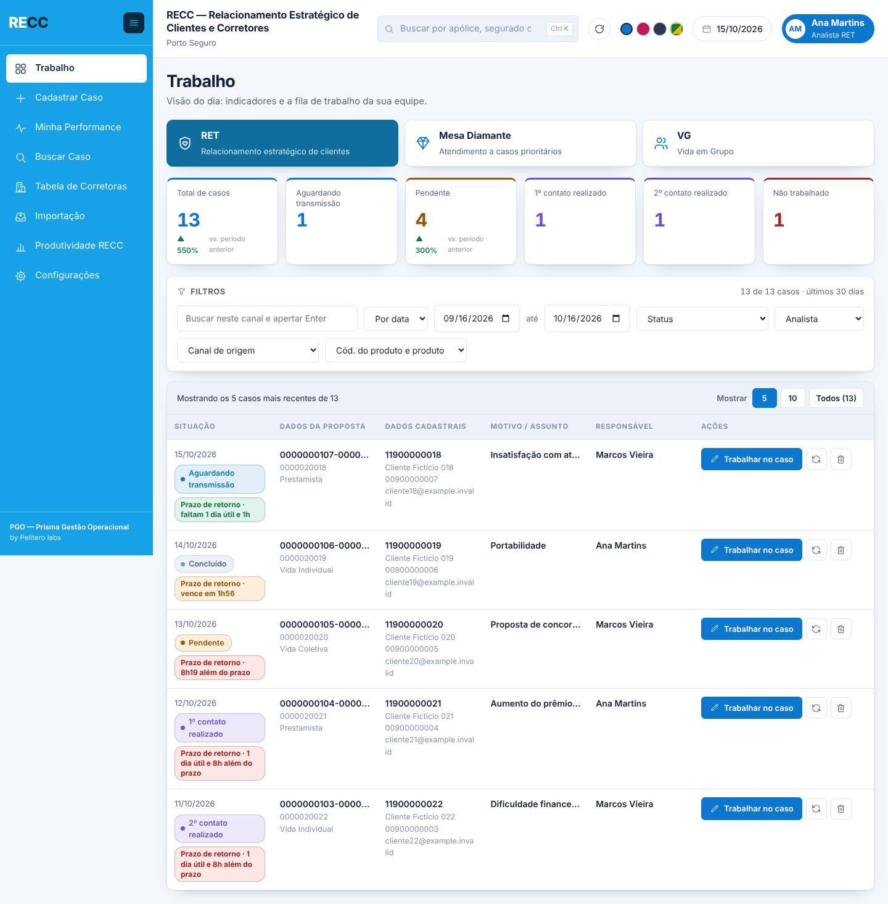
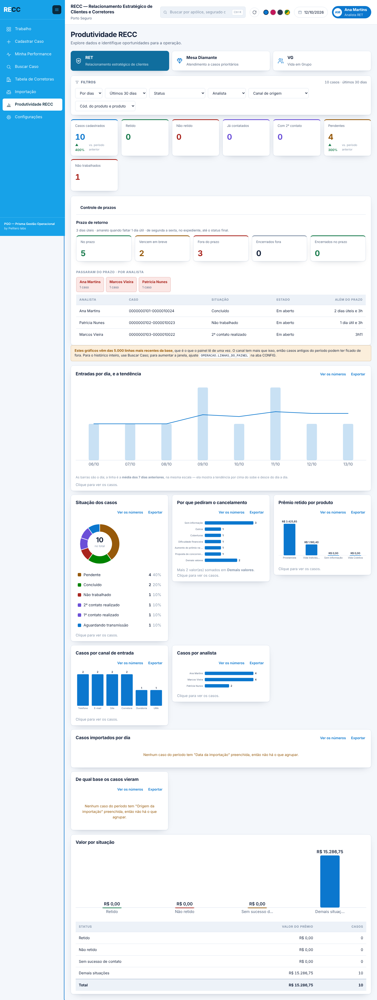
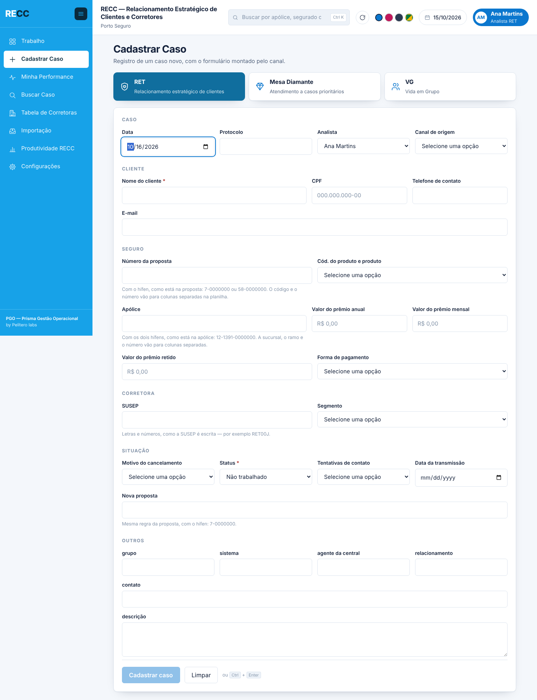
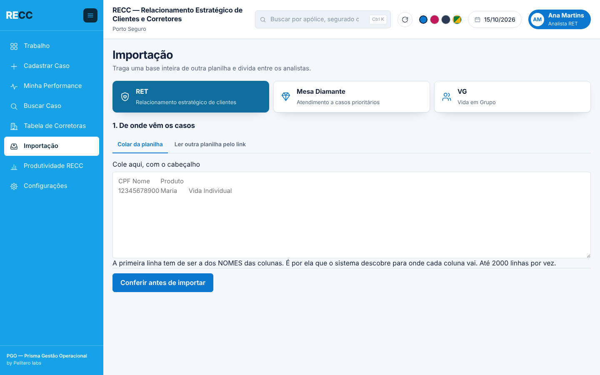
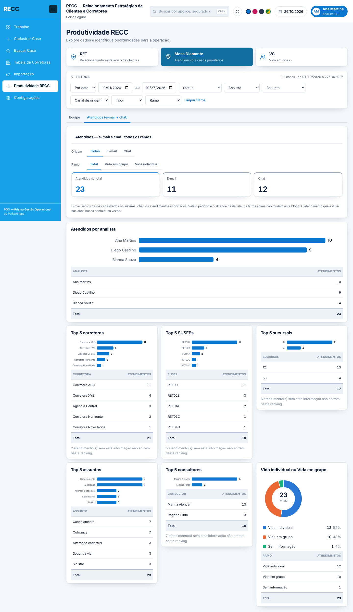
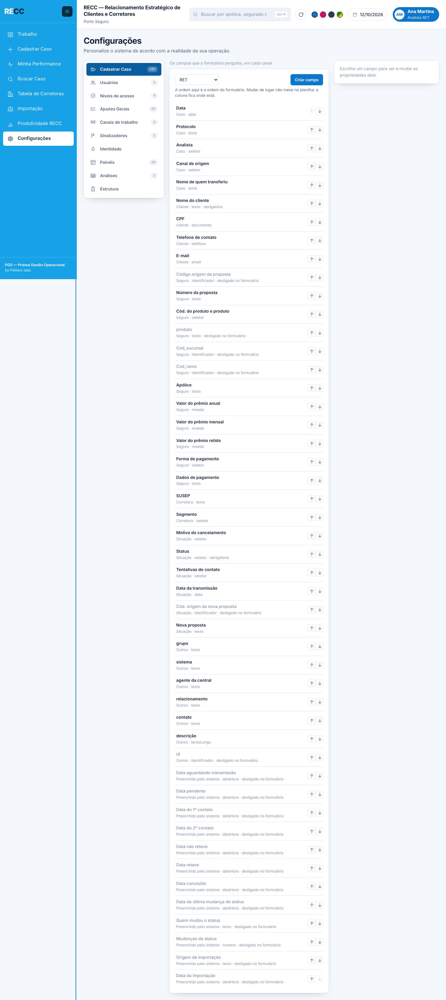
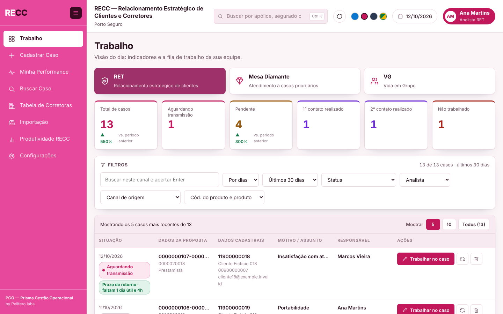
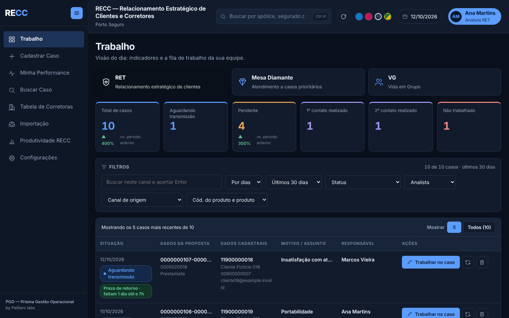
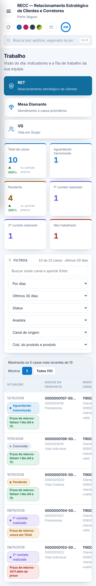

# PGO — Prisma Gestão Operacional

### A gestão de casos da sua operação, dentro do Google Workspace que a empresa já usa.

Sem servidor para manter, sem banco de dados externo, sem licença por usuário e
sem custo de infraestrutura. O PGO roda sobre **Google Planilhas e Google Apps
Script**, na conta da própria empresa — os dados nunca saem do seu Google.

Desenvolvido por **Pelitero Labs**.


---

## Por que o PGO

| | |
|---|---|
| **Implantação em horas, não em meses** | Uma planilha, um projeto do Apps Script e uma função de instalação. Nenhum fornecedor de nuvem, nenhum contrato de hospedagem, nenhuma TI externa |
| **Os dados ficam com a empresa** | Tudo mora no Google Workspace da organização, sob as políticas de acesso, retenção e auditoria que ela já tem |
| **Acesso pelo e-mail corporativo** | Só entra quem está cadastrado. Cada pessoa vê as telas, os canais e os casos do seu nível de acesso — e toda permissão é conferida de novo no servidor, não só escondida na tela |
| **Configurável sem programador** | Formulários, listas, status, prazos, cartões, gráficos, nomes das telas, logo e cores se ajustam pela tela de Configurações |
| **Pronto para volume** | Busca indexada, leitura por período, histórico automático dos casos antigos e cadastros de apoio em planilha separada — testado com cadastros de 151 mil linhas |
| **Pronto para BI** | Uma linha por caso, identificadores como texto, dinheiro como número e abas de análise prontas para Power BI ou tabela dinâmica |

---

## O que a operação ganha

**Início** — cada pessoa abre o sistema no seu dia: os seus casos abertos, os
perto de vencer e os estourados; e, para a liderança, o dia da operação inteira,
canal por canal.

**Trabalho** — a fila da equipe com cartões que filtram num clique, prazos com
selo verde, amarelo e vermelho, e o aviso dos casos perto de vencer logo na
entrada.

**Cadastro de casos** — formulário montado por canal, com campos que aparecem e
se tornam obrigatórios conforme a resposta de outro campo, consulta da SUSEP
bloqueada, aviso de proposta repetida no mês — dizendo com quem ela está — e
gravação protegida contra duplicidade.

**Buscar Caso** — encontra pelo protocolo, apólice, proposta, CPF ou nome, em
todos os canais, nos casos arquivados no histórico e na base do sistema anterior.

**Importação** — traz uma base inteira de outra planilha: o de-para das colunas
é sugerido e lembrado, a conferência diz o que vai entrar antes de gravar, os
repetidos são pulados e os casos são divididos entre os analistas.

**Produtividade** — gráficos configuráveis por canal, em que clicar numa barra
lista os casos daquele número; tentativas até o sucesso por analista e por
cliente; os atendimentos do chat somados aos do sistema; exportação em CSV, que
abre direto no Excel.

**Tabela de Corretoras** — o cadastro de corretoras e de SUSEPs bloqueadas,
consultado na hora do cadastro do caso.

**Configurações** — a tela que muda todas as outras, com o diagnóstico do
sistema inteiro a um clique.

| | |
|---|---|
|  |  |
|  |  |
|  |  |

---

## Feito para operações de grande porte

**Governança**
- Auditoria de cada ação — quem, quando, o quê —, gravada em lote para não
  atrasar a operação, com arquivamento automático do que é antigo.
- Registro de erros: o que falha longe da tela fica escrito, com quem, quando
  e onde, e aparece para quem administra.
- Exclusão lógica e reversível; a estrutura da planilha nunca muda sozinha.

**Escala**
- Casos encerrados há mais de 13 meses vão para uma planilha de histórico — a
  base principal continua leve e a busca continua achando tudo.
- Qualquer mês aparece completo nos indicadores, lido pela coluna de data.
- Cadastros mantidos por outras áreas podem morar em outra planilha, sem cópia.

**Continuidade**
- Atualizar para uma versão nova não apaga nada: uma função traz o que a versão
  pede e respeita o que a empresa já configurou.
- Um diagnóstico confere fuso, estrutura, canais, campos, painéis, permissões e
  a ligação entre tela e servidor, e diz o que fazer em cada problema.

**Multioperação**
- Marca branca: nome, subtítulo, logo, cores e títulos do menu vêm da
  configuração. Servir outra operação é trocar linhas, não código.
- Canais de trabalho independentes, cada um com sua base, formulário, status,
  prazos e gráficos. Hoje: **RET**, **Mesa Diamante** e **VG**.

**Experiência**
- Quatro temas por usuário (Padrão, Rosa, Escuro e Brasil) e uso no celular.

| | | |
|---|---|---|
|  |  |  |

---

## Qualidade comprovada

Cada versão só é entregue quando passa por:

- **1553 testes** automatizados, que simulam a planilha e o Apps Script;
- **testes de ponta a ponta** num navegador de verdade;
- uma **varredura que clica em tudo**, inclusive com dados malformados;
- a **conferência de responsividade** em todas as telas e larguras de tela;
- **quebras de propósito** no código, para provar que os testes pegam o erro.

```bash
node Evolucao/Testes/rodar.js                     # a suíte
node Evolucao/Testes/ponta-a-ponta.js             # ponta a ponta
node Evolucao/Testes/conferir-responsividade.js   # responsividade
```

---

## Implantação

1. Crie uma planilha vazia e abra *Extensões › Apps Script*.
2. Cole o código da pasta [`Evolucao/pacote/`](Evolucao/pacote/) — três arquivos.
3. Execute **`instalarRECC`**. Ela cria as 18 abas, semeia os canais, os
   formulários, as listas, os cartões, os gráficos e os prazos, e cadastra você
   como o primeiro administrador.
4. Publique como *App da Web* para as pessoas da organização. O e-mail de quem
   acessa só chega ao sistema quando a pessoa está na
   **mesma organização do Google Workspace** que publicou — publique com a
   conta da empresa.
5. Execute **`diagnosticoRECC`** para conferir, e cadastre a equipe em
   Configurações.

O passo a passo completo — incluindo atualização de uma instalação em uso — está
no [manual](Evolucao/07-manual-completo.md#instalação).

---

## Documentação

| | |
|---|---|
| [Manual completo](Evolucao/07-manual-completo.md) | Instalação, cada tela, cada regra e o porquê |
| [Arquitetura](Evolucao/01-arquitetura.md) | O modelo de dados e as decisões de projeto |
| [Padrão de código](Evolucao/02-padrao-de-codigo.md) | Como os nomes são escolhidos |
| [Manutenção](Evolucao/03-manutencao.md) | Como evoluir sem quebrar |
| [Defeitos capturados](Evolucao/04-bugs-capturados.md) | Cada defeito encontrado, com causa e defesa |
| [Progresso](Evolucao/05-progresso.md) | O que cada etapa entregou |
| [O que é configurável](Evolucao/06-o-que-e-configuravel.md) | O que se ajusta pela tela e o que não |

---

<sub>Pelitero Labs · PGO — Prisma Gestão Operacional</sub>
